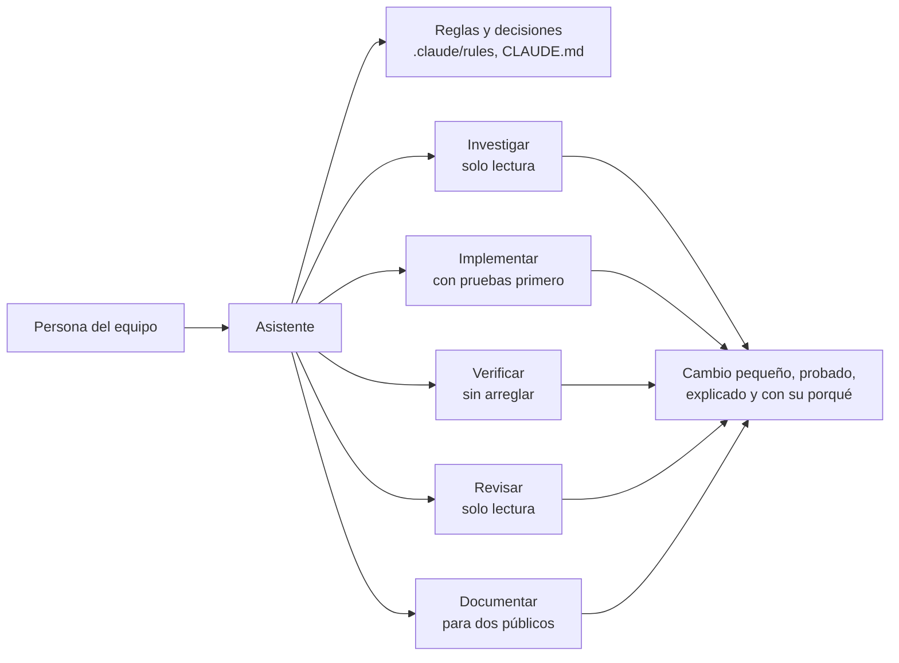

# Configuración de agentes de este repositorio

## Qué hace, en términos de negocio

Quien trabaja en este repositorio lo hace acompañado de un asistente de programación. Para que el asistente no reinvente cada vez cómo se trabaja aquí, esta carpeta guarda tres cosas: las **reglas** (cómo se escribe código y documentación en este equipo), las **decisiones ya tomadas** (para que no se reabran) y un pequeño **equipo de ayudantes especializados**, cada uno con un papel claro, igual que en un equipo humano: uno investiga sin tocar nada, otro implementa una tarea cerrada, otro ejecuta las pruebas y cuenta el resultado sin arreglar, otro revisa, otro documenta.

Para una persona del equipo, la consecuencia es que el asistente se comporta de forma previsible: sigue las mismas convenciones, pregunta solo cuando una decisión importa de verdad, y deja cada cambio con sus pruebas y su documentación para dos públicos, el técnico y el que no lo es.

## Inventario

| Pieza | Papel | Puede escribir |
|---|---|---|
| `rules/dotnet-standards.md` | Estándares de C# y .NET, carpetas, `var`, secrets | |
| `rules/naming.md` | Convención de nombres | |
| `rules/comments.md` | Un comentario es code smell por defecto | |
| `rules/documentation.md` | Dos documentaciones por README, decisiones con porqué | |
| `rules/implementation.md` | Lo mínimo que cumple, cuándo preguntar, seguridad al verificar | |
| `agents/researcher` | Exploración de solo lectura con `fichero:línea` | no |
| `agents/implementer` | Tarea acotada con TDD y las reglas | sí |
| `agents/test-writer` | Solo el test en rojo | sí (tests) |
| `agents/tester` | Ejecuta build y tests, informa, no arregla | no |
| `agents/dotnet-reviewer` | Revisión rápida de un diff contra las reglas | no |
| `agents/dotnet-architect-reviewer` | Revisión profunda con skills externas y locales | no |
| `agents/doc-writer` | README en dos partes y CLAUDE.md | sí (docs) |
| `agents/concept-explainer` | Explica un concepto con tipos del repo | no |

Los agentes de solo lectura lo son por configuración (`disallowedTools: Edit, Write, NotebookEdit`), no solo por instrucción.

## De dónde viene y qué se cambió

Esta configuración se construyó mirando kits públicos y quedándose con lo que aguantaba el porqué:

| Fuente | Qué se adoptó | Qué se descartó y por qué |
|---|---|---|
| [devtuc/agent-kit](https://github.com/devtuc/agent-kit) | Los cinco roles (researcher, implementer, tester, reviewer, doc-writer); revisores de solo lectura con herramientas bloqueadas; el formato de hallazgo (severidad, `fichero:línea`, condición, consecuencia, corrección mínima); distinguir problemas introducidos de preexistentes; las reglas contra la sobreingeniería y de seguridad al verificar | Beads como estado de tareas (dependencia externa no portable), symlinks a `~/.claude` (frágiles en Windows y en equipo), definiciones duplicadas para Codex (se desincronizan), preferencias personales del autor (commits sin firmar, estilo), y los nombres de modelo del autor |
| [github/awesome-copilot](https://github.com/github/awesome-copilot) | Las skills `dotnet-best-practices` y `dotnet-design-pattern-review`, cargadas por el revisor de arquitectura | Nada en concreto; se usan tal cual, con las reglas del repo por encima |
| `dotnet-skills` (plugin local) | `csharp-coding-standards` y `api-design` como criterios del revisor | Su recomendación de evitar clases abstractas: aquí la herencia es objeto de estudio |
| [affaan-m/everything-claude-code](https://github.com/affaan-m/everything-claude-code), [davila7/claude-code-templates](https://github.com/davila7/claude-code-templates) | Referencia de inventario y de formato de agentes | Su volumen: aquí cada agente existe porque alguien lo usó en una tarea real de este repo |

Las decisiones de cada regla llevan su porqué dentro del propio fichero.
