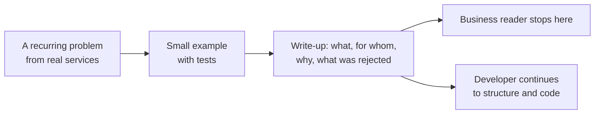
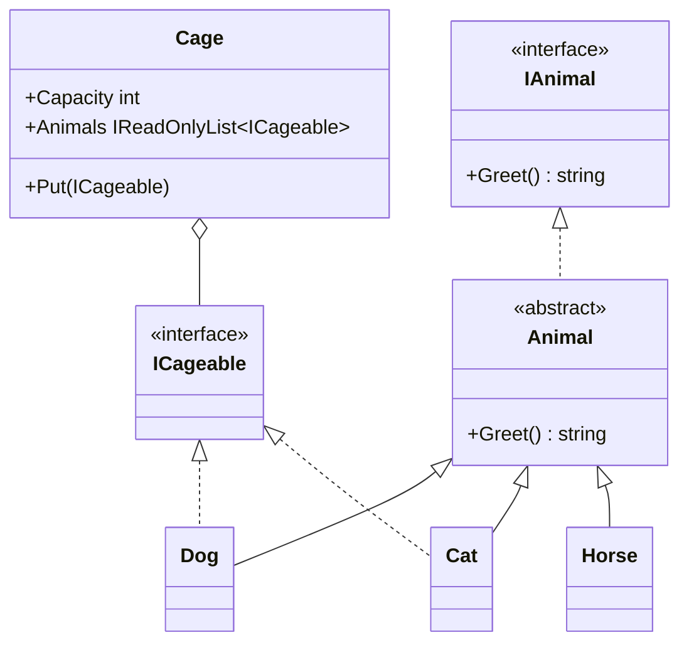
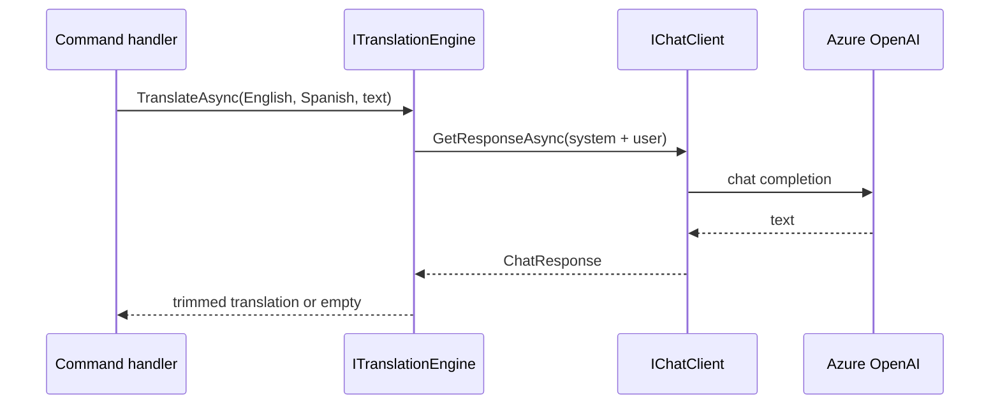
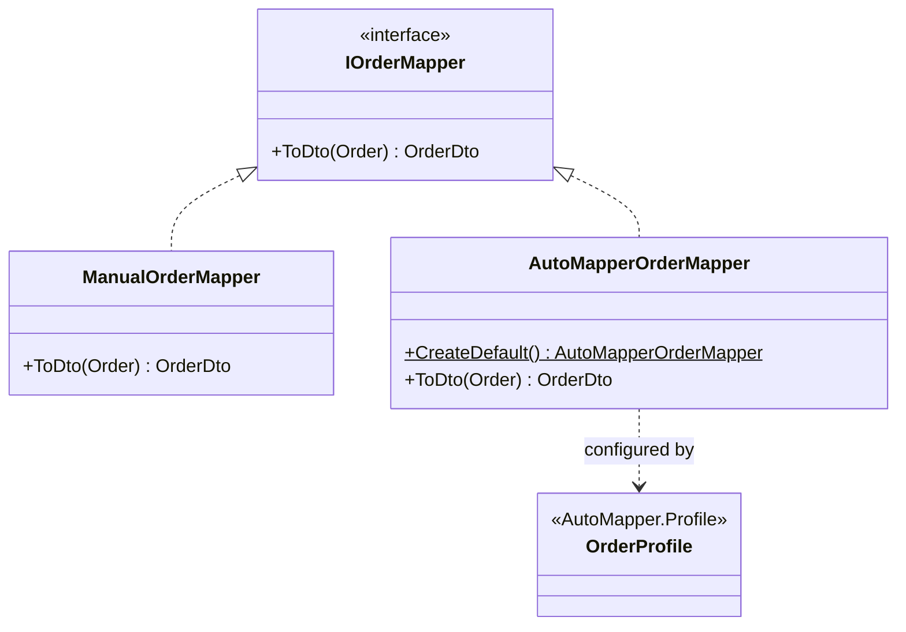
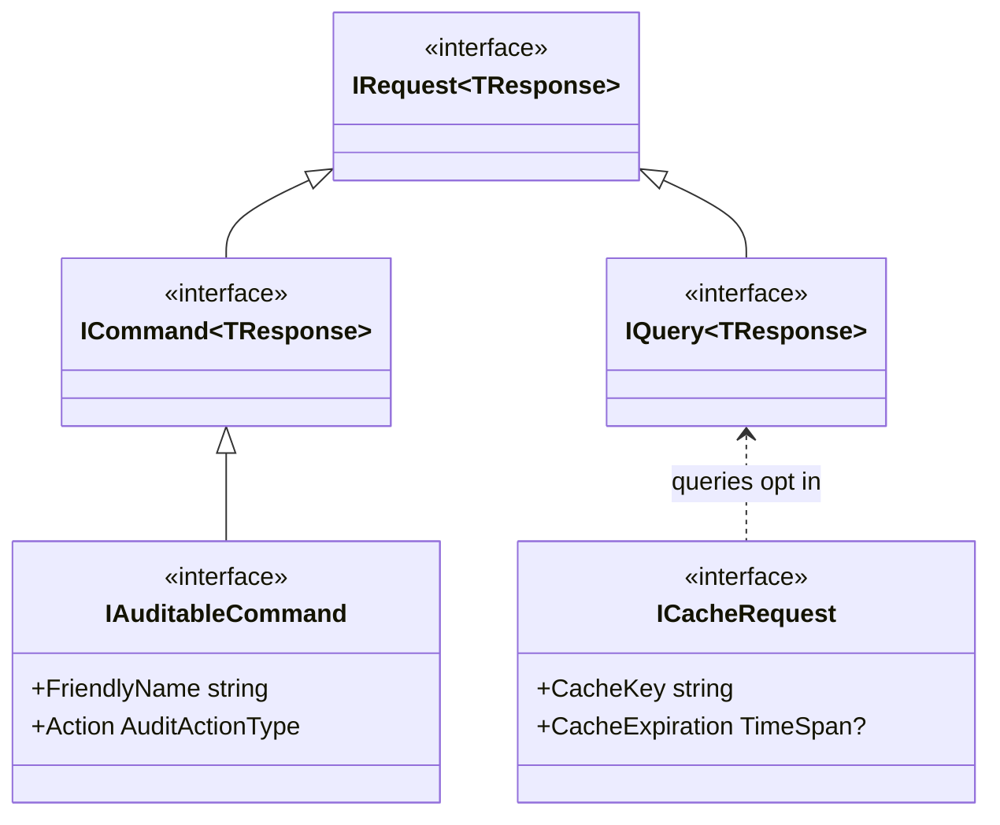
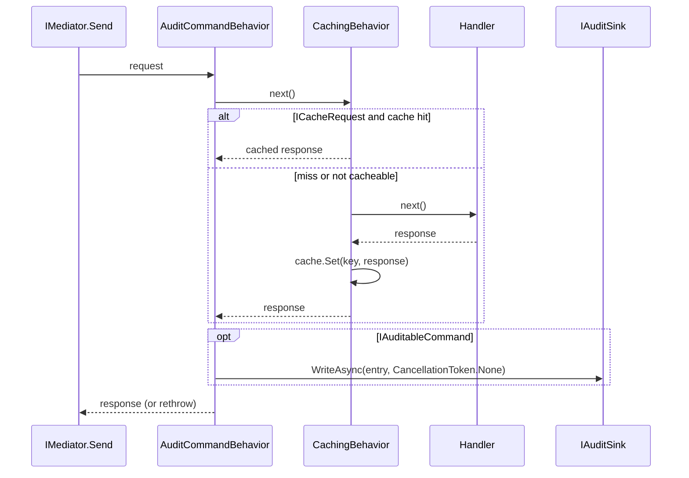

# DotNet.Practices

Educational repository: small, test-driven examples of design patterns and conventions used in real .NET services. Every example lives in its own folder with a `CLAUDE.md` that records the decisions taken and the alternatives rejected, so the *why* travels with the code.

Target: .NET 10, C# latest, NUnit. Nothing here is a library to depend on; copy what you need.

## What this is, in plain terms

A software team learns by building small, well-explained examples. This repository is that notebook for .NET: each folder takes one recurring problem from real services (how to create objects without knowing their type, how to notify a company through the channels it chose, how to translate texts with a language model, how to fill in the properties of a corporate account from an HR record) and shows one careful way to solve it, with tests that prove it works and a write-up that explains **why** it was done that way and what was rejected.

Who it is for and what they get:

| Reader | What to read | What they get |
|---|---|---|
| Someone from business, HR or support | The first section of each project README, titled "Qué hace, en términos de negocio" | What the piece does, who feeds it and what comes out, with a concrete example and a flow diagram; no code |
| A developer joining a team that uses these ideas | The rest of each README, then the code and its tests | The structure, the trade-offs, when to use it and when not |
| An AI coding assistant | The `CLAUDE.md` files | The decisions already taken, so it does not reopen them |



Nothing here is a library to install. Copy what you need, together with its reasons.

## Layout

```
DotNet.Practices.slnx
Directory.Build.props        shared TargetFramework, LangVersion, Nullable, ImplicitUsings
Directory.Packages.props     Central Package Management (one version per package)
.claude/                     generated: rules and agents for Claude Code (see .claude/README.md)
AGENTS.md, .cursor/, .github/ generated: the same rules and roles for Codex, Cursor and Copilot
agent-kit/                   the single source of those rules and roles, and the .NET generator (own solution)
src/
  DotNet.Practices.Patterns/       the 23 design patterns of the classic catalog, one folder per category (see its README)
  DotNet.Practices.SqlErrors/      common SQL Server errors reproduced against a real database, one folder per error (see its README)
  DotNet.Practices.Abstractions/   abstraction examples: abstract classes, interfaces, a real component over IChatClient
  DotNet.Practices.Mediator/       MediatR usage: abstractions, caching and audit behaviors
  DotNet.Practices.DynamicMapping/ property-bag mapper: LLM compiles a plan once, runtime stays deterministic (see its README)
  DotNet.Practices.ScriptedMapping/ the original approach (Roslyn C# script, dynamic Context) rebuilt and tested, for comparison
  DotNet.Practices.Benchmarks/     BenchmarkDotNet: hand-written mapping vs AutoMapper
tests/
  DotNet.Practices.Patterns.Tests/
  DotNet.Practices.SqlErrors.Tests/
  DotNet.Practices.Abstractions.Tests/
  DotNet.Practices.Mediator.Tests/
  DotNet.Practices.DynamicMapping.Tests/
  DotNet.Practices.ScriptedMapping.Tests/
```

Conventions inside each example: interfaces in `Interfaces/`, implementations of the same abstraction grouped in a plural folder (`Animals/`, `Notifiers/`, `Middlewares/`), orchestrators and records at the root. Namespace equals folder path. Tests mirror the folder.

## Design pattern catalog

One pattern at a time, following the order of the [refactoring.guru](https://refactoring.guru/es/design-patterns/csharp) catalog: creational, then structural, then behavioral. Patterns live in [`src/DotNet.Practices.Patterns/`](src/DotNet.Practices.Patterns/README.md), a folder per category (`Creational/`, `Structural/`, `Behavioral/`); each category has a `README.md` comparing its patterns, and each pattern folder has a `README.md` with the explanation and diagram plus a `CLAUDE.md` with the implementation decisions.

| Category | Pattern | Example | Status |
|---|---|---|---|
| Creational | Factory Method | [`Creational/FactoryMethod/`](src/DotNet.Practices.Patterns/Creational/FactoryMethod/README.md) | done |
| Creational | Abstract Factory | [`Creational/AbstractFactory/`](src/DotNet.Practices.Patterns/Creational/AbstractFactory/README.md) | done |
| Creational | Builder | [`Creational/Builder/`](src/DotNet.Practices.Patterns/Creational/Builder/README.md) | done |
| Creational | Prototype | [`Creational/Prototype/`](src/DotNet.Practices.Patterns/Creational/Prototype/README.md) | done |
| Creational | Singleton | [`Creational/Singleton/`](src/DotNet.Practices.Patterns/Creational/Singleton/README.md) | done |
| Structural | Adapter | [`Structural/Adapter/`](src/DotNet.Practices.Patterns/Structural/Adapter/README.md) | done |
| Structural | Bridge | [`Structural/Bridge/`](src/DotNet.Practices.Patterns/Structural/Bridge/README.md) | done |
| Structural | Composite | [`Structural/Composite/`](src/DotNet.Practices.Patterns/Structural/Composite/README.md) | done |
| Structural | Decorator | [`Structural/Decorator/`](src/DotNet.Practices.Patterns/Structural/Decorator/README.md) | done |
| Structural | Facade | [`Structural/Facade/`](src/DotNet.Practices.Patterns/Structural/Facade/README.md) | done |
| Structural | Flyweight | [`Structural/Flyweight/`](src/DotNet.Practices.Patterns/Structural/Flyweight/README.md) | done |
| Structural | Proxy | [`Structural/Proxy/`](src/DotNet.Practices.Patterns/Structural/Proxy/README.md) | done |
| Behavioral | Chain of Responsibility | [`Behavioral/ChainOfResponsibility/`](src/DotNet.Practices.Patterns/Behavioral/ChainOfResponsibility/README.md) | done |
| Behavioral | Command | [`Behavioral/Command/`](src/DotNet.Practices.Patterns/Behavioral/Command/README.md) | done |
| Behavioral | Iterator | [`Behavioral/Iterator/`](src/DotNet.Practices.Patterns/Behavioral/Iterator/README.md) | done |
| Behavioral | Mediator | [`Behavioral/Mediator/`](src/DotNet.Practices.Patterns/Behavioral/Mediator/README.md) | done |
| Behavioral | Memento | [`Behavioral/Memento/`](src/DotNet.Practices.Patterns/Behavioral/Memento/README.md) | done |
| Behavioral | Observer | [`Behavioral/Observer/`](src/DotNet.Practices.Patterns/Behavioral/Observer/README.md) | done |
| Behavioral | State | [`Behavioral/State/`](src/DotNet.Practices.Patterns/Behavioral/State/README.md) | done |
| Behavioral | Strategy | [`Behavioral/Strategy/`](src/DotNet.Practices.Patterns/Behavioral/Strategy/README.md) | done |
| Behavioral | Template Method | [`Behavioral/TemplateMethod/`](src/DotNet.Practices.Patterns/Behavioral/TemplateMethod/README.md) | done |
| Behavioral | Visitor | [`Behavioral/Visitor/`](src/DotNet.Practices.Patterns/Behavioral/Visitor/README.md) | done |

## Common SQL Server errors

One error at a time, each reproduced against a real SQL Server in an integration test and handled the way production code should: by `SqlException.Number`, never by message text. Lives in [`src/DotNet.Practices.SqlErrors/`](src/DotNet.Practices.SqlErrors/README.md), a folder per error, same two-part docs as the pattern catalog. Tests use the local instance by default (`DOTNET_PRACTICES_SQLSERVER` overrides) and are ignored, not failed, when no server is reachable.

## Examples

### Veterinary: abstract class, interface, capability interface

`Animal` is an abstract base with a default `Greet()`. `Dog` and `Cat` override it. `ICageable` is a marker interface: only species that fit in a cage implement it, so `Cage.Put(new Horse())` is a **compile-time** error instead of a runtime check.



Rejected: a `CanBeCaged` flag on `Animal` (moves the error to runtime) and a `switch` over concrete types inside `Cage` (breaks open/closed).

### Military: Composite

Moved to the catalog as [`Patterns/Structural/Composite/`](src/DotNet.Practices.Patterns/Structural/Composite/README.md): a chain of command as a tree, where `Soldier` is both leaf and composite.

### Notifications: Strategy with per-tenant fan-out

Moved to the catalog as [`Patterns/Behavioral/Strategy/`](src/DotNet.Practices.Patterns/Behavioral/Strategy/README.md): one `INotifier` per channel and a dispatcher that fans out to the channels each company enabled.

### RequestPipeline: Chain of Responsibility, ASP.NET middleware style

Moved to the catalog as [`Patterns/Behavioral/ChainOfResponsibility/`](src/DotNet.Practices.Patterns/Behavioral/ChainOfResponsibility/README.md): middlewares composed by a fluent builder, each deciding whether to call `next`.

### Translation: a real component over `IChatClient`

`TranslationEngine` ported from a production service: builds system + user messages, calls `IChatClient` (Microsoft.Extensions.AI), trims the answer, and returns empty on any failure because translation is best effort. The library references only `Microsoft.Extensions.AI.Abstractions`; the Azure OpenAI client is built where the app (or the integration test) is wired.



Tests: unit tests use a hand-written `FakeChatClient`; the integration test reads `OpenAI:*` from user-secrets and is ignored when they are missing.

### Mapping: AutoMapper vs hand-written mapper

The recurring team debate. Both mappers implement the same `IOrderMapper` and run the same tests through `TestFixtureSource`, so the comparison is fair. `Order` to `OrderDto` has a nested collection and three computed fields; that is where AutoMapper stops being free and needs a `ForCtorParam` per field, plus an `AssertConfigurationIsValid()` test or mistakes only show at runtime.



Benchmark (`dotnet run -c Release --project src/DotNet.Practices.Benchmarks`), BenchmarkDotNet 0.15.8, .NET 10.0.14, x64, ShortRunJob. Your numbers will differ; the ratio is the point.

| Method     | Lines | Mean        | Ratio | Allocated | Alloc Ratio |
|----------- |------:|------------:|------:|----------:|------------:|
| Manual     | 1     |    97 ns    |  1.00 |     208 B |        1.00 |
| AutoMapper | 1     |   891 ns    |  9.30 |     368 B |        1.77 |
| Manual     | 10    |   259 ns    |  1.00 |     712 B |        1.00 |
| AutoMapper | 10    | 2,579 ns    | 10.04 |    1040 B |        1.46 |
| Manual     | 100   | 1,744 ns    |  1.00 |    5752 B |        1.00 |
| AutoMapper | 100   | 6,341 ns    |  3.67 |    7224 B |        1.26 |

Takeaways: AutoMapper costs roughly 10x per call on small objects (fixed reflection and expression overhead) and still 3-4x at 100 lines, with more allocations. For most services the wall-clock difference is irrelevant; the real arguments are compile-time safety, debuggability and the dependency itself: AutoMapper 15+ is commercially licensed, and the last MIT release (14.0.0) carries an unpatched DoS advisory (CVE-2026-32933, self-referential maps only) that is suppressed in `Directory.Build.props` with the reasoning. Default to hand-written `ToDto()` extension methods; consider Mapperly (source generator) when the boilerplate hurts.

## DotNet.Practices.Mediator

How a CQRS service uses MediatR, reduced to three pieces: typed abstractions, a caching behavior and an audit behavior. MediatR is pinned to 12.5.0 (13+ changed license).





Registration order is execution order: audit wraps caching. The audit write uses `CancellationToken.None` so it survives the caller aborting the request. `[AuditTrailIgnore]` removes a property from the serialized payload at any depth.

## Running

```
dotnet test DotNet.Practices.slnx
dotnet test DotNet.Practices.slnx --filter "Category!=Integration"
```

Integration test secrets (optional):

```
dotnet user-secrets set "OpenAI:Endpoint" "https://<resource>.openai.azure.com/" --project tests/DotNet.Practices.Abstractions.Tests
dotnet user-secrets set "OpenAI:ApiKey" "<key>" --project tests/DotNet.Practices.Abstractions.Tests
dotnet user-secrets set "OpenAI:DeploymentName" "gpt-4o" --project tests/DotNet.Practices.Abstractions.Tests
```

## How the examples were built

- TDD: every class started as a failing NUnit test. No mocks; fakes are hand-written and live next to the tests.
- One behavior per test, named `Class_Method_Result`.
- Code, names and comments in English. Comments only for the why.
- Conventional commits, one topic per commit.
