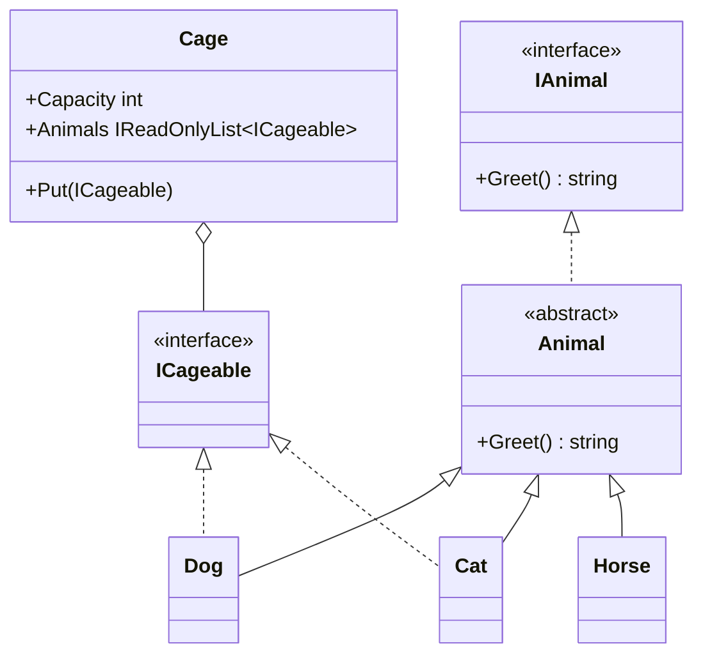
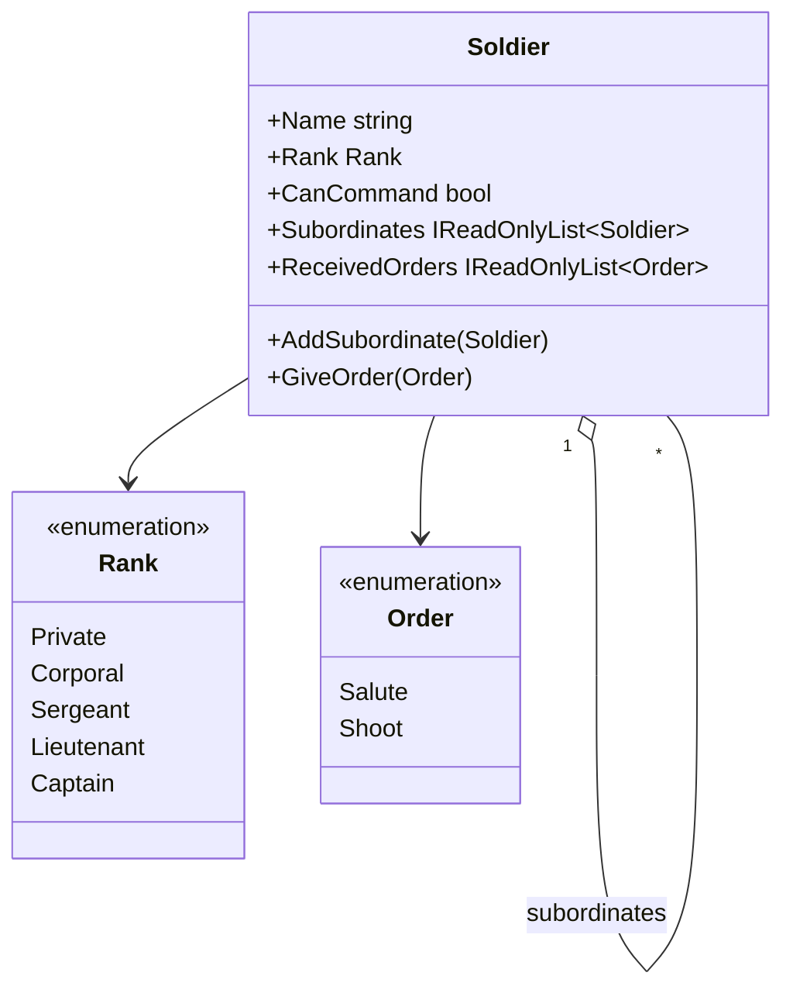
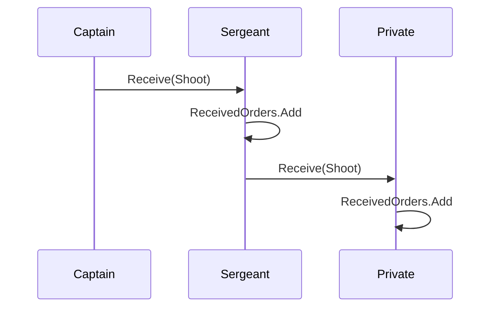
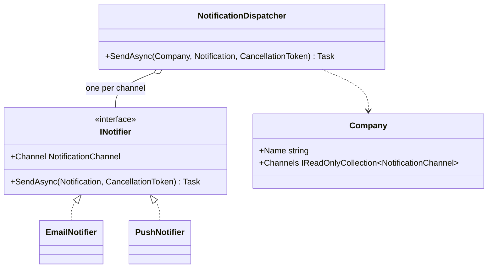
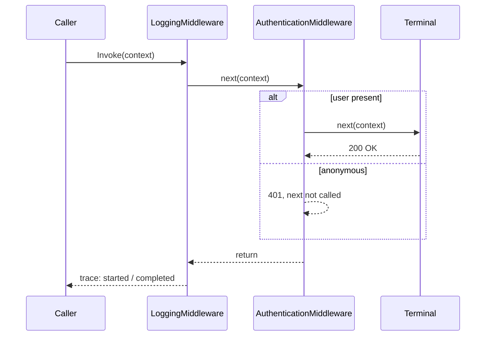
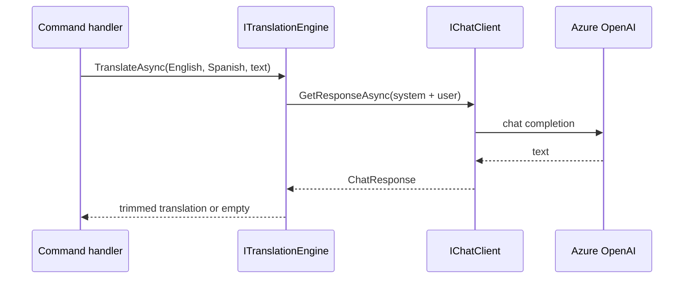
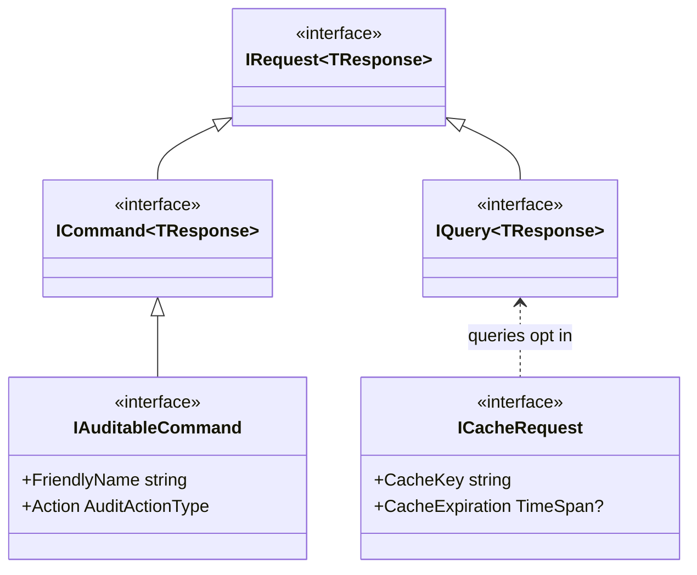
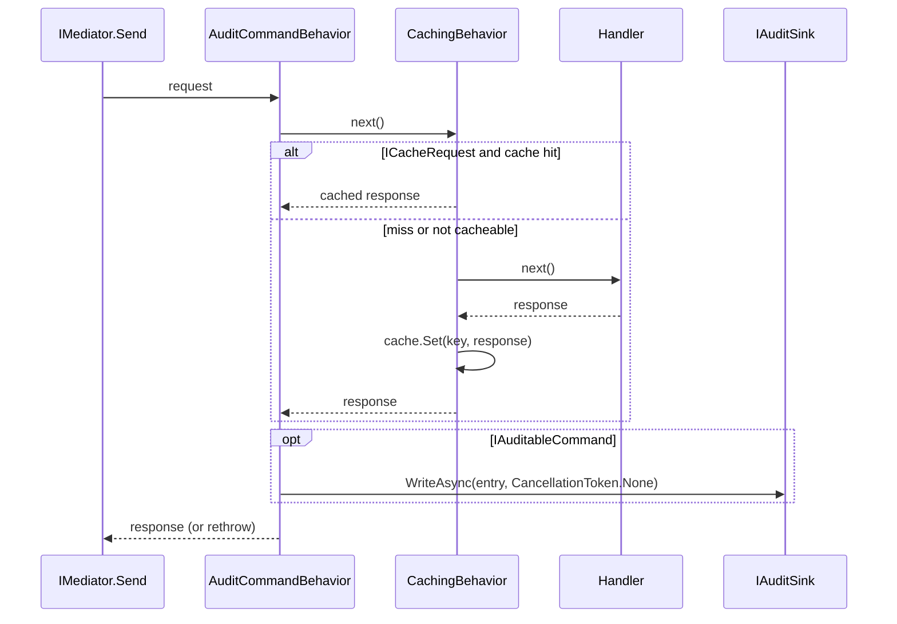

# DotNet.Practices

Educational repository: small, test-driven examples of design patterns and conventions used in real .NET services. Every example lives in its own folder with a `CLAUDE.md` that records the decisions taken and the alternatives rejected, so the *why* travels with the code.

Target: .NET 10, C# latest, NUnit. Nothing here is a library to depend on; copy what you need.

## Layout

```
DotNet.Practices.slnx
Directory.Build.props        shared TargetFramework, LangVersion, Nullable, ImplicitUsings
Directory.Packages.props     Central Package Management (one version per package)
.claude/rules/               coding standards, naming, comments
.claude/agents/              reviewer, test writer, concept explainer
src/
  DotNet.Practices.Abstractions/   pattern examples (one folder each)
  DotNet.Practices.Mediator/       MediatR usage: abstractions, caching and audit behaviors
tests/
  DotNet.Practices.Abstractions.Tests/
  DotNet.Practices.Mediator.Tests/
```

Conventions inside each example: interfaces in `Interfaces/`, implementations of the same abstraction grouped in a plural folder (`Animals/`, `Notifiers/`, `Middlewares/`), orchestrators and records at the root. Namespace equals folder path. Tests mirror the folder.

## Examples

### Veterinary: abstract class, interface, capability interface

`Animal` is an abstract base with a default `Greet()`. `Dog` and `Cat` override it. `ICageable` is a marker interface: only species that fit in a cage implement it, so `Cage.Put(new Horse())` is a **compile-time** error instead of a runtime check.



Rejected: a `CanBeCaged` flag on `Animal` (moves the error to runtime) and a `switch` over concrete types inside `Cage` (breaks open/closed).

### Military: Composite

A chain of command as a tree. `Soldier` is both leaf and composite. `GiveOrder` propagates recursively; rank rules are enforced when adding subordinates.





Rejected: Chain of Responsibility (orders go down to everyone, not up until handled) and Command objects (an enum is enough).

### Notifications: Strategy with per-tenant fan-out

Each channel is an `INotifier`. `NotificationDispatcher` receives all of them (what DI would inject as `IEnumerable<INotifier>`), indexes them by channel and sends in parallel to the channels a `Company` has enabled. Adding a channel is a new class plus an enum value; the dispatcher does not change.



### RequestPipeline: Chain of Responsibility, ASP.NET middleware style

`PipelineBuilder.Use(...)` is a fluent interface; `Build(terminal)` composes the middlewares in reverse so the first registered is the outermost. A middleware short-circuits by not calling `next`.



Same shape as `IApplicationBuilder`, MediatR `IPipelineBehavior` and `HttpClient` `DelegatingHandler`.

### Translation: a real component over `IChatClient`

`TranslationEngine` ported from a production service: builds system + user messages, calls `IChatClient` (Microsoft.Extensions.AI), trims the answer, and returns empty on any failure because translation is best effort. The library references only `Microsoft.Extensions.AI.Abstractions`; the Azure OpenAI client is built where the app (or the integration test) is wired.



Tests: unit tests use a hand-written `FakeChatClient`; the integration test reads `OpenAI:*` from user-secrets and is ignored when they are missing.

## DotNet.Practices.Mediator

How a CQRS service uses MediatR, reduced to three pieces: typed abstractions, a caching behavior and an audit behavior. MediatR is pinned to 12.5.0 (13+ changed license).





Registration order is execution order: audit wraps caching. The audit write uses `CancellationToken.None` so it survives the caller aborting the request. `[AuditTrailIgnore]` removes a property from the serialized payload at any depth.

## Running

```
dotnet test DotNet.Practices.slnx
dotnet test DotNet.Practices.slnx --filter "Category!=Integration"
```

Integration test secrets (optional):

```
dotnet user-secrets set "OpenAI:Endpoint" "https://<resource>.openai.azure.com/" --project tests/DotNet.Practices.Abstractions.Tests
dotnet user-secrets set "OpenAI:ApiKey" "<key>" --project tests/DotNet.Practices.Abstractions.Tests
dotnet user-secrets set "OpenAI:DeploymentName" "gpt-4o" --project tests/DotNet.Practices.Abstractions.Tests
```

## How the examples were built

- TDD: every class started as a failing NUnit test. No mocks; fakes are hand-written and live next to the tests.
- One behavior per test, named `Class_Method_Result`.
- Code, names and comments in English. Comments only for the why.
- Conventional commits, one topic per commit.
