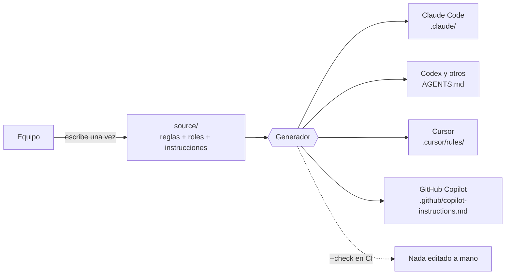
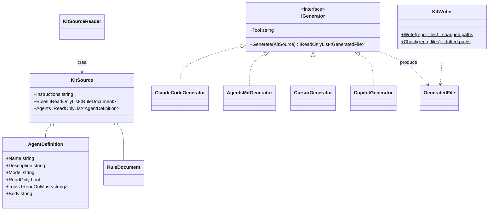

# agent-kit

## Qué hace, en términos de negocio

Un equipo que programa con asistentes de IA tiene un problema nuevo: cada persona usa una herramienta distinta (Claude Code, Codex, Cursor, Copilot) y cada herramienta lee sus instrucciones de un sitio y en un formato distinto. Si las normas del equipo se escriben cuatro veces, se desincronizan en una semana y cada asistente acaba trabajando con reglas diferentes.

`agent-kit` resuelve eso como se resuelve cualquier duplicación: **una sola fuente y un generador**. Las reglas del equipo (cómo se escribe código, cómo se documenta, cuándo preguntar) y los papeles de los ayudantes (quién investiga, quién implementa, quién verifica, quién revisa, quién documenta) se escriben una vez, en texto plano, en la carpeta `source/`. Un pequeño programa produce a partir de ahí los ficheros que cada herramienta espera, en el sitio exacto donde los busca. Y puede comprobar en la integración continua que nadie ha editado un fichero generado a mano.



Para el equipo: una norma se cambia en un sitio, se regenera, y todos los asistentes la reciben igual. Funciona en Windows, Linux y macOS sin instalar nada más que .NET, que ya está.

## Por qué existe, frente a lo que había

Nació de inspeccionar [devtuc/agent-kit](https://github.com/devtuc/agent-kit), un kit para Claude Code y Codex. Lo que aguantaba el porqué se adoptó; lo demás se cambió:

| Problema | Alternativa descartada | Qué se gana |
|---|---|---|
| Las mismas reglas en varios formatos se desincronizan | Mantener a mano `.claude/`, `AGENTS.md`, `.cursor/`, `.github/` (o copiarlos con un script) | Una fuente, salida generada y un modo `--check` que falla en CI si alguien edita la salida |
| El kit original dependía de PowerShell, symlinks de Windows y Developer Mode | Reescribirlo en `pwsh` multiplataforma | Un programa .NET: corre donde corre el repo, se prueba con NUnit como todo lo demás, y es un ejemplo más de Strategy (un generador por herramienta) |
| El kit duplicaba cada agente en formato Claude y formato Codex | Mantener los dos a mano "y acordarse de sincronizar" | Un frontmatter neutral (`readOnly`, `tools`, `model`) del que cada generador deriva lo suyo: Claude Code recibe `disallowedTools`, Codex una sección de roles, Cursor una regla manual |
| Un revisor "de solo lectura" que lo era solo por instrucción | Confiar en que el prompt dice "no escribas" | `readOnly: true` en la fuente bloquea las herramientas de escritura donde la herramienta lo soporta |
| Estado de tareas en una base de datos externa (Beads) | Adoptarlo | No se adopta: el repo ya tiene git y no necesita otra fuente de verdad |

## Estructura

```
agent-kit/
  source/
    instructions.md     preámbulo común (apunta al CLAUDE.md del repo)
    rules/*.md          una regla por fichero, Markdown plano
    agents/*.md         un rol por fichero: frontmatter neutral + cuerpo
  src/DotNet.Practices.AgentKit/
    Models/             RuleDocument, AgentDefinition, KitSource, GeneratedFile
    Source/             KitSourceReader: lee source/ y valida el frontmatter
    Generators/         IGenerator y uno por herramienta
    Output/             KitWriter: escribe o comprueba (--check) sin salirse del repo
    Program.cs          dotnet run -- <repo> [--check]
  tests/DotNet.Practices.AgentKit.Tests/
  AgentKit.slnx         solución propia; no forma parte de DotNet.Practices.slnx
```



### Frontmatter neutral de un rol

```markdown
---
name: researcher
description: Exploración de solo lectura ...
tools: Read, Grep, Glob, Bash, WebFetch, WebSearch
readOnly: true
model: sonnet
---
Cuerpo del rol, en Markdown.
```

| Herramienta | Qué recibe |
|---|---|
| Claude Code | `.claude/agents/<name>.md` con `tools`, `disallowedTools: Edit, Write, NotebookEdit` si `readOnly`, y `model`; `.claude/rules/<rule>.md` |
| Codex y cualquiera que lea `AGENTS.md` | Un solo fichero: instrucciones, todas las reglas con los títulos anidados, y una sección por rol marcando los de solo lectura |
| Cursor | `.cursor/rules/<rule>.mdc` con `alwaysApply: true`, y `agent-roles.mdc` con `alwaysApply: false` para adjuntar a demanda |
| GitHub Copilot | `.github/copilot-instructions.md` con instrucciones y reglas; sin roles, porque Copilot no los tiene |

Cada fichero generado lleva en la primera línea útil un marcador `<!-- generated by agent-kit from source/...; edit the source, not this file -->`.

## Uso

```
dotnet run --project agent-kit/src/DotNet.Practices.AgentKit -- <ruta-del-repo>
dotnet run --project agent-kit/src/DotNet.Practices.AgentKit -- <ruta-del-repo> --check
dotnet test agent-kit/AgentKit.slnx
```

Flujo: editar `source/`, regenerar, revisar el diff, commitear fuente y salida juntas. `--check` devuelve 1 si algún fichero generado difiere de disco o falta.

## Decisiones

- **CRLF siempre en la salida**, sea cual sea la plataforma. Problema: con `Environment.NewLine` el mismo `source/` generaría ficheros distintos en Windows y Linux y `--check` fallaría según quién lo ejecute. Alternativa descartada: LF y dejar que git normalice. Qué se gana: salida idéntica en cualquier máquina y coherencia con la regla CRLF del repo.
- **`AgentDefinition` compara `Tools` por contenido.** Problema: los records comparan listas por referencia, y los tests comparan definiciones completas. Alternativa descartada: guardar `tools` como una cadena. Qué se gana: igualdad por valor real sin perder la lista tipada.
- **El escritor rechaza rutas que salen del repo.** Problema: una regla con nombre `../x` escribiría fuera. Alternativa descartada: confiar en los nombres de fichero. Qué se gana: el generador no puede tocar nada fuera de la raíz que se le da.
- **Fuera de `DotNet.Practices.slnx`.** Problema: es herramienta del repo, no un ejemplo de .NET para estudiar. Alternativa descartada: meterlo en la solución principal. Qué se gana: la solución principal sigue siendo solo ejemplos; el kit se abre y se prueba por separado.
- **Los títulos de las reglas se anidan dos niveles en `AGENTS.md`.** Problema: cada regla es un documento con su propio `#`, y en el fichero único viven bajo `## Reglas`. Alternativa descartada: dejarlas con `#` y romper la jerarquía. Qué se gana: un `AGENTS.md` legible como un solo documento.

## Tests

`KitSourceReaderTests` (frontmatter, errores con nombre de fichero y clave), `GeneratorTests` (rutas y contenido exacto por herramienta, `readOnly` → `disallowedTools`, orden de secciones, solo CRLF) y `KitWriterTests` (escribe, devuelve solo lo que cambió, `--check`, rutas fuera del repo). Veintitrés tests, sin mocks.
