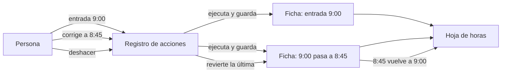
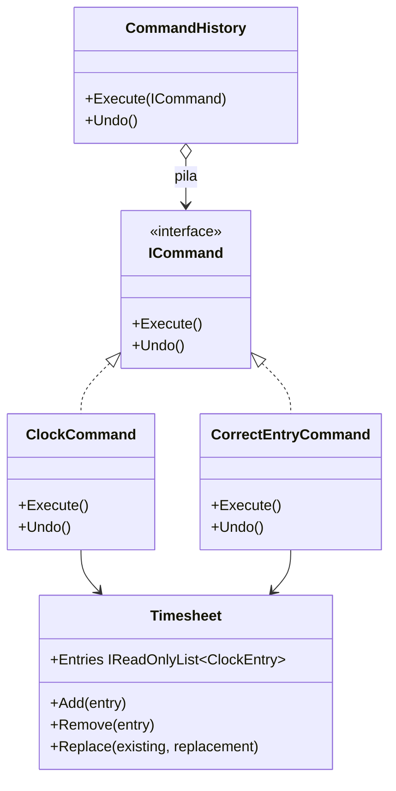

# Command

**Comportamiento.** Convertir una petición en un objeto, con todo lo necesario para ejecutarla, de forma que se pueda guardar, encolar, registrar y deshacer.

Dominio común de los de comportamiento: fichaje y ausencias. Un fichaje es una petición ("entrada a las 9:00") que se ejecuta sobre la hoja de horas y que, si fue un error, hay que poder deshacer. En [refactoring.guru](https://refactoring.guru/es/design-patterns/command) el mismo patrón se cuenta con los botones de un editor de texto.

## Qué hace, en términos de negocio

Una empresa registra la jornada de su gente. Cada fichaje, cada corrección de un fichaje, es una acción sobre la hoja de horas de la persona. Y las acciones se equivocan: alguien ficha salida a las 17:00 cuando quería fichar a las 17:30, o corrige una entrada y se da cuenta de que la original estaba bien. Lo que la gente espera es un botón de **deshacer**, no abrir una incidencia.

Command convierte cada acción en una **ficha**: qué hoja de horas toca, qué cambia, y cómo se revierte. Un **registro de acciones** las va ejecutando y guardando en orden. Deshacer es sacar la última ficha y pedirle que se revierta. La hoja de horas no sabe nada de fichas ni de registro; solo sabe añadir, quitar y sustituir apuntes. Y como cada acción es una ficha, el mismo mecanismo sirve para auditar quién hizo qué, para encolar fichajes hechos sin conexión y para reproducirlos después.

Quién gana: quien ficha, porque un error se deshace con un gesto; y la empresa, porque todas las acciones pasan por el mismo sitio y quedan registradas en orden.

## Estructura

| Rol | Tipo |
|---|---|
| Command | `Interfaces/ICommand` |
| Concrete commands | `Commands/ClockCommand`, `Commands/CorrectEntryCommand` |
| Receiver | `Timesheet` |
| Invoker | `CommandHistory` |

El comando guarda en sus campos todo lo que necesita (la hoja y el apunte), así que `Execute()` y `Undo()` no reciben parámetros. El invocador solo conoce `ICommand`.

## Decisiones

**`Undo()` en la interfaz, no en un `IUndoableCommand` aparte.**
Problema: el libro presenta `Undo` como opcional; separarlo en otra interfaz es más "correcto" pero obliga al invocador a comprobar el tipo en cada deshacer.
Alternativa descartada: `ICommand` solo con `Execute` y `IUndoableCommand : ICommand`.
Qué se gana: el invocador es trivial y en este dominio no hay comandos que no se puedan deshacer. Si aparece uno, se añade la segunda interfaz entonces, no antes.

**El comando guarda el estado para deshacer, no el receptor.**
Problema: para revertir una corrección hay que saber qué había antes; alguien tiene que recordarlo.
Alternativa descartada: que `Timesheet` lleve su propio histórico. Entonces el receptor hace dos cosas y el patrón sobra: eso es [Memento](../Memento/README.md), que sirve cuando el estado a restaurar es todo el objeto.
Qué se gana: `Timesheet` se queda con tres operaciones simples y cada comando sabe revertir exactamente lo que hizo. Command guarda el delta; Memento guarda la foto.

**`Undo()` sin nada que deshacer no lanza.**
Problema: pulsar deshacer en una hoja vacía es un gesto, no un error.
Alternativa descartada: `InvalidOperationException`.
Qué se gana: la interfaz de usuario no necesita comprobar antes si hay algo que deshacer, y el invocador sigue siendo una pila con `TryPop`.

## Cuándo usarlo

- Deshacer y rehacer.
- Encolar, diferir o reintentar operaciones: la petición vive como objeto hasta que se ejecuta.
- Registrar o auditar acciones, o reproducirlas (event sourcing ligero).
- Desacoplar quien pide (botón, endpoint, cron) de quien ejecuta.

## Cuándo no usarlo

- La petición se ejecuta de inmediato y nunca se guarda, encola ni revierte: una llamada a un método basta.
- Con MediatR en .NET, cada `IRequest` ya es un comando y el `IMediator` el invocador; no construyas otra pila encima, salvo para deshacer, que MediatR no da. El proyecto [`DotNet.Practices.Mediator`](../../../DotNet.Practices.Mediator/CLAUDE.md) muestra ese uso.

## Tests

`CommandHistoryTests`: ejecutar un fichaje lo añade a la hoja; deshacer quita el último fichaje; deshacer una corrección devuelve el apunte original; y deshacer sin historial no toca nada.
