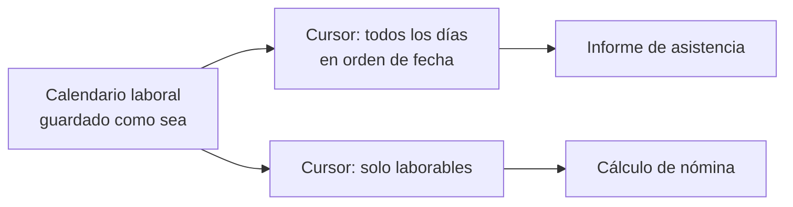
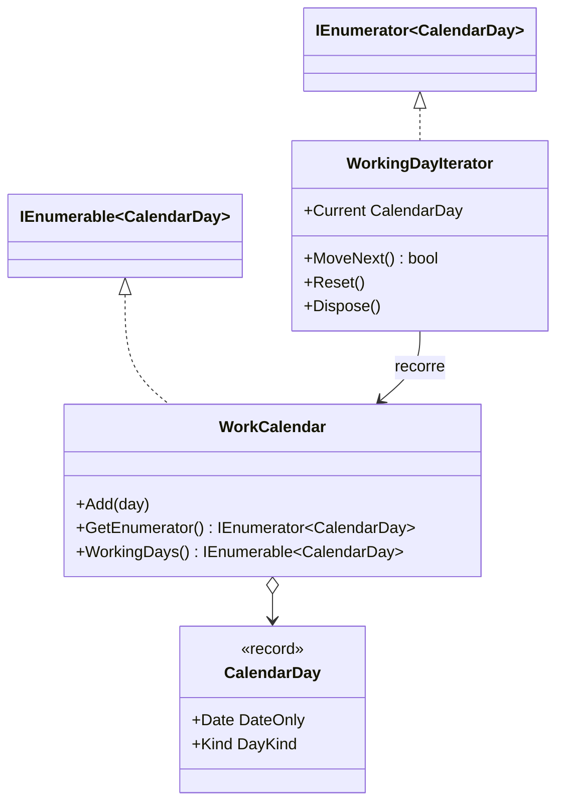

# Iterator

**Comportamiento.** Recorrer los elementos de una colección sin exponer cómo está construida por dentro, y permitir varios recorridos distintos sobre la misma colección.

Dominio común de los de comportamiento: fichaje y ausencias. Un calendario laboral se recorre día a día, o solo por días laborables, sin que quien lo recorre sepa cómo se guardan los días. En [refactoring.guru](https://refactoring.guru/es/design-patterns/iterator) el mismo patrón se cuenta con los contactos de una red social.

## Qué hace, en términos de negocio

La misma empresa que gestiona jornadas. El calendario laboral de una persona tiene días de trabajo, fines de semana y festivos. Distintas partes del sistema lo recorren para cosas distintas: la nómina quiere solo los días laborables, el informe de asistencia los quiere todos en orden, el planificador de vacaciones los quiere por semanas. Y a nadie le importa, ni debería importarle, si los días se guardan en una lista, en una tabla ordenada por fecha o se calculan al vuelo.

Iterator da a cada recorrido su **cursor**: un objeto que sabe cuál es el siguiente día según su criterio (todos, solo laborables) y que se pide al calendario. Quien recorre pregunta "¿hay otro?" y "dame el siguiente" y no ve nada más. El calendario puede cambiar por dentro sin que ningún recorrido se entere, y añadir un criterio nuevo es añadir un cursor, no tocar el calendario ni a quienes ya lo recorren.

Quién gana: quien calcula nóminas o informes, porque pide el recorrido que necesita y nada más; y quien mantiene el calendario, porque puede cambiar cómo se guarda sin romper a nadie.

## Estructura

| Rol | Tipo |
|---|---|
| Aggregate | `WorkCalendar : IEnumerable<CalendarDay>` |
| Iterator (del lenguaje) | `IEnumerator<CalendarDay>`, el que `WorkCalendar.GetEnumerator()` y `WorkingDays()` devuelven |
| Concrete iterator a mano | `Iterators/WorkingDayIterator` |
| Element | `CalendarDay` |

`WorkCalendar` guarda los días en un `SortedDictionary` y nadie fuera lo sabe: el recorrido sale ordenado por fecha aunque se añadan desordenados. `WorkingDays()` es el segundo recorrido, escrito con `yield return`; `WorkingDayIterator` es el mismo recorrido escrito a mano, para ver lo que el compilador genera.

## Decisiones

**Usar `IEnumerable<T>` e `IEnumerator<T>`, no una interfaz propia.**
Problema: el libro define `Iterator` y `Aggregate` propios; en .NET ya existen y todo el lenguaje (`foreach`, LINQ) los entiende.
Alternativa descartada: `IDayIterator` con `HasNext()` y `Next()`. Sería fiel al libro e inútil en la práctica: ningún `foreach` lo recorrería.
Qué se gana: el ejemplo enseña el patrón tal como se usa en .NET, y los tests comparan colecciones con `Is.EqualTo` directamente.

**Un recorrido con `yield` y el mismo a mano.**
Problema: con `yield return` el patrón desaparece dentro del compilador y no se ve qué objeto es el iterador.
Alternativa descartada: solo la versión `yield`, que es la que se escribe en producción.
Qué se gana: `WorkingDayIterator` muestra la máquina de estados (`MoveNext`, `Current`) que `yield` genera, y el test demuestra que ambos recorren lo mismo. En producción, siempre `yield`.

**El iterador a mano delega en el enumerador del calendario.**
Problema: para no exponer la estructura interna, el iterador no puede acceder al diccionario.
Alternativa descartada: hacer el diccionario `internal` o pasar la colección de valores al iterador.
Qué se gana: el iterador solo usa la API pública del agregado; si el calendario cambia de `SortedDictionary` a otra cosa, el iterador no se toca.

## Cuándo usarlo

- Una colección con estructura interna que no quieres exponer (árbol, grafo, almacenamiento paginado o remoto).
- Varias formas de recorrer lo mismo: en orden, filtrado, por bloques, en profundidad o en anchura.
- Recorrer de forma perezosa algo grande o infinito: `yield return` solo calcula el siguiente cuando se pide.

## Cuándo no usarlo

- Es una `List<T>` y se recorre entera: expón `IReadOnlyList<T>` y listo.
- El filtro es trivial y puntual: `calendar.Where(d => d.Kind == DayKind.Working)` en el llamador, sin método nuevo. `WorkingDays()` compensa cuando el criterio es de dominio y se usa en varios sitios.
- Escribir `IEnumerator<T>` a mano en producción: casi nunca. `yield return` lo hace mejor.

## Tests

`WorkCalendarTests`: el calendario se recorre en orden de fecha aunque los días se añadan desordenados; `WorkingDays()` salta fines de semana y festivos; y el iterador escrito a mano recorre exactamente los mismos días que la versión con `yield`.
