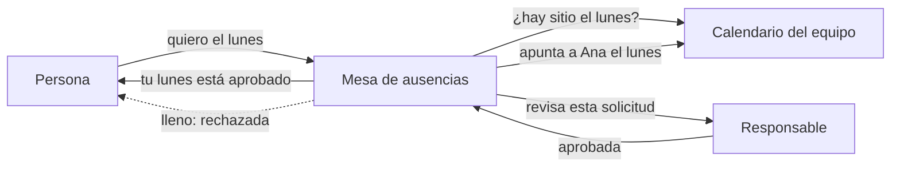
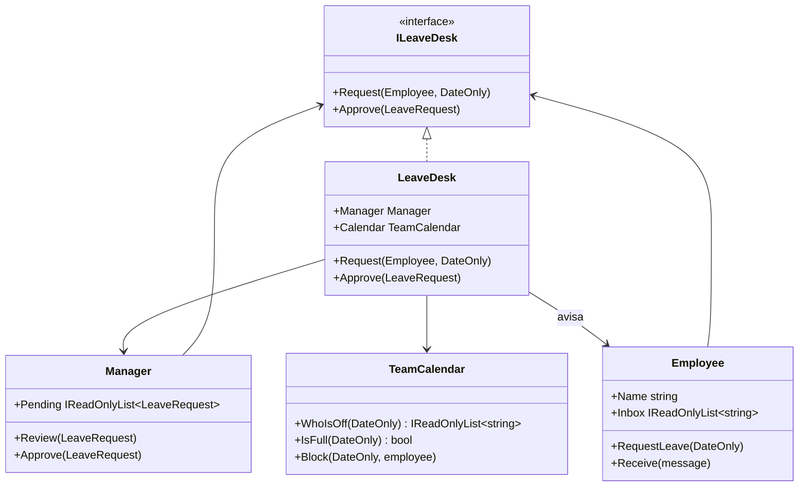

# Mediator

**Comportamiento.** Hacer que un conjunto de objetos se comuniquen a través de un objeto central en lugar de hablarse directamente, de modo que ninguno conozca a los demás.

Dominio común de los de comportamiento: fichaje y ausencias. Una solicitud de vacaciones involucra a quien la pide, a quien la aprueba y al calendario del equipo; sin un centro, cada uno tendría que conocer a los otros dos. En [refactoring.guru](https://refactoring.guru/es/design-patterns/mediator) el mismo patrón se cuenta con los controles de un formulario que se habilitan unos a otros.

Este es el Mediator **del libro**. El proyecto [`DotNet.Practices.Mediator`](../../../DotNet.Practices.Mediator/CLAUDE.md) muestra la versión con MediatR que se usa en las aplicaciones.

## Qué hace, en términos de negocio

La misma empresa que gestiona ausencias. Pedir un día libre pone en marcha a varias partes: la persona que lo pide, su responsable que lo aprueba, y el calendario del equipo que no puede quedarse vacío. Si cada parte habla con las demás por su cuenta, la persona tiene que saber quién es su responsable y mirar el calendario antes de pedir; el responsable tiene que acordarse de apuntar en el calendario y de avisar; y cuando cambia la regla ("máximo dos personas fuera a la vez"), hay que tocar a todos.

Mediator pone una **mesa de ausencias** en medio. La persona le dice a la mesa "quiero el lunes". La mesa mira el calendario: si ya está lleno, se lo dice a la persona y ahí acaba; si no, se lo pasa al responsable. Cuando el responsable aprueba, se lo dice a la mesa, y la mesa apunta el día en el calendario y avisa a la persona. Nadie salvo la mesa sabe quién más participa ni en qué orden. Cambiar la regla es cambiar la mesa.

Quién gana: cada participante, porque solo tiene que saber hablar con la mesa; y quien define el proceso, porque las reglas y el orden viven en un solo sitio.

## Estructura

| Rol | Tipo |
|---|---|
| Mediator | `Interfaces/ILeaveDesk` |
| Concrete mediator | `LeaveDesk` |
| Colleagues | `Colleagues/Employee`, `Colleagues/Manager`, `Colleagues/TeamCalendar` |

`Employee` y `Manager` reciben `ILeaveDesk` y no se conocen entre sí. `TeamCalendar` no conoce ni a la mesa: la mesa le pregunta y le ordena. Las flechas de comunicación salen todas de la mesa o van hacia ella.

## Decisiones

**Interfaz tipada, no `Notify(sender, string evento)`.**
Problema: el libro y refactoring.guru usan un único `Notify` con el evento como cadena; es flexible y es el origen de todos los `if (evento == "...")`.
Alternativa descartada: `ILeaveDesk.Notify(object sender, string eventName)`.
Qué se gana: dos métodos con nombre (`Request`, `Approve`) que el compilador comprueba; añadir un evento nuevo es añadir un método y el compilador señala quién tiene que implementarlo.

**La mesa crea al responsable y al calendario.**
Problema: `Manager` necesita la mesa y la mesa necesita a `Manager`; alguien tiene que romper el círculo.
Alternativa descartada: construir cada pieza fuera y registrarla con `desk.Register(manager)`. Es más flexible y añade un estado "a medio montar" en el que la mesa puede recibir una solicitud sin tener responsable.
Qué se gana: una mesa recién construida está completa. Los empleados sí se crean fuera, porque son muchos y aparecen después.

**La mesa recuerda quién pidió cada solicitud.**
Problema: `LeaveRequest` lleva el nombre, no el objeto `Employee`, y al aprobar hay que avisar al objeto.
Alternativa descartada: meter el `Employee` en el record, lo que haría que `Manager` tuviera una referencia al empleado, justo el acoplamiento que el patrón evita.
Qué se gana: la solicitud que ve el responsable es un dato plano; la relación solicitud-empleado es conocimiento de la mesa, que es donde debe estar.

## Cuándo usarlo

- Varios objetos se hablan entre sí y el grafo de referencias se vuelve una maraña.
- Las reglas de coordinación cambian a menudo y quieres un único sitio donde vivan.
- Quieres reutilizar un participante en otro flujo: si solo conoce al mediador, basta con darle otro.

## Cuándo no usarlo

- Solo hay dos participantes: una referencia directa es más clara.
- El mediador acumula toda la lógica de la aplicación: es la "god class" que el patrón crea cuando se abusa. Un mediador por flujo de negocio, no uno global.
- Es uno-a-muchos sin coordinación (un evento y varios interesados): [Observer](../Observer/README.md) es más simple.
- En .NET con MediatR: cada `IRequest` va a un único handler y el `IMediator` es la central. Resuelve el desacoplamiento entre quien pide y quien ejecuta, no la coordinación entre varios participantes de este ejemplo. Son usos distintos del mismo nombre.

## Tests

`LeaveDeskTests`: una solicitud llega al responsable a través de la mesa; aprobar avisa a la persona y bloquea el día en el calendario; con el calendario lleno la solicitud se rechaza sin llegar al responsable y no deja nada pendiente.
