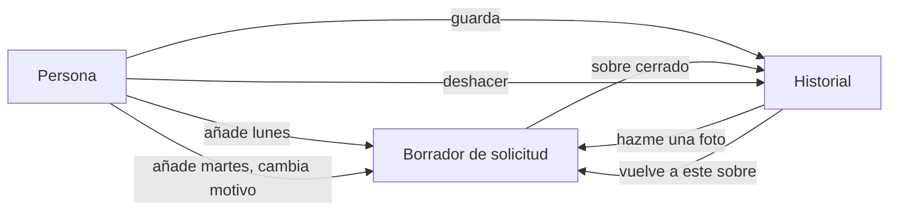
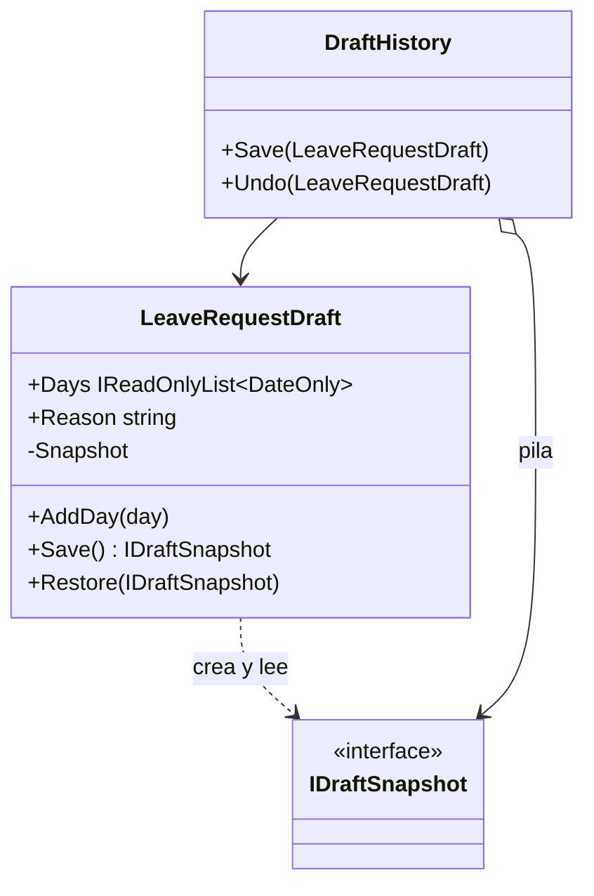

# Memento

**Comportamiento.** Guardar una foto del estado interno de un objeto y poder restaurarla después, sin que nadie fuera del objeto vea lo que hay en la foto.

Dominio común de los de comportamiento: fichaje y ausencias. Un borrador de solicitud de vacaciones se va editando (días, motivo) y la persona quiere poder volver a como lo tenía hace dos cambios. En [refactoring.guru](https://refactoring.guru/es/design-patterns/memento) el mismo patrón se cuenta con un editor de texto que guarda versiones.

## Qué hace, en términos de negocio

La misma empresa que gestiona ausencias. Rellenar una solicitud de vacaciones lleva su tiempo: se añaden días, se quitan, se cambia el motivo, se prueba otra combinación. Y a mitad de camino la persona quiere volver a la versión de hace un momento, que estaba mejor. Para eso hace falta guardar **cómo estaba el borrador** en ciertos momentos y poder volver a cualquiera de ellos.

Memento resuelve quién guarda qué. El **borrador** es el único que sabe lo que tiene dentro, así que es él quien hace la foto y quien la aplica al volver. Un **historial** guarda las fotos en orden, pero son sobres cerrados: no puede abrirlos ni modificarlos, solo devolverlos al borrador cuando se pide deshacer. Así el borrador puede cambiar por dentro (añadir un campo "sustituto", por ejemplo) sin que el historial se entere, y nadie puede fabricar una foto falsa ni leer datos del borrador por la puerta de atrás.

Quién gana: quien rellena solicitudes, porque puede probar sin miedo; y quien mantiene el borrador, porque puede cambiar lo que guarda sin tocar el historial.

## Estructura

| Rol | Tipo |
|---|---|
| Originator | `LeaveRequestDraft` |
| Memento | `LeaveRequestDraft.Snapshot` (record privado) tras `Interfaces/IDraftSnapshot` |
| Caretaker | `DraftHistory` |

El historial solo ve `IDraftSnapshot`, una interfaz vacía. El record con los datos es privado del borrador: solo `Save()` lo crea y solo `Restore()` lo lee.

## Decisiones

**El memento es un tipo anidado privado tras una interfaz vacía.**
Problema: el patrón exige que el estado guardado sea opaco para el historial, pero C# no tiene "amigos" como C++.
Alternativa descartada: un `DraftSnapshot` público con propiedades `init`. Funciona, pero cualquiera puede leerlo, construir uno a mano y restaurar un estado inventado.
Qué se gana: la única clase que puede ver el contenido del sobre es la que lo fabrica. El cast en `Restore` es seguro porque nadie más puede implementar `IDraftSnapshot` con sentido.

**La foto copia la lista de días.**
Problema: si la foto guardara la misma lista que el borrador, añadir un día después cambiaría también la foto, y deshacer no desharía nada.
Alternativa descartada: guardar la referencia.
Qué se gana: el primer test (añadir después de guardar, restaurar, comprobar que el día añadido desapareció) demuestra que la foto es independiente.

**Memento aquí, Command para los fichajes.**
Problema: [Command](../Command/README.md) también deshace; hay que elegir.
Alternativa descartada: una pila de comandos ("añadir día", "cambiar motivo") con su inverso.
Qué se gana: el borrador tiene varios campos que cambian a la vez y el estado completo es pequeño: una foto es más simple que un comando por tipo de edición. Command guarda el delta; Memento la foto. Con pocos campos, foto.

## Cuándo usarlo

- Deshacer, puntos de restauración, borradores, "volver a como estaba" cuando el estado completo es manejable.
- Transacciones en memoria: foto antes, operación, si falla se restaura.
- Cuando exponer los campos internos para que otro los guarde rompería la encapsulación.

## Cuándo no usarlo

- El estado es grande o caro de copiar y los cambios son pequeños y conocidos: [Command](../Command/README.md) con deltas.
- El objeto es un `record` inmutable: cada versión ya es su propia foto; guarda referencias en una pila y no hace falta patrón.
- Hay que persistir las fotos fuera del proceso: entonces el memento tiene que ser serializable y público, y pasa a ser un DTO de versión, no este patrón.

## Tests

`LeaveRequestDraftTests`: restaurar devuelve días y motivo tal como estaban al guardar; el historial deshace una y dos veces en orden; y deshacer sin fotos no toca el borrador.
