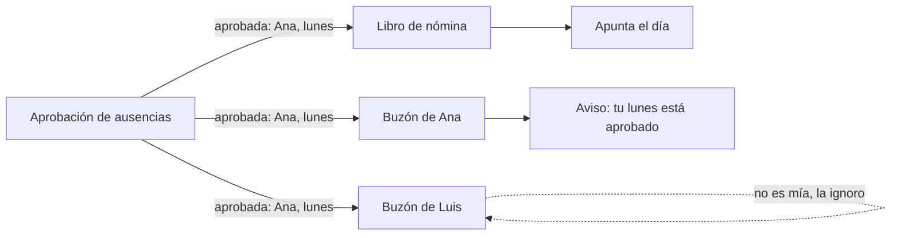
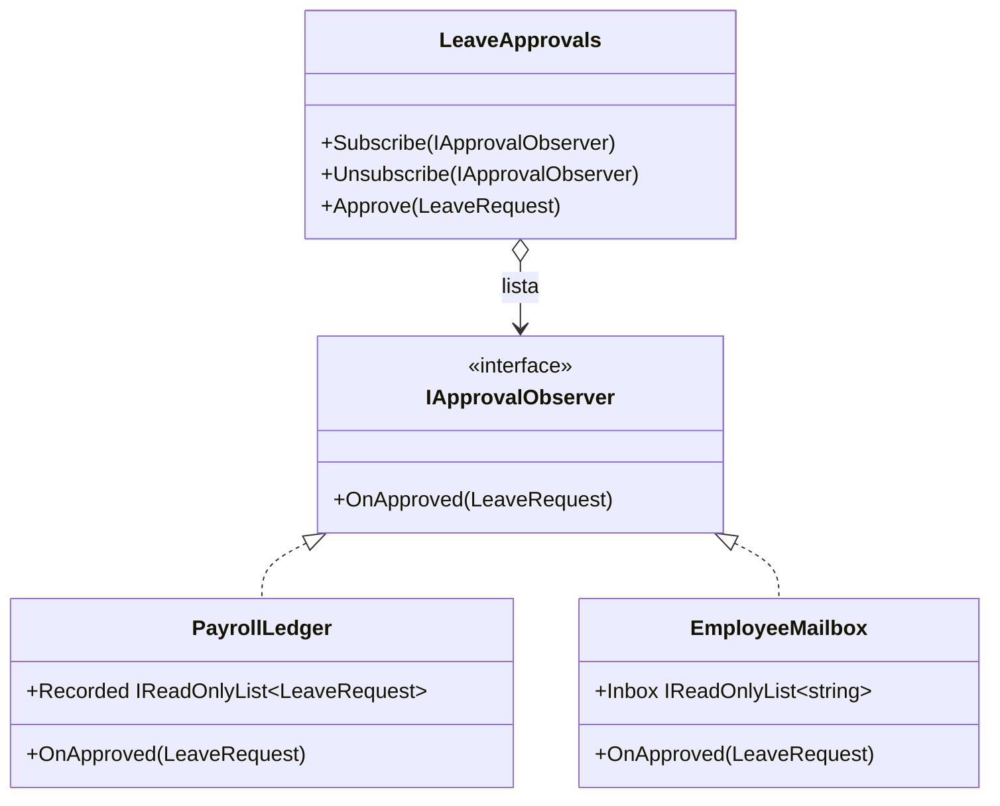

# Observer

**Comportamiento.** Definir una relación uno-a-muchos en la que, cuando un objeto cambia, todos los que se apuntaron se enteran, sin que el objeto sepa quiénes son.

Dominio común de los de comportamiento: fichaje y ausencias. Cuando se aprueba una ausencia, nómina tiene que descontarla y la persona tiene que recibir el aviso; mañana habrá un tercero interesado. En [refactoring.guru](https://refactoring.guru/es/design-patterns/observer) el mismo patrón se cuenta con una tienda que avisa de novedades a quien se suscribe.

## Qué hace, en términos de negocio

La misma empresa que gestiona ausencias. Aprobar un día libre no acaba en la aprobación: nómina lo necesita para calcular el mes, la persona quiere el aviso, el calendario del equipo lo apunta, y dentro de un tiempo un panel de dirección querrá contarlo. Si quien aprueba tuviera que llamar a cada uno de ellos, cada interesado nuevo obligaría a tocar la aprobación, y un olvido dejaría a alguien sin enterarse.

Observer da la vuelta a la relación. Quien aprueba mantiene una **lista de interesados** y, cada vez que aprueba algo, se lo cuenta a todos los de la lista, sin saber quién es cada uno ni qué hará con la noticia. Los interesados se **apuntan** o se **borran** cuando quieren. Añadir el panel de dirección es apuntar un interesado más; la aprobación no cambia. Y cada interesado decide si la noticia le incumbe: el buzón de Ana ignora las aprobaciones de Luis.

Quién gana: quien añade interesados, porque se apunta y ya; y quien mantiene la aprobación, porque no cambia por mucho que crezca la lista.

## Estructura

| Rol | Tipo |
|---|---|
| Subject | `LeaveApprovals` |
| Observer | `Interfaces/IApprovalObserver` |
| Concrete observers | `Observers/PayrollLedger`, `Observers/EmployeeMailbox` |

El sujeto recorre su lista y llama a `OnApproved`. Nada más: no sabe qué hace cada observador, y el filtrado ("¿es mía?") lo hace el observador.

## Decisiones

**Interfaz explícita en vez de `event`.**
Problema: en C# el patrón está en el lenguaje: `public event Action<LeaveRequest>? Approved;` y `approvals.Approved += ledger.OnApproved;` hacen lo mismo en dos líneas.
Alternativa descartada: usar `event`, que es lo que se escribe en producción.
Qué se gana: con la interfaz se ve la lista, el recorrido y los dos métodos de suscripción que `event` esconde; y los observadores son objetos con nombre, no delegados anónimos, lo que facilita el test de "ignora las ajenas". En producción: `event` para notificaciones dentro del proceso, `IObservable<T>` o un bus para flujos, y esta forma solo si hace falta controlar la lista (prioridades, orden, filtrado en el sujeto).

**El observador filtra, no el sujeto.**
Problema: el buzón de Ana solo quiere las de Ana; alguien tiene que decidirlo.
Alternativa descartada: `Subscribe(observer, employeeFilter)` en el sujeto. El sujeto empezaría a conocer la semántica de los interesados.
Qué se gana: el sujeto sigue siendo tonto y genérico; cada observador aplica su criterio con el dato que recibe.

**`Approve` notifica de forma síncrona y en orden de suscripción.**
Problema: un observador lento o que lanza para a los demás.
Alternativa descartada: capturar excepciones por observador, o notificar en paralelo. Añade decisiones (¿qué se hace con el error?) que no son del patrón.
Qué se gana: comportamiento predecible y tests deterministas. Es la misma elección que hace `event` en C#. Si hace falta aislamiento, es una cola de mensajes, no este patrón.

## Cuándo usarlo

- Un cambio interesa a varios y la lista de interesados crece o cambia en tiempo de ejecución.
- Quien produce el cambio no debe conocer a quienes reaccionan (capas distintas, módulos distintos).
- Eventos de dominio dentro de un proceso: "ausencia aprobada", "fichaje corregido".

## Cuándo no usarlo

- Hay un único interesado fijo: una llamada directa es más clara.
- Los interesados tienen que coordinarse entre sí o el orden importa: eso es [Mediator](../Mediator/README.md).
- La reacción debe sobrevivir a un fallo del proceso o cruzar servicios: cola o bus de mensajes, con reintentos, no una lista en memoria.
- El sujeto necesita respuesta de los observadores: Observer es fuego y olvido; si hay respuesta, es una llamada normal.

## Tests

`LeaveApprovalsTests`: aprobar llega al libro de nómina y al buzón de la persona; el buzón de otra persona ignora la aprobación; y quien se da de baja deja de recibir.
