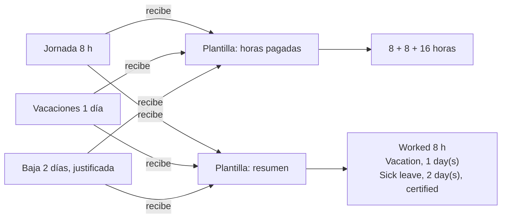
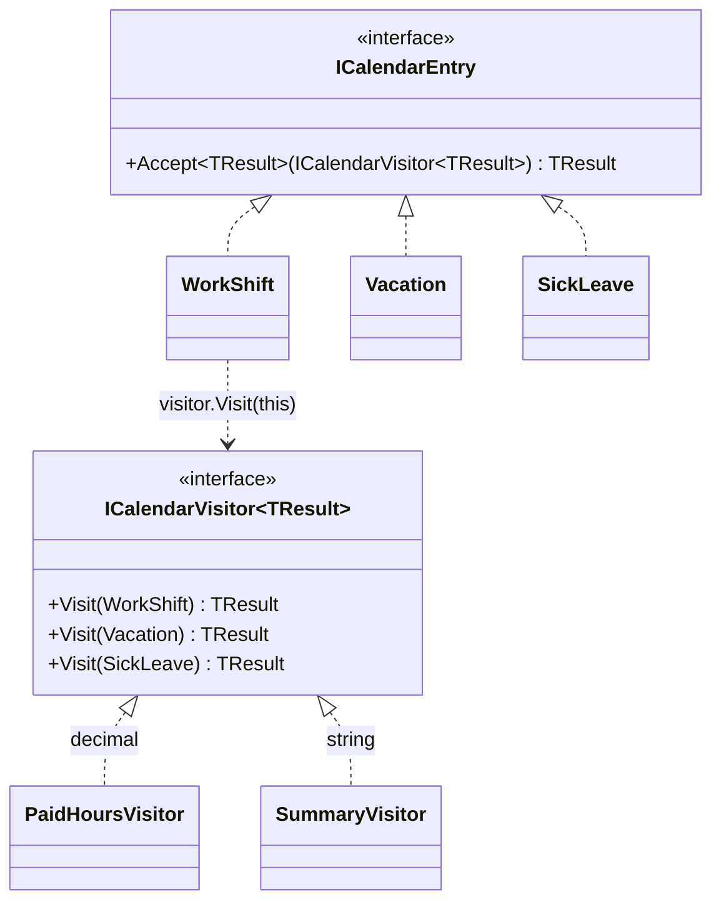

# Visitor

**Comportamiento.** Añadir operaciones nuevas a una jerarquía de objetos sin tocar las clases de la jerarquía, poniendo cada operación en su propio objeto que "visita" cada tipo.

Dominio común de los de comportamiento: fichaje y ausencias. El calendario de una persona tiene jornadas, vacaciones y bajas; sobre ese mismo calendario hay que calcular horas pagadas, sacar un resumen, y el mes que viene algo más. En [refactoring.guru](https://refactoring.guru/es/design-patterns/visitor) el mismo patrón se cuenta con exportar a XML un grafo de figuras.

## Qué hace, en términos de negocio

La misma empresa que gestiona jornadas. El calendario de cada persona tiene apuntes de tipos distintos: jornadas trabajadas, días de vacaciones, bajas con o sin justificante. Y sobre esos apuntes se hacen muchas cosas: nómina calcula qué se paga, el informe mensual los describe, auditoría los cuenta, dirección los agrega. Cada operación nueva, si viviera dentro de los apuntes, obligaría a tocar los tres tipos de apunte, y los apuntes acabarían sabiendo de nómina, de informes y de auditoría a la vez.

Visitor saca cada operación a su propia **plantilla de visita**: una para "horas pagadas", otra para "resumen", con una casilla por tipo de apunte. Para aplicar una operación al calendario, cada apunte **recibe** la plantilla y le indica su casilla. Añadir una operación es escribir una plantilla nueva sin tocar los apuntes. Y si aparece un tipo de apunte nuevo, todas las plantillas avisan de que les falta una casilla, así que ninguna operación se queda sin contemplarlo.



Quién gana: quien añade informes o cálculos, porque escribe una plantilla y no toca el calendario; y quien mantiene los apuntes, porque siguen siendo datos sin saber para qué se usan.

## Estructura



| Rol | Tipo |
|---|---|
| Element | `Interfaces/ICalendarEntry` |
| Concrete elements | `Entries/WorkShift`, `Entries/Vacation`, `Entries/SickLeave` |
| Visitor | `Interfaces/ICalendarVisitor<TResult>` |
| Concrete visitors | `Visitors/PaidHoursVisitor`, `Visitors/SummaryVisitor` |

`Accept` es una línea idéntica en cada elemento: `visitor.Visit(this)`. Esa línea es el **doble despacho**: el tipo de `this` elige la sobrecarga en tiempo de compilación, cosa que una llamada `visitor.Visit(entry)` con `entry` tipado como `ICalendarEntry` no podría hacer.

## Decisiones

**Visitor genérico en el resultado.**
Problema: el libro usa `void Visit(...)` y el visitante acumula el resultado en un campo; cada visitante necesita un `Result` y un `Reset`.
Alternativa descartada: `void` con estado interno.
Qué se gana: `Accept` devuelve el valor, los visitantes no tienen estado, y aplicar uno a un calendario es un `Select`. `out TResult` permite asignar un `ICalendarVisitor<decimal>` donde se espera `ICalendarVisitor<object>`, sin coste.

**Una sobrecarga por tipo, sin `Visit(ICalendarEntry)` genérico de respaldo.**
Problema: un método de respaldo evita tocar los visitantes al añadir un tipo, pero entonces el tipo nuevo cae en silencio en el respaldo y ninguna operación lo trata bien.
Alternativa descartada: `TResult VisitDefault(ICalendarEntry entry)`.
Qué se gana: añadir `Overtime` a la jerarquía obliga a añadir `Visit(Overtime)` a la interfaz y el compilador señala cada visitante incompleto. Ese "rompe a propósito" es la garantía del patrón.

**Elementos como `record`.**
Problema: los elementos son datos; el patrón no les pide comportamiento más allá de `Accept`.
Alternativa descartada: clases con propiedades.
Qué se gana: igualdad por valor en los tests y la señal clara de que los apuntes son datos y las operaciones viven fuera.

## Visitor frente a pattern matching

En C# moderno la alternativa es un `switch` exhaustivo:

```csharp
decimal PaidHours(ICalendarEntry entry) => entry switch
{
    WorkShift shift => shift.Hours,
    Vacation vacation => vacation.Days * 8m,
    SickLeave sick => sick.Days * 8m * (sick.IsCertified ? 1m : 0.6m),
    _ => throw new ArgumentOutOfRangeException(nameof(entry)),
};
```

Es más corto, no toca la jerarquía, y es lo que conviene en la mayoría de casos. Lo que pierde frente a Visitor: el compilador **no** avisa si falta un caso cuando la jerarquía es una interfaz (solo lo hace con tipos cerrados y, aun así, hay que quitar el `_`). Visitor compensa cuando la jerarquía es estable, las operaciones son muchas y se quiere que añadir un tipo rompa la compilación de todas ellas.

## Cuándo usarlo

- Jerarquía estable con muchas operaciones que cambian o crecen: exportadores, cálculos, validadores sobre un modelo de dominio o un árbol sintáctico.
- Las operaciones no pertenecen conceptualmente a los elementos (nómina no es asunto de un apunte de calendario).
- Quieres que un tipo nuevo obligue a revisar todas las operaciones.

## Cuándo no usarlo

- La jerarquía cambia a menudo: cada tipo nuevo toca todos los visitantes. Entonces las operaciones dentro de los elementos (polimorfismo normal) o un `switch` local.
- Pocas operaciones y una jerarquía pequeña: `switch` con pattern matching, como arriba.
- Los elementos ya tienen el comportamiento y encaja ahí: no lo saques por sacarlo.

## Tests

`CalendarVisitorTests`: horas pagadas de una jornada, de unas vacaciones y de una baja sin justificante al 60 %; y el visitante de resumen describe un mes entero aplicándose con `Select` sin cambiar los apuntes.
