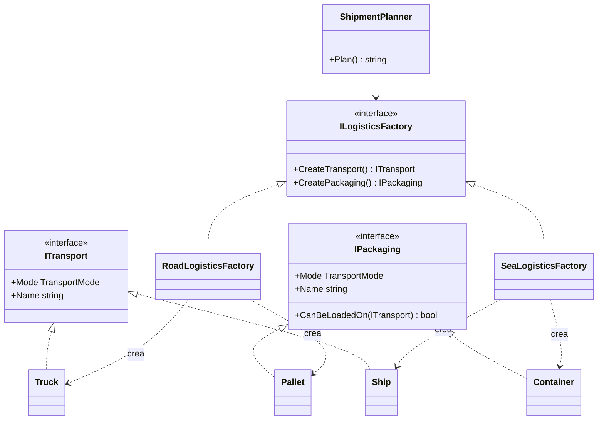

# Abstract Factory

**Creacional.** Crear **familias** de objetos relacionados sin acoplarse a sus clases concretas, garantizando que los objetos de una misma familia son compatibles entre sí.

Mismo dominio que el resto de creacionales: logística. Cada vía de transporte es una familia: por carretera se envía en `Truck` con `Pallet`; por mar, en `Ship` con `Container`. Un contenedor marítimo en un camión es la combinación inválida que la fábrica impide. En [refactoring.guru](https://refactoring.guru/es/design-patterns/abstract-factory) el mismo patrón se cuenta con sillas y sofás de distintos estilos.

## Estructura

| Rol | Tipo |
|---|---|
| Abstract factory | `Interfaces/ILogisticsFactory` |
| Concrete factories | `Factories/RoadLogisticsFactory`, `Factories/SeaLogisticsFactory` |
| Abstract products | `Interfaces/ITransport`, `Interfaces/IPackaging` |
| Concrete products | `Transports/*`, `Packagings/*` |
| Client | `ShipmentPlanner` |
| Selector | `LogisticsFactories.For(mode)` |

`ShipmentPlanner` recibe una `ILogisticsFactory` y nunca nombra una clase concreta. Cambiar de vía es cambiar la fábrica que se le pasa. `LogisticsFactories.For` es el único sitio que conoce las fábricas concretas; en una app con DI, ese sitio es el registro del contenedor.

## De Factory Method a Abstract Factory

En [Factory Method](../FactoryMethod/README.md) `Logistics` tenía un solo método fábrica, `CreateTransport()`, y la variante se elegía por **herencia** (`RoadLogistics`, `SeaLogistics`). Aquí aparece un segundo producto que debe combinar con el primero, así que:

| | Factory Method | Abstract Factory |
|---|---|---|
| Qué crea | Un producto (`ITransport`) | Una familia (`ITransport` + `IPackaging`) |
| Mecanismo | Herencia: la subclase sobreescribe el método | Composición: el cliente recibe un objeto fábrica |
| Garantía | Que el cliente no conozca el subtipo | Además, que los productos combinen entre sí |

Cuando un creator empieza a tener dos o tres métodos fábrica relacionados, ya es una Abstract Factory.

## Cuándo usarlo

- El código tiene que trabajar con varias familias y hay combinaciones inválidas (proveedores cloud con sus clientes de cola, blob y secretos; drivers de base de datos con su conexión, comando y transacción; temas de UI).
- Quieres cambiar de familia entera con un solo punto de configuración.

## Cuándo no usarlo

- Hay un solo producto: es Factory Method o una fábrica simple.
- Las familias no tienen restricciones de compatibilidad: inyecta cada producto por separado y deja que el contenedor DI los resuelva.
- Añadir un **producto nuevo** a la familia obliga a tocar la interfaz y todas las fábricas. Si eso va a pasar a menudo, el patrón duele.

## Tests

`LogisticsFactoryTests`: cada fábrica crea sus productos, los productos de una misma fábrica son compatibles, los de fábricas distintas no, y `ShipmentPlanner` funciona con cualquier fábrica sin saber cuál es.
