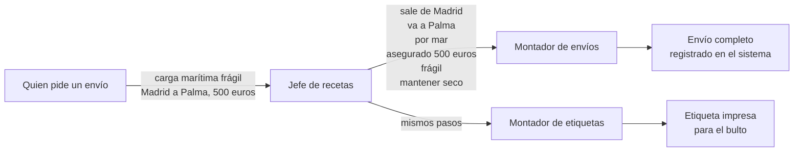
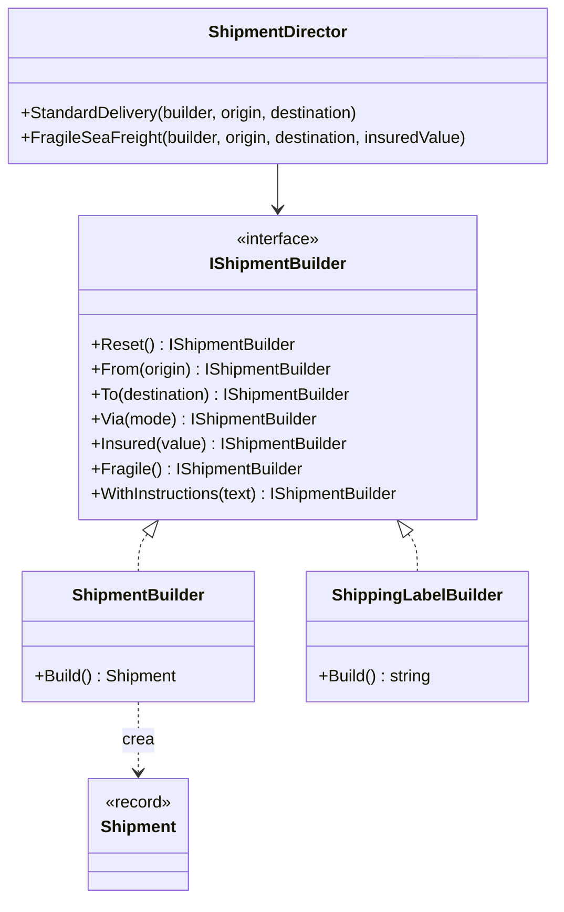

# Builder

**Creacional.** Construir un objeto complejo **paso a paso**, de forma que los mismos pasos puedan producir representaciones distintas y que el objeto no exista a medias.

Mismo dominio que el resto de creacionales: logística. Un envío (`Shipment`) tiene origen, destino, vía, seguro, fragilidad e instrucciones; casi todo es opcional. En [refactoring.guru](https://refactoring.guru/es/design-patterns/builder) el mismo patrón se cuenta con coches y sus manuales.

## Qué hace, en términos de negocio

La misma empresa de logística. Dar de alta un envío son muchas decisiones: de dónde sale, a dónde va, si va por carretera o por mar, si lleva seguro y por cuánto, si es frágil, si hay instrucciones para el transportista. La mayoría de los envíos solo necesitan dos o tres de esas cosas, pero el formulario completo tiene todas las casillas, y quien lo rellena tiene que saber cuáles importan y en qué orden.

Builder separa dos papeles. Un **montador** sabe apuntar cada decisión una a una ("sale de Madrid", "va a Palma", "es frágil"); no exige rellenarlas todas ni en un orden fijo, y al final entrega el envío completo o avisa de que falta algo imprescindible, como el destino. Un **jefe de recetas** conoce las combinaciones que el negocio pide por nombre: "entrega estándar", "carga marítima frágil". Quien necesita un envío pide la receta y no toca las casillas.

El mismo montaje sirve para cosas distintas: con los mismos pasos, un montador produce el envío que entra en el sistema y otro produce la **etiqueta** impresa que va pegada al bulto. Si mañana se añade un paso ("entrega en mano"), se añade en un sitio y los dos lo heredan.

Quién gana: quien registra envíos, porque pide recetas en vez de rellenar casillas; y quien mantiene el proceso, porque añadir un paso o una receta no obliga a tocar lo demás.

## Estructura

| Rol | Tipo |
|---|---|
| Builder | `Interfaces/IShipmentBuilder` |
| Concrete builders | `Builders/ShipmentBuilder`, `Builders/ShippingLabelBuilder` |
| Products | `Shipment` (record), `string` (etiqueta) |
| Director | `ShipmentDirector` |

El cliente elige el builder concreto, se lo pasa al director (o encadena los pasos él mismo) y pide el producto al builder: `director.FragileSeaFreight(builder, ...); var shipment = builder.Build();`.

## Decisiones

**`Build()` no está en la interfaz.**
Problema: los dos builders producen tipos distintos (`Shipment` y `string`), y una interfaz solo puede declarar un tipo de retorno.
Alternativa descartada: `IShipmentBuilder<TProduct>` genérico. Funciona, pero el director tendría que ser genérico también y el ejemplo deja de leerse de un vistazo.
Qué se gana: la interfaz solo tiene pasos, el director solo conoce pasos, y cada builder decide qué entrega. Es la forma del libro y de refactoring.guru.

**Los pasos devuelven `IShipmentBuilder`.**
Problema: en el libro los pasos devuelven `void`; en .NET lo idiomático es encadenar (`StringBuilder`, `HostApplicationBuilder`).
Alternativa descartada: devolver el tipo concreto para poder encadenar hasta `Build()`. Obliga a genéricos con self-type y el director no podría escribir la receta contra la interfaz.
Qué se gana: el director escribe las recetas en una línea y el cliente que quiere el producto conserva su referencia concreta, que es lo que ya tenía.

**`Build()` valida al final, no en cada paso.**
Problema: origen y destino son obligatorios, el resto no, y el orden de los pasos es libre.
Alternativa descartada: constructor con los dos obligatorios y pasos para los opcionales. Es válido, pero entonces el builder ya no sirve para la etiqueta, que no tiene obligatorios.
Qué se gana: el objeto nunca existe a medias (`Shipment` es un record inmutable que solo nace completo) y la regla de "qué es imprescindible" vive en un sitio.

## Cuándo usarlo

- El objeto tiene muchos parámetros opcionales y los constructores empiezan a multiplicarse ("telescópicos").
- La construcción tiene pasos y el orden o la combinación importa; el director captura las combinaciones con nombre de negocio.
- Los mismos pasos tienen que producir más de una representación (objeto de dominio y su etiqueta, su JSON, su resumen).

## Cuándo no usarlo

- El objeto es un `record` con propiedades `init`: `new Shipment { Origin = "Madrid", ... }` ya es "construcción por pasos con opcionales" gratis. Builder solo compensa si hay validación final, varias representaciones o recetas.
- No hay segundo builder ni director a la vista: una clase con métodos fluidos y `Build()` basta, sin interfaz.

## Tests

`ShipmentBuilderTests`: el builder entrega el record con todos los pasos y con los valores por defecto, lanza si falta el destino, el builder de etiquetas produce una línea por paso, el director aplica la misma receta a los dos builders y `Reset()` borra los pasos del envío anterior.
