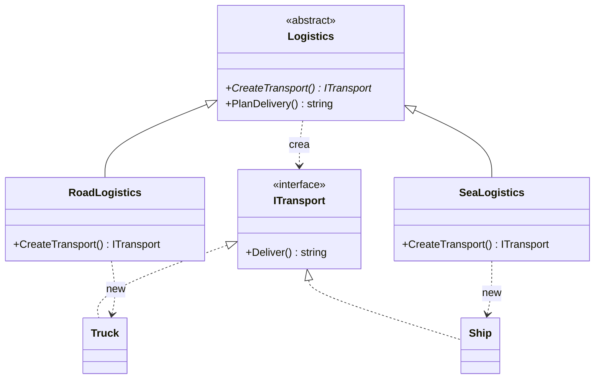

# Factory Method

**Creacional.** Una clase base tiene lógica de negocio que necesita un objeto, pero no debe saber de qué tipo concreto. Declara un *método fábrica* y deja que las subclases decidan qué construir.

Dominio tomado de [refactoring.guru](https://refactoring.guru/es/design-patterns/factory-method) para poder leer ambos en paralelo: una empresa de logística planifica entregas sin importarle si las hace un camión o un barco.

## Estructura

| Rol | Tipo |
|---|---|
| Creator | `Abstracts/Logistics` |
| Concrete creators | `Creators/RoadLogistics`, `Creators/SeaLogistics` |
| Product | `Interfaces/ITransport` |
| Concrete products | `Transports/Truck`, `Transports/Ship` |

`PlanDelivery()` se escribe una sola vez contra `ITransport`. Lo único que aporta cada subclase es el `new`.

## Cuándo usarlo

- La clase base tiene lógica real alrededor del objeto que crea. Si el creator solo contiene el `new`, no hace falta el patrón: una fábrica estática o inyección por constructor es más simple.
- Esperas nuevas variantes del producto y quieres añadirlas creando clases, no editando un `switch`.

## Cuándo no usarlo

- En un servicio .NET con inyección de dependencias, el contenedor ya es la fábrica. Inyecta `ITransport` (o `Func<ITransport>`) en vez de montar una jerarquía de creators.
- Cuando la elección depende de datos en tiempo de ejecución y no de la subclase. Eso es una fábrica simple o Strategy, no Factory Method.

## Tests

`LogisticsTests` comprueba que cada creator construye su producto, que `PlanDelivery` compone la salida del producto y que cada llamada devuelve una instancia nueva.
