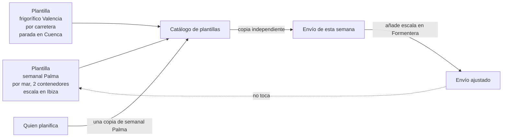
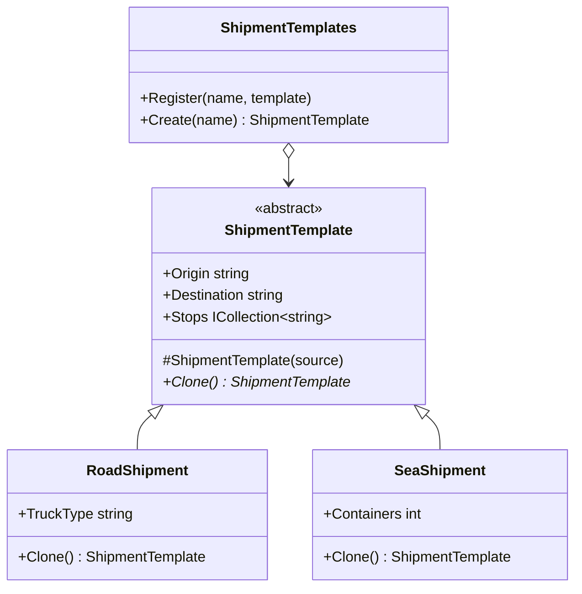

# Prototype

**Creacional.** Crear objetos nuevos **copiando** uno ya configurado, sin que quien copia conozca la clase concreta ni cómo se construyó el original.

Mismo dominio que el resto de creacionales: logística. Una ruta recurrente ("Valencia a Palma cada lunes, dos contenedores, escala en Ibiza") se guarda como plantilla y cada semana se copia y se ajusta. En [refactoring.guru](https://refactoring.guru/es/design-patterns/prototype) el mismo patrón se cuenta con figuras geométricas que se clonan.

## Qué hace, en términos de negocio

La misma empresa de logística. Hay envíos que se repiten: la carga marítima de los lunes a Palma, el camión frigorífico a Valencia con parada en Cuenca. Montarlos desde cero cada vez es repetir las mismas decisiones y arriesgarse a olvidar una parada.

Prototype guarda cada envío modelo como **plantilla** en un **catálogo** con nombre ("semanal Palma"). Cuando toca, quien planifica pide "una copia de la semanal Palma" y recibe un envío nuevo e independiente: puede añadirle una parada o cambiar la fecha sin que la plantilla cambie para la semana siguiente. Y no necesita saber si lo que copia es un envío por mar o por carretera; la copia sale del mismo tipo que el original.

Quién gana: quien planifica, porque pide copias en vez de montar envíos; y quien define rutas, porque cambia la plantilla una vez y las copias siguientes salen ya corregidas.

## Estructura

| Rol | Tipo |
|---|---|
| Prototype | `Abstracts/ShipmentTemplate` (`Clone()` abstracto y constructor de copia) |
| Concrete prototypes | `Templates/RoadShipment`, `Templates/SeaShipment` |
| Prototype registry | `ShipmentTemplates` |

Cada clase concreta implementa `Clone()` llamando a su propio constructor de copia, que delega en el de la base. La base copia lo común y **duplica** la lista de paradas; la hija copia lo suyo. El registro devuelve siempre `Clone()`, nunca la plantilla.

## Decisiones

**Constructor de copia en vez de `MemberwiseClone()`.**
Problema: `MemberwiseClone()` copia referencias; la lista de paradas quedaría compartida entre plantilla y copia, y añadir una escala al envío de esta semana cambiaría la plantilla.
Alternativa descartada: `MemberwiseClone()` seguido de un arreglo manual de la lista. Funciona, pero cada campo nuevo con referencia es una trampa silenciosa.
Qué se gana: la decisión "qué se comparte y qué se duplica" está en un único sitio por clase, y el compilador avisa si un campo `readonly` se queda sin copiar.

**Sin `ICloneable`.**
Problema: la BCL ofrece `ICloneable`, pero devuelve `object` y no dice si la copia es profunda o superficial; las guías de .NET desaconsejan implementarla.
Alternativa descartada: `ICloneable` y un cast en cada llamada.
Qué se gana: `Clone()` devuelve `ShipmentTemplate` y el contrato de copia profunda es el de esta jerarquía, documentado aquí.

**Clases y no `record`.**
Problema: `record` con `with` ya es Prototype gratis, pero `with` es **superficial**: la lista de paradas se compartiría, y `with` exige conocer el tipo concreto, que es justo lo que el registro no sabe.
Alternativa descartada: `record` con constructor de copia personalizado (que `with` respeta). Resuelve la profundidad, pero no el polimorfismo: `ShipmentTemplate t = ...; t with { }` no compila sobre un tipo abstracto sin trucos.
Qué se gana: una jerarquía que se clona desde la referencia abstracta, que es el caso en que el patrón aporta algo. Para datos inmutables sin listas, usa `record` y `with` y olvida este patrón.

## Cuándo usarlo

- Configurar un objeto es caro o largo (muchos pasos, datos de otro sistema) y ya tienes uno bien configurado.
- El código que necesita la copia no conoce la clase concreta: trabaja con la abstracción y el registro.
- Hay un catálogo de "modelos" que el negocio nombra: rutas recurrentes, plantillas de documento, configuraciones por defecto.

## Cuándo no usarlo

- El objeto es inmutable y sin colecciones mutables: `record` con `with`.
- Solo hay una clase concreta y el cliente la conoce: un constructor de copia público basta, sin jerarquía ni registro.
- Los objetos tienen referencias circulares o a recursos (conexiones, ficheros): clonar se vuelve ambiguo y suele ser mejor reconstruir.

## Tests

`ShipmentTemplateTests`: la copia es otra instancia con los mismos campos, no comparte la lista de paradas, conserva el tipo concreto aunque se clone desde la referencia abstracta, y el registro entrega una copia nueva en cada llamada y lanza si el nombre no existe.
