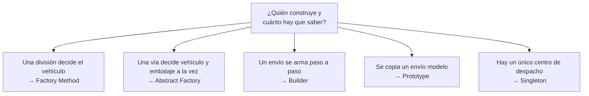
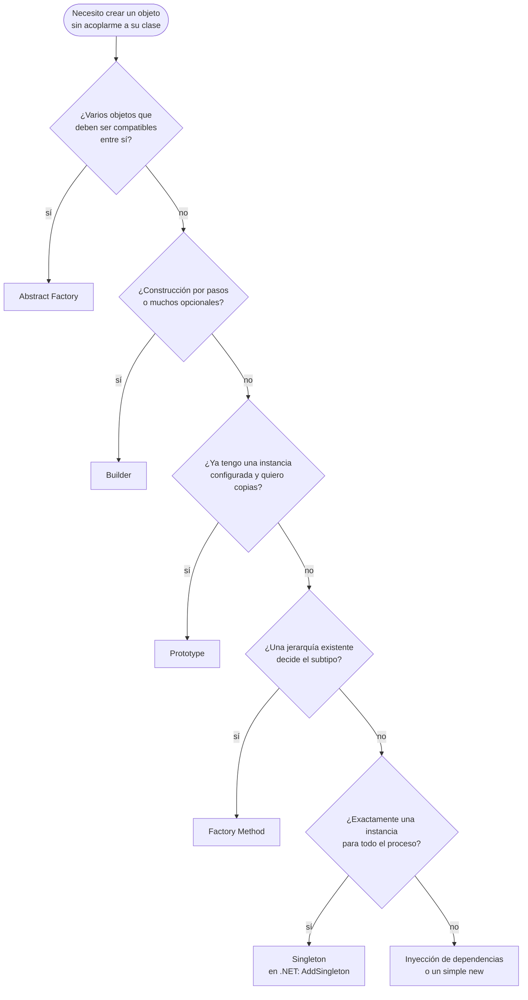
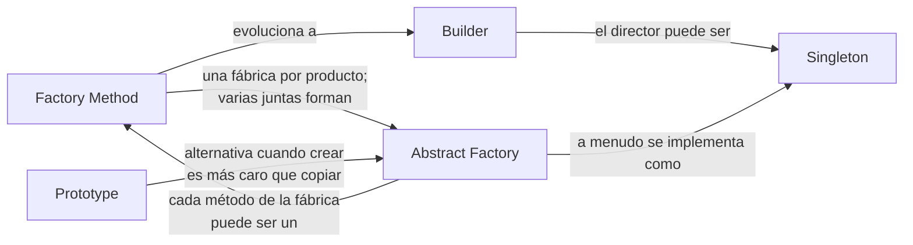

# Patrones creacionales

Los cinco ejemplos comparten un dominio, **logística** (transportes, embalajes, envíos), para que se vea cómo un patrón evoluciona en otro con los mismos tipos.

## Qué hace, en términos de negocio

Los patrones creacionales responden a una pregunta de organización, no de código: **¿quién decide cómo se construye una cosa, y cuánto tiene que saber de ella quien la usa?** En una empresa de logística: quien planifica una entrega no debería saber fabricar camiones; quien pide un envío no debería poder combinar un contenedor con un camión; quien configura un envío con doce opciones no debería rellenar doce casillas cada vez; y si ya existe un envío modelo para una ruta semanal, lo natural es copiarlo, no rehacerlo.

Cada patrón de esta carpeta es una respuesta distinta a esa pregunta, con el mismo dominio para que se vea cuándo encaja cada una:

Todos resuelven la misma pregunta: **¿quién hace el `new` y cómo evitamos que el código cliente dependa de clases concretas?** Se diferencian en *qué* problema del `new` atacan.

| Patrón | Problema que ataca | Señal de que lo necesitas | Estado |
|---|---|---|---|
| [Factory Method](FactoryMethod/README.md) | Una clase base tiene lógica pero no sabe qué subtipo crear | Un `switch` sobre un tipo dentro de una jerarquía que ya existe | hecho |
| [Abstract Factory](AbstractFactory/README.md) | Hay que crear **familias** de objetos que deben ser compatibles entre sí | Pasas varias fábricas a la vez y hay combinaciones inválidas | hecho |
| Builder | El objeto tiene muchos parámetros opcionales o se construye por pasos | Constructores con 6+ parámetros o varios constructores "telescópicos" | pendiente |
| Prototype | Crear desde cero es caro o el tipo concreto no se conoce; clonar es más simple | Copias de objetos configurados, con `with` en records como caso trivial | pendiente |
| Singleton | Debe existir una sola instancia con acceso global | Casi nunca: en .NET lo resuelve el contenedor DI con `AddSingleton` | pendiente |

## Cómo elegir

## Relaciones entre ellos

- **Factory Method → Abstract Factory**: cuando un creator empieza a tener varios métodos fábrica relacionados (`CreateTransport`, `CreatePackaging`, `CreateLabel`), ya es una Abstract Factory.
- **Factory Method → Builder**: cuando el producto deja de construirse con un solo `new` y necesita pasos, el método fábrica se convierte en un builder.
- **Abstract Factory / Builder + Singleton**: las fábricas no tienen estado, así que suelen ser únicas. En .NET eso es `AddSingleton<IFactory, Factory>()`, no un `static Instance`.
- **Prototype vs Abstract Factory**: ambos ocultan la clase concreta; Prototype copia instancias ya configuradas, Abstract Factory las crea desde cero.

## Qué cambia en .NET moderno

- El contenedor de DI ya es una fábrica abstracta con singleton incorporado. Registrar `IEnumerable<INotifier>` o `Func<ITransport>` cubre la mayoría de casos donde el libro propone Factory Method o Abstract Factory.
- `record` con `with` es Prototype gratis para datos inmutables.
- Builder sigue siendo valioso: `HostApplicationBuilder`, `StringBuilder`, `PipelineBuilder` en este repo. Es el creacional que más se escribe a mano.
- Singleton como patrón de clase (`static Instance`) es casi siempre un error: oculta la dependencia y bloquea los tests.
