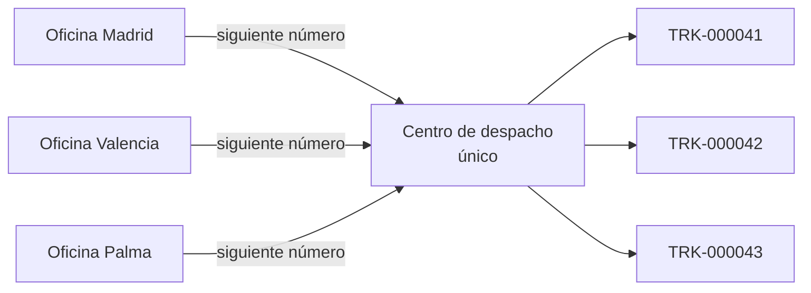
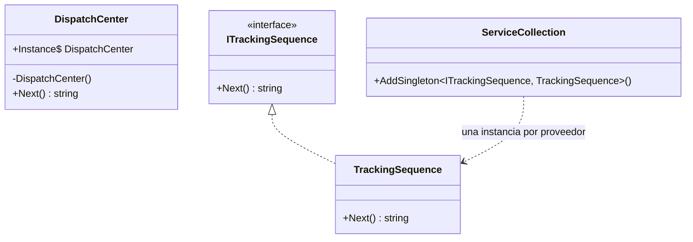

# Singleton

**Creacional.** Garantizar que una clase tiene **una sola instancia** en todo el proceso y dar un punto de acceso global a ella.

Mismo dominio que el resto de creacionales: logística. El centro de despacho asigna números de seguimiento correlativos; si hubiera dos centros, dos envíos podrían salir con el mismo número. En [refactoring.guru](https://refactoring.guru/es/design-patterns/singleton) el mismo patrón se cuenta con una conexión a base de datos.

Este ejemplo tiene **dos versiones** de la misma pieza, a propósito: la del libro, que en .NET es un contraejemplo, y la que de verdad se escribe hoy.

## Qué hace, en términos de negocio

La misma empresa de logística. Cada envío lleva un número de seguimiento y ese número no puede repetirse: el cliente lo usa para localizar su paquete. Para que no se repita, el contador tiene que ser **uno solo** para toda la empresa; si cada oficina llevara el suyo, dos paquetes podrían salir con el mismo número.

Singleton es esa regla: existe un único centro de despacho y todo el mundo le pide el siguiente número a él. La diferencia entre las dos versiones de este ejemplo está en **quién garantiza que es único**:

- En la versión clásica, el propio centro se declara único y nadie puede crear otro. Es cómodo, pero rígido: en el entorno de pruebas no hay forma de empezar con el contador a cero, y quien usa el centro no dice que lo usa, lo coge de un sitio fijo.
- En la versión moderna, el centro es una pieza normal y es quien **monta la aplicación** quien decide que haya una sola copia. Mismo resultado en producción, pero en pruebas se puede montar un centro nuevo cada vez.

Quién gana: operaciones, porque los números no se repiten; y quien prueba el sistema, si se usa la versión moderna, porque puede arrancar cada prueba con un contador limpio.

## Estructura

| Rol | Versión clásica | Versión .NET |
|---|---|---|
| Singleton | `DispatchCenter` (constructor privado, `Lazy<T>`, `static Instance`) | `TrackingSequence` (clase normal) |
| Quién garantiza la unicidad | La propia clase | El contenedor: `AddSingleton<ITrackingSequence, TrackingSequence>()` |
| Cómo se accede | `DispatchCenter.Instance` | Se inyecta `ITrackingSequence` |

Ambas generan el mismo número con la misma lógica (`Interlocked.Increment` para que dos hilos no obtengan el mismo). Solo cambia dónde vive la decisión de "una sola".

## Decisiones

**Dos versiones en el mismo ejemplo.**
Problema: el patrón del libro hay que conocerlo (aparece en bases de código antiguas y en entrevistas), pero escribirlo hoy en .NET es un error documentado en el README de la categoría.
Alternativa descartada: implementar solo la versión DI y contar la clásica en prosa. Sin código, la comparación no se puede probar con tests.
Qué se gana: los tests enseñan la diferencia. `TrackingSequence` tiene un test que arranca en `TRK-000001`; `DispatchCenter` no puede tenerlo, porque su contador es global al proceso y depende de qué tests corrieron antes.

**`Lazy<T>` en la versión clásica.**
Problema: la inicialización perezosa y segura entre hilos a mano (`lock` + doble comprobación) es ruido y fácil de escribir mal.
Alternativa descartada: campo `static readonly` inicializado directamente. Es igual de seguro y más corto, pero no es perezoso y oculta que la BCL ya resuelve el caso general.
Qué se gana: una línea, seguridad entre hilos garantizada por la BCL, y el patrón reconocible.

**`DispatchCenter` no implementa `ITrackingSequence`.**
Problema: tentador para que el cliente pudiera usar cualquiera de las dos.
Alternativa descartada: implementarla. Si se pudiera inyectar, la versión clásica dejaría de ser el contraejemplo: el problema del `static Instance` es justamente que no se inyecta.
Qué se gana: el contraste queda nítido y nadie registra `DispatchCenter.Instance` en el contenedor "por comodidad".

**El paquete de DI solo en el proyecto de tests.**
Problema: la versión .NET necesita un `ServiceCollection` para demostrarse, y la librería `Abstractions` no depende de DI.
Alternativa descartada: una extensión `AddDispatchCenter()` en la librería. Tres líneas que arrastran un paquete a todo el proyecto.
Qué se gana: la librería sigue sin dependencias nuevas; el registro, que en una aplicación real es código de arranque, vive en el test que lo demuestra.

## Cuándo usarlo

- Casi nunca como patrón de clase. La necesidad real (una instancia compartida: caché, contador, cliente HTTP, conexión) se cubre con `AddSingleton` en el contenedor.
- La versión clásica solo cuando no hay contenedor: una herramienta de consola mínima, un analizador de Roslyn, código que se carga por reflexión.

## Cuándo no usarlo

- Cuando hay inyección de dependencias disponible, que en .NET moderno es siempre. `static Instance` oculta la dependencia, impide sustituirla en tests y acopla a todos los consumidores a una clase concreta.
- Como forma de "variable global con nombre bonito". Si el estado es mutable y global, el problema es el estado, no cómo se accede a él.

## Tests

`DispatchCenterTests`: `Instance` devuelve siempre el mismo objeto y su contador avanza entre llamadas; `TrackingSequence` arranca en uno en cada instancia nueva; registrada con `AddSingleton`, dos ámbitos distintos del contenedor reciben la misma instancia.
