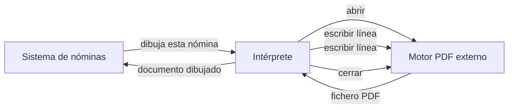
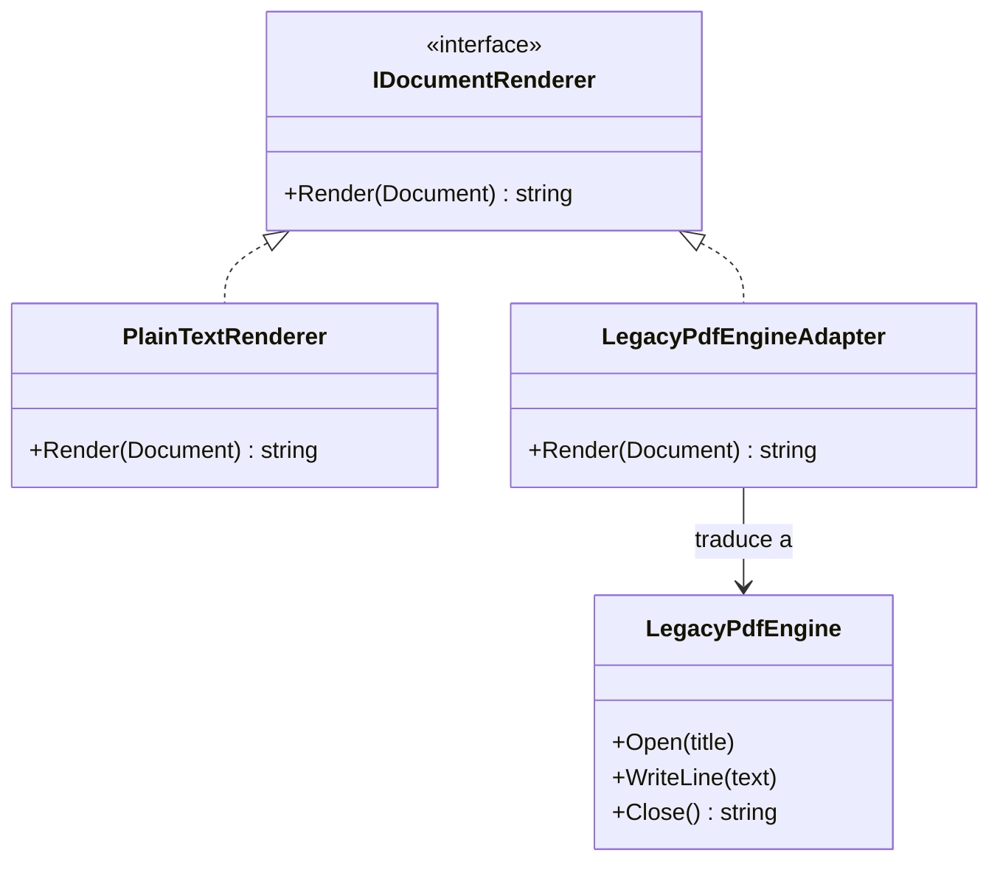

# Adapter

**Estructural.** Hacer que una clase con una interfaz incompatible se pueda usar donde se espera otra, envolviéndola en un traductor.

Dominio común de los estructurales: documentos (nóminas, informes). Nuestro código dibuja documentos con una sola llamada; un motor PDF de terceros exige abrir, escribir línea a línea y cerrar. En [refactoring.guru](https://refactoring.guru/es/design-patterns/adapter) el mismo patrón se cuenta con datos XML y una librería que solo acepta JSON.

## Qué hace, en términos de negocio

Una empresa genera nóminas e informes. El sistema sabe pedir "dibuja este documento" y le da igual quién lo dibuje: hay una pieza que lo saca en texto plano y mañana puede haber otra que lo saque en HTML. Se contrata un motor PDF externo, que es bueno, pero trabaja a su manera: hay que abrirlo, dictarle las líneas una a una y cerrarlo para que entregue el fichero.

Adapter es el **intérprete** que se pone en medio: recibe la petición "dibuja este documento" tal como la hace el sistema, y la traduce a la secuencia que entiende el motor externo. El sistema no cambia ni una línea; el motor externo tampoco, que no es nuestro. Si el proveedor se sustituye, se cambia el intérprete.

Quién gana: quien integra proveedores, porque un cambio de motor no toca el resto del sistema; y quien mantiene el sistema, porque sigue habiendo una sola forma de pedir un documento.

## Estructura

| Rol | Tipo |
|---|---|
| Target | `Interfaces/IDocumentRenderer` |
| Adaptee | `Adaptees/LegacyPdfEngine` (simula una librería ajena) |
| Adapter | `Adapters/LegacyPdfEngineAdapter` |
| Implementación nativa, para comparar | `Renderers/PlainTextRenderer` |

El adaptador recibe el motor por constructor y traduce una llamada `Render` en `Open`, n `WriteLine` y `Close`. El cliente solo conoce `IDocumentRenderer`.

## Decisiones

**Adapter de objeto (composición), no de clase (herencia).**
Problema: el libro describe las dos variantes; la de clase hereda del adaptee e implementa el target.
Alternativa descartada: `class LegacyPdfEngineAdapter : LegacyPdfEngine, IDocumentRenderer`. Expone al cliente la API del motor (`Open`, `Close`) y exige que la librería ajena no sea `sealed`, que no controlamos.
Qué se gana: el cliente ve solo `Render`; el motor se inyecta y se puede sustituir por otro en tests.

**El adaptee es stateful a propósito.**
Problema: si la librería ajena tuviera también un método de una llamada, el adaptador sería un simple renombrado y el patrón no se vería.
Alternativa descartada: un adaptee con una sola llamada y nombres distintos.
Qué se gana: el adaptador tiene algo que traducir (una llamada en una secuencia), y el test de "cada `Render` empieza un documento nuevo" demuestra que la traducción oculta el estado del motor.

## Cuándo usarlo

- Una librería o servicio ajeno hace lo que necesitas pero con otra forma: nombres, orden de llamadas, tipos de datos.
- Quieres que el código existente use algo nuevo sin tocar ni el existente ni lo nuevo.
- Varias implementaciones de una interfaz y una de ellas viene de fuera.

## Cuándo no usarlo

- Controlas las dos partes: cambia una de ellas y ahórrate la capa.
- La "traducción" añade comportamiento (caché, validación, logging): eso es [Decorator](../Decorator/README.md) o [Proxy](../Proxy/README.md), que mantienen la misma interfaz a ambos lados.
- Las interfaces difieren en semántica y no solo en forma: entonces hace falta una capa de dominio, no un adaptador.

## Tests

`DocumentRendererTests`: el renderer nativo devuelve título y líneas; el adaptador devuelve lo que produce el motor; y cada `Render` del adaptador empieza un documento limpio aunque el motor conserve estado.
