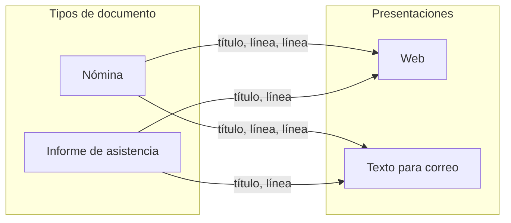
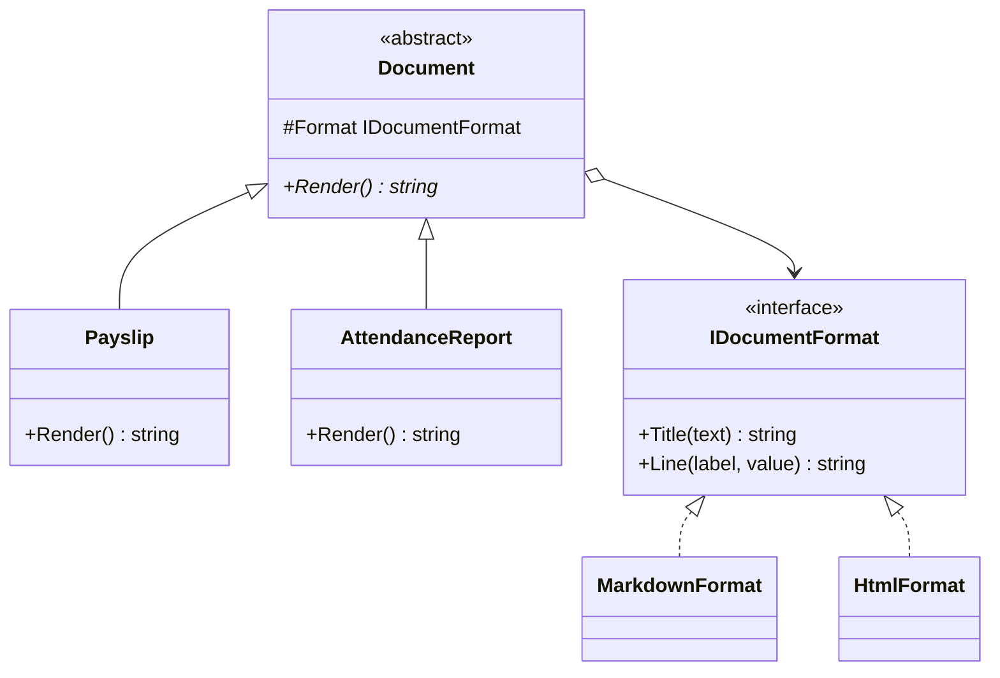

# Bridge

**Estructural.** Separar una abstracción de su implementación para que las dos puedan variar por separado, sustituyendo la herencia por composición.

Dominio común de los estructurales: documentos. Hay varios **tipos de documento** (nómina, informe de asistencia) y varios **formatos de salida** (Markdown, HTML). Sin el patrón, cada combinación es una clase. En [refactoring.guru](https://refactoring.guru/es/design-patterns/bridge) el mismo patrón se cuenta con mandos a distancia y dispositivos.

## Qué hace, en términos de negocio

La misma empresa de documentos. Hoy produce nóminas e informes de asistencia, y cada uno puede salir en dos presentaciones: una para la web y otra para enviar por correo en texto. Mañana aparecerá un tercer tipo de documento (certificado de retenciones) y una tercera presentación (PDF). Si cada combinación se preparase a mano, con tres tipos y tres presentaciones habría nueve plantillas que mantener, y cada corrección en una presentación habría que repetirla en tres sitios.

Bridge separa las dos preguntas. **Qué dice** el documento (título, importes, horas) lo decide el tipo de documento. **Cómo se pinta** cada cosa (un título, una línea con etiqueta y valor) lo decide la presentación. El documento le va dictando a la presentación "esto es un título", "esto es una línea", y la presentación lo dibuja a su manera. Añadir un tipo de documento es una pieza nueva; añadir una presentación, otra; y todas las combinaciones salen solas.

Quién gana: quien añade documentos o presentaciones, porque hace una pieza y no una por combinación; y quien corrige un detalle visual, porque lo arregla en la presentación y todos los documentos lo heredan.

## Estructura

| Rol | Tipo |
|---|---|
| Abstraction | `Abstracts/Document` |
| Refined abstractions | `Documents/Payslip`, `Documents/AttendanceReport` |
| Implementor | `Interfaces/IDocumentFormat` |
| Concrete implementors | `Formats/MarkdownFormat`, `Formats/HtmlFormat` |

Dos tipos por dos formatos son cuatro combinaciones con cuatro clases, no cuatro subclases. El tercer formato cuesta una clase y funciona con todos los documentos ya escritos.

## Decisiones

**El implementor ofrece primitivas, no `Render(document)`.**
Problema: si `IDocumentFormat` tuviera `Render(Payslip)` y `Render(AttendanceReport)`, cada formato nuevo tendría que conocer todos los documentos y cada documento nuevo obligaría a tocar todos los formatos. Eso no es Bridge, es la explosión que intenta evitar.
Alternativa descartada: un método por tipo de documento en el formato.
Qué se gana: el formato solo sabe pintar un título y una línea; los documentos componen esas primitivas. Los dos ejes son de verdad independientes.

**El formato se pasa por constructor y se expone como propiedad protegida.**
Problema: las subclases necesitan el formato y nadie más.
Alternativa descartada: campo público, o pasar el formato en cada llamada a `Render(format)`. Lo segundo funciona pero convierte el patrón en Strategy: la implementación dejaría de ser parte de la identidad del objeto.
Qué se gana: una nómina en HTML es un objeto concreto que se puede guardar y pasar; el formato se fija al construir y la jerarquía de documentos no lo repite en cada método.

## Cuándo usarlo

- Una jerarquía crece en dos dimensiones y empiezas a ver nombres compuestos (`HtmlPayslip`, `MarkdownAttendanceReport`).
- Quieres cambiar la implementación en tiempo de ejecución o elegirla por configuración.
- Varias abstracciones comparten el mismo conjunto de operaciones primitivas de bajo nivel.

## Cuándo no usarlo

- Solo hay un eje de variación: una interfaz y sus implementaciones bastan ([Strategy](../../../README.md#notifications-strategy-with-per-tenant-fan-out) si se elige por comportamiento).
- Las "primitivas" son distintas para cada documento: entonces no hay un implementor común y forzarlo produce una interfaz enorme.
- En .NET con DI, si la abstracción no tiene jerarquía propia (solo una clase que recibe `IDocumentFormat`), eso ya es inyección de dependencias normal; el patrón aporta cuando los dos lados tienen varias clases.

## Tests

`DocumentTests`: la misma nómina sale en Markdown y en HTML cambiando solo el formato, y un segundo tipo de documento usa el formato HTML sin que haya una clase para esa combinación.
