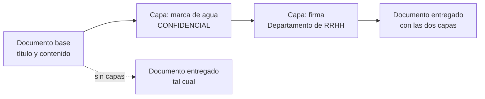
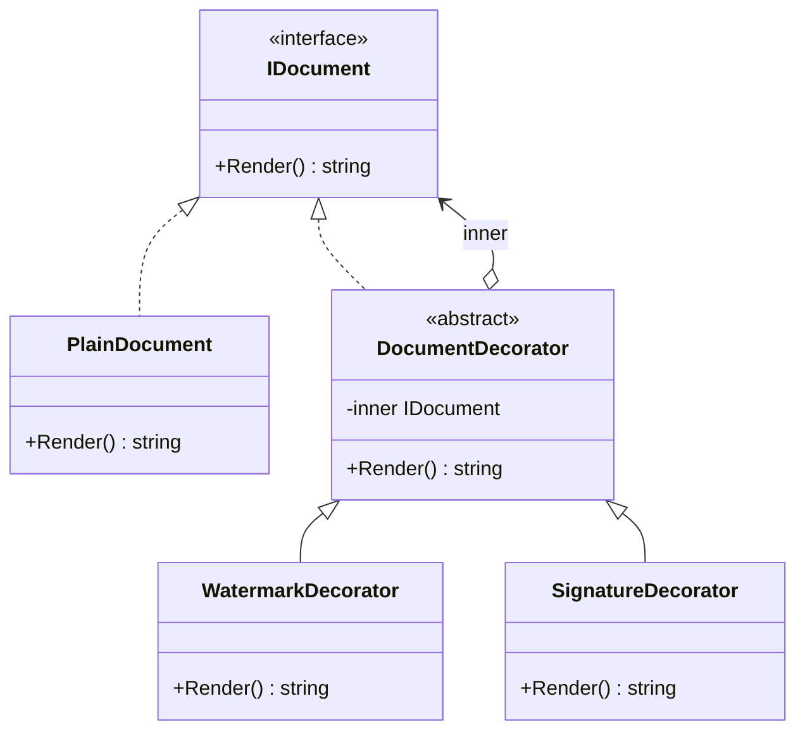

# Decorator

**Estructural.** Añadir responsabilidades a un objeto envolviéndolo en otro que tiene la misma interfaz, de forma que los extras se combinan en tiempo de ejecución sin crear una subclase por combinación.

Dominio común de los estructurales: documentos. Una nómina a veces lleva marca de agua, a veces firma, a veces las dos, a veces nada. En [refactoring.guru](https://refactoring.guru/es/design-patterns/decorator) el mismo patrón se cuenta con notificaciones que se envían por varios canales a la vez.

## Qué hace, en términos de negocio

La misma empresa de documentos. Un documento base es siempre el mismo: título y contenido. Pero según a quién va y para qué, se le añaden cosas: la marca "CONFIDENCIAL" si va fuera de la empresa, la firma del departamento si tiene valor legal, un pie con la fecha de impresión. Las combinaciones crecen rápido: con tres extras opcionales hay ocho variantes posibles, y preparar una plantilla por variante es inviable.

Decorator trata cada extra como una **capa** que se pone encima del documento. Cada capa recibe el documento tal como viene, le añade lo suyo y lo entrega igual que lo recibió, así que encima se puede poner otra capa. El documento base no sabe que lo han envuelto; quien lo recibe tampoco distingue un documento con tres capas de uno sin ninguna. Se eligen las capas al vuelo, por documento, y el orden en que se ponen es el orden en que se ven.

Quién gana: quien prepara documentos, porque combina extras en lugar de elegir entre plantillas; y quien añade un extra nuevo, porque hace una capa y encaja con todas las demás.

## Estructura

| Rol | Tipo |
|---|---|
| Component | `Interfaces/IDocument` |
| Concrete component | `PlainDocument` |
| Base decorator | `Abstracts/DocumentDecorator` |
| Concrete decorators | `Decorators/WatermarkDecorator`, `Decorators/SignatureDecorator` |

Cada decorador llama a `base.Render()` (que delega en el interior) y añade lo suyo. El orden de anidamiento es el orden del resultado: el más interno aparece primero.

## Decisiones

**Base abstracta que reenvía por defecto.**
Problema: cada decorador tiene que guardar el interior y reenviar lo que no cambia; con una interfaz de un método parece poca cosa, pero con cinco métodos cada decorador repetiría cinco reenvíos.
Alternativa descartada: cada decorador implementa `IDocument` directamente y guarda su propio campo.
Qué se gana: un decorador escribe solo lo que añade; si la interfaz crece, el reenvío se escribe una vez en la base. Es la forma del libro y la de `DelegatingHandler` en .NET.

**Los decoradores añaden al final, y el orden importa.**
Problema: si cada capa escribiera en un sitio distinto del documento, el orden de anidamiento no se vería y el patrón parecería un conjunto de flags.
Alternativa descartada: una lista de extras en `PlainDocument` con un bucle. Funciona, pero entonces el componente conoce todos los extras y añadir uno obliga a tocarlo.
Qué se gana: el test de apilado demuestra que firma-sobre-marca-de-agua y marca-de-agua-sobre-firma son documentos distintos, que es la propiedad que distingue Decorator de una configuración.

## Cuándo usarlo

- Extras opcionales y combinables sobre un objeto, elegidos en tiempo de ejecución.
- No puedes o no quieres heredar: la clase es `sealed`, viene de fuera, o la combinatoria de subclases es inviable.
- Comportamiento transversal sobre una interfaz existente: logging, caché, reintentos, métricas. En .NET es `DelegatingHandler`, los `IPipelineBehavior` de MediatR, los middlewares.

## Cuándo no usarlo

- El extra cambia la interfaz: eso es [Adapter](../Adapter/README.md).
- El envoltorio no añade comportamiento sino que controla el acceso (carga perezosa, permisos, caché del objeto entero): misma estructura, pero la intención es [Proxy](../Proxy/README.md).
- Solo hay un extra y siempre está: ponlo en la clase.
- El orden de las capas tiene reglas complejas (A siempre antes que B): el patrón las deja en manos de quien compone, y eso puede ser una trampa. Documenta el orden o encapsula la composición en una fábrica.

## Tests

`DocumentDecoratorTests`: el documento base devuelve título y cuerpo; la marca de agua se añade al interior; y dos decoradores apilados aplican del más interno al más externo.
