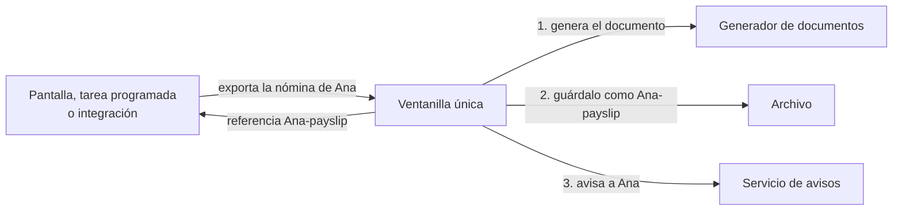
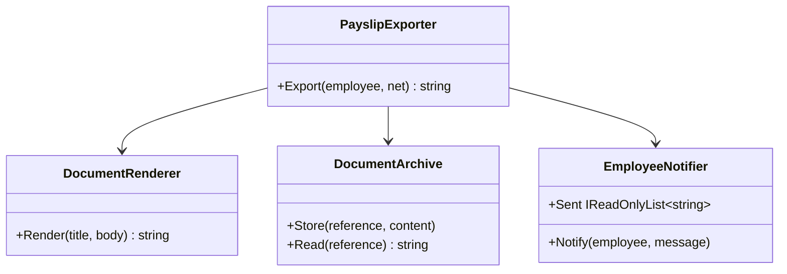

# Facade

**Estructural.** Dar una interfaz simple a un subsistema complejo: una sola entrada que orquesta varias piezas para una operación de negocio, sin que quien llama conozca las piezas.

Dominio común de los estructurales: documentos. Exportar una nómina es dibujarla, archivarla y avisar a la persona; tres servicios y un orden. En [refactoring.guru](https://refactoring.guru/es/design-patterns/facade) el mismo patrón se cuenta con una librería de conversión de vídeo.

## Qué hace, en términos de negocio

La misma empresa de documentos. "Exportar la nómina de Ana" parece una cosa, pero por dentro son tres: generar el documento, guardarlo en el archivo con una referencia y avisar a Ana de que ya lo tiene. Si cada pantalla, cada tarea programada y cada integración tuviera que recordar los tres pasos y su orden, antes o después alguien archivaría sin avisar o avisaría sin archivar.

Facade es la **ventanilla única**: se le pide "exporta la nómina de Ana con este neto" y ella habla con el generador, con el archivo y con el servicio de avisos en el orden correcto. Quien pide no ve las tres piezas ni tiene que saber que existen. Si mañana el aviso pasa a ser por otro canal, o se añade un cuarto paso (registrar la exportación para auditoría), se cambia en la ventanilla y todos los que la usan lo heredan sin enterarse.

Quién gana: quien usa la operación, porque pide una cosa y recibe una referencia; y quien mantiene el proceso, porque los pasos y su orden viven en un solo sitio.

## Estructura

| Rol | Tipo |
|---|---|
| Facade | `PayslipExporter` |
| Subsystem | `Services/DocumentRenderer`, `Services/DocumentArchive`, `Services/EmployeeNotifier` |

La fachada recibe los servicios por constructor y expone una operación de negocio. Los servicios siguen siendo públicos: quien necesite algo que la fachada no ofrece puede usarlos directamente.

## Decisiones

**Los servicios del subsistema son clases concretas, sin interfaces.**
Problema: el patrón trata de esconder el subsistema, no de abstraerlo; cada interfaz añadida sería ruido que no demuestra nada.
Alternativa descartada: `IDocumentRenderer`, `IDocumentArchive`, `IEmployeeNotifier` con sus implementaciones. En una aplicación real con DI probablemente existirían, pero por otros motivos (sustituir en tests, varias implementaciones), no por la fachada.
Qué se gana: el ejemplo muestra lo esencial: una clase que orquesta tres. Los tests usan los servicios reales y leen de ellos (`archive.Read`, `notifier.Sent`), sin mocks.

**La fachada devuelve la referencia del archivo.**
Problema: una operación que solo tiene efectos secundarios es difícil de usar y de probar.
Alternativa descartada: `void Export(...)`.
Qué se gana: quien llama recibe algo que puede guardar o mostrar, y el test más simple no necesita mirar dentro del subsistema.

**El subsistema sigue siendo accesible.**
Problema: la tentación de hacer los servicios `internal` para "forzar" el paso por la fachada.
Alternativa descartada: ocultarlos. Facade no es un muro; es un atajo para el caso común.
Qué se gana: quien necesita leer un documento archivado usa `DocumentArchive` directamente, sin que la fachada tenga que crecer con cada necesidad puntual.

## Cuándo usarlo

- Una operación de negocio toca varios servicios en un orden que hay que respetar.
- Quieres que el código cliente dependa de una pieza en lugar de cinco, y que el subsistema pueda cambiar por dentro.
- Integras una librería con una API extensa y solo usas un par de flujos: la fachada es "la librería tal como la usamos nosotros".

## Cuándo no usarlo

- Solo hay un servicio detrás: la fachada es un reenvío sin valor. Eso sí puede ser [Adapter](../Adapter/README.md) si la interfaz cambia, o nada si no.
- La fachada empieza a tener lógica de negocio propia (reglas, validaciones, estado): ya no es una fachada, es un servicio de dominio, y merece sus propios tests y nombre.
- Crece hasta ofrecer todo lo que ofrece el subsistema: una "god class". Varias fachadas pequeñas por caso de uso, en lugar de una enorme.

## Tests

`PayslipExporterTests`: exportar deja el documento generado en el archivo bajo la referencia esperada, envía exactamente un aviso a la persona y devuelve la referencia.
