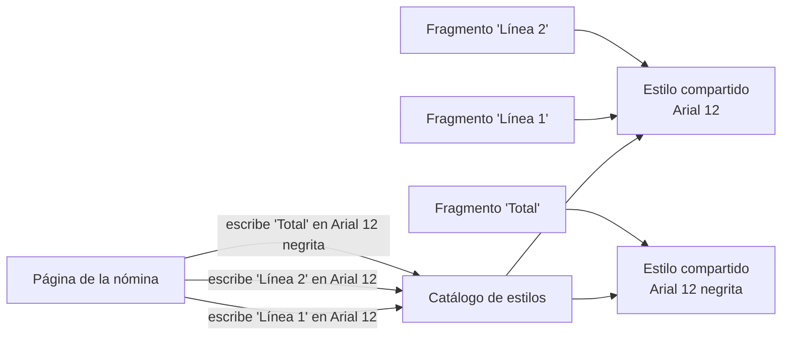
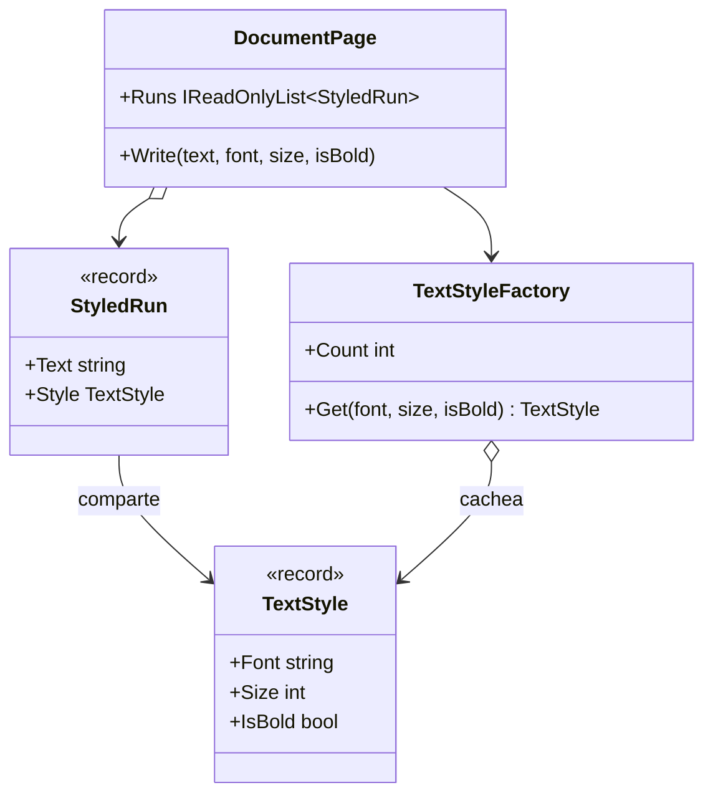

# Flyweight

**Estructural.** Compartir entre muchos objetos la parte de su estado que se repite (intrínseca), dejando fuera la parte que cambia en cada uno (extrínseca), para que miles de objetos quepan en la memoria de unos pocos.

Dominio común de los estructurales: documentos. Una página tiene miles de fragmentos de texto, pero solo dos o tres estilos distintos (fuente, tamaño, negrita). En [refactoring.guru](https://refactoring.guru/es/design-patterns/flyweight) el mismo patrón se cuenta con las partículas de un videojuego.

## Qué hace, en términos de negocio

La misma empresa de documentos. Cada nómina tiene cientos de fragmentos de texto y cada fragmento sabe cómo pintarse: con qué letra, a qué tamaño, si en negrita. Si cada fragmento guarda su propia copia de "Arial, 12, normal", una página de mil fragmentos guarda mil veces lo mismo. Con miles de nóminas al mes, eso es memoria y tiempo tirados en repetir tres datos.

Flyweight separa lo que se repite de lo que no. El **estilo** (letra, tamaño, negrita) es igual para muchos fragmentos, así que existe una sola vez y todos los fragmentos que lo usan apuntan a él. El **texto** es distinto en cada fragmento y se queda en el fragmento. Un **catálogo de estilos** se encarga de que, cuando alguien pide "Arial, 12, normal", reciba el que ya existe en lugar de uno nuevo. Mil fragmentos con dos estilos son mil textos y dos estilos, no mil de cada.

Quién gana: operaciones, porque generar miles de documentos consume una fracción de la memoria; y nadie pierde, porque quien escribe en la página sigue pidiendo "este texto con este estilo" sin saber que el estilo se comparte.

## Estructura

| Rol | Tipo |
|---|---|
| Flyweight (estado intrínseco) | `TextStyle` |
| Contexto (estado extrínseco + referencia) | `StyledRun` |
| Flyweight factory | `TextStyleFactory` |
| Client | `DocumentPage` |

`DocumentPage` nunca hace `new TextStyle`; siempre pasa por la fábrica, que devuelve la instancia ya existente si la hay.

## Decisiones

**El flyweight es un `record` inmutable.**
Problema: compartir una instancia entre miles de objetos solo es seguro si nadie puede cambiarla; un `IsBold` mutable en un estilo compartido pondría en negrita media página.
Alternativa descartada: clase con propiedades `init` y `Equals` a mano. El `record` da la inmutabilidad y la igualdad por valor sin escribir nada.
Qué se gana: seguridad gratis y, de regalo, la igualdad por valor que la fábrica necesita como clave del diccionario.

**La fábrica usa el propio flyweight como clave.**
Problema: hace falta una clave que identifique "mismo estilo"; lo típico es un `string` concatenado o una tupla.
Alternativa descartada: `Dictionary<string, TextStyle>` con clave `$"{font}|{size}|{isBold}"`. Funciona, pero inventa un formato que hay que mantener en paralelo a los campos.
Qué se gana: `Dictionary<TextStyle, TextStyle>` reutiliza la igualdad del record; añadir un campo al estilo no obliga a tocar la fábrica.

**El test mide instancias, no memoria.**
Problema: la promesa del patrón es ahorrar memoria, pero medir bytes en un test unitario es frágil.
Alternativa descartada: `GC.GetTotalMemory` antes y después.
Qué se gana: `Count` de la fábrica tras mil escrituras con dos estilos vale dos, de forma determinista. El ahorro real se mide con BenchmarkDotNet cuando haga falta, no en un test.

## Cuándo usarlo

- Hay una cantidad enorme de objetos y la memoria lo nota (medido, no supuesto).
- Una parte del estado se repite entre muchos objetos y es inmutable o se puede hacer inmutable.
- La parte que varía se puede sacar fuera y pasar en cada operación o guardar en un objeto de contexto ligero.

## Cuándo no usarlo

- No hay problema de memoria medido. El patrón complica el código a cambio de un ahorro que quizá no exista; mide primero.
- El estado "compartido" cambia: entonces no es intrínseco y compartirlo es un bug.
- En .NET el runtime ya lo hace por ti en los casos comunes: `string.Intern`, los `bool` y enteros pequeños en caja, `ArrayPool<T>`, `Enum` cacheados. Escribir un flyweight a mano solo compensa para tipos propios.

## Tests

`TextStyleFactoryTests`: la fábrica devuelve la misma instancia para el mismo estilo y otra para uno distinto; una página con mil fragmentos y dos estilos deja dos instancias en la fábrica; y el texto vive en el fragmento, fuera del estilo compartido.
