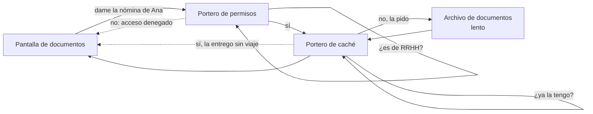
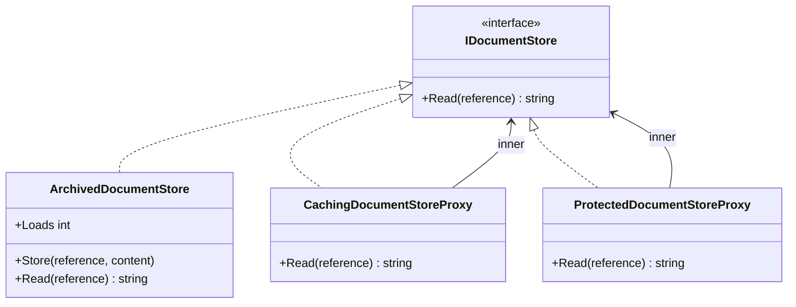

# Proxy

**Estructural.** Poner un sustituto delante de un objeto, con su misma interfaz, para controlar el acceso a él: evitar llamadas caras, exigir permisos, cargar perezosamente, registrar.

Dominio común de los estructurales: documentos. El archivo de documentos es lento y contiene nóminas; hay que evitar leer dos veces lo mismo y que lo lea quien no debe. En [refactoring.guru](https://refactoring.guru/es/design-patterns/proxy) el mismo patrón se cuenta con una caché delante de una librería de vídeo.

## Qué hace, en términos de negocio

La misma empresa de documentos. El archivo donde se guardan las nóminas es la pieza lenta del sistema: cada lectura es un viaje. Y es la pieza delicada: una nómina solo la puede ver RRHH. Si cada pantalla que muestra documentos tuviera que recordar "no pidas dos veces lo mismo" y "comprueba antes el rol", alguna se olvidaría.

Proxy pone un **portero** delante del archivo. El portero se presenta igual que el archivo, así que quien pide un documento no distingue si habla con el archivo o con el portero. Pero el portero decide: si el documento ya se pidió antes, lo entrega sin molestar al archivo; si quien pide no es de RRHH, no le deja pasar. El archivo no cambia y las pantallas tampoco; se añade el portero entre medias y se puede poner más de uno en fila, uno para la caché y otro para los permisos.

Quién gana: operaciones, porque el archivo recibe una fracción de las lecturas; y cumplimiento, porque la regla de quién puede leer una nómina vive en un sitio y nadie puede saltársela por descuido.

## Estructura

| Rol | Tipo |
|---|---|
| Subject | `Interfaces/IDocumentStore` |
| Real subject | `Stores/ArchivedDocumentStore` |
| Proxies | `Proxies/CachingDocumentStoreProxy` (caché), `Proxies/ProtectedDocumentStoreProxy` (permisos) |

Los dos proxies reciben un `IDocumentStore` interior, así que se encadenan: `new ProtectedDocumentStoreProxy(new CachingDocumentStoreProxy(archive), role)`.

## Proxy frente a Decorator

La estructura es la misma que en [Decorator](../Decorator/README.md): una interfaz, un interior, un envoltorio que delega. La diferencia es la intención y se nota en qué hace el envoltorio con la llamada:

| | Decorator | Proxy |
|---|---|---|
| Qué hace con la llamada | Siempre la pasa al interior y añade algo al resultado | Decide **si** la pasa: la sirve de caché, la rechaza, la retrasa |
| Quién compone | El cliente elige las capas al vuelo | Suele estar fijado en la configuración; el cliente ni sabe que hay proxy |
| Ejemplo aquí | Marca de agua, firma | Caché, control de acceso |

## Decisiones

**Dos proxies con intenciones distintas.**
Problema: un solo proxy de caché se confunde con un decorador que "añade memoria".
Alternativa descartada: solo el de caché.
Qué se gana: el de permisos deja claro lo que un decorador nunca hace, no llamar al interior; y los dos juntos muestran que se encadenan sobre la misma interfaz.

**El sujeto real expone `Loads`.**
Problema: la promesa del proxy de caché es ahorrar viajes; sin un contador, el test solo podría comprobar que devuelve el documento, cosa que el archivo a secas también cumple.
Alternativa descartada: un mock del `IDocumentStore` contando llamadas. Funciona, pero un contador en el sujeto real es más corto y no añade librería.
Qué se gana: el test de "carga una vez" es una línea y usa el objeto real.

**El rol se pasa al construir el proxy, no en cada `Read`.**
Problema: `Read(reference, role)` cambiaría la interfaz, y entonces el proxy dejaría de ser transparente para el cliente.
Alternativa descartada: añadir el rol a `IDocumentStore`.
Qué se gana: la interfaz no cambia; en una aplicación real el rol vendría del contexto de la petición inyectado en el proxy, exactamente como aquí.

## Cuándo usarlo

- El objeto real es caro (remoto, lento, grande) y no siempre hace falta llamarlo: caché, carga perezosa.
- Hay que controlar quién o cuándo accede: permisos, cuotas, horarios.
- Quieres añadir registro, métricas o reintentos sin tocar el objeto ni los clientes. En .NET: `DelegatingHandler`, `IPipelineBehavior`, los proxies de Entity Framework para lazy loading, los clientes generados por gRPC.

## Cuándo no usarlo

- El envoltorio siempre llama al interior y añade algo al resultado: eso es [Decorator](../Decorator/README.md), y conviene llamarlo así.
- Cambia la interfaz: [Adapter](../Adapter/README.md).
- La caché o los permisos son transversales a muchos servicios: un proxy por servicio se multiplica; busca un mecanismo del framework (middleware, atributo, behavior) antes que escribir treinta proxies.

## Tests

`DocumentStoreProxyTests`: el proxy de caché devuelve el documento y solo carga del archivo una vez aunque se lea dos; el de permisos deja pasar a RRHH y lanza `UnauthorizedAccessException` para cualquier otro rol.
