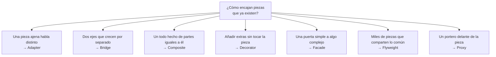
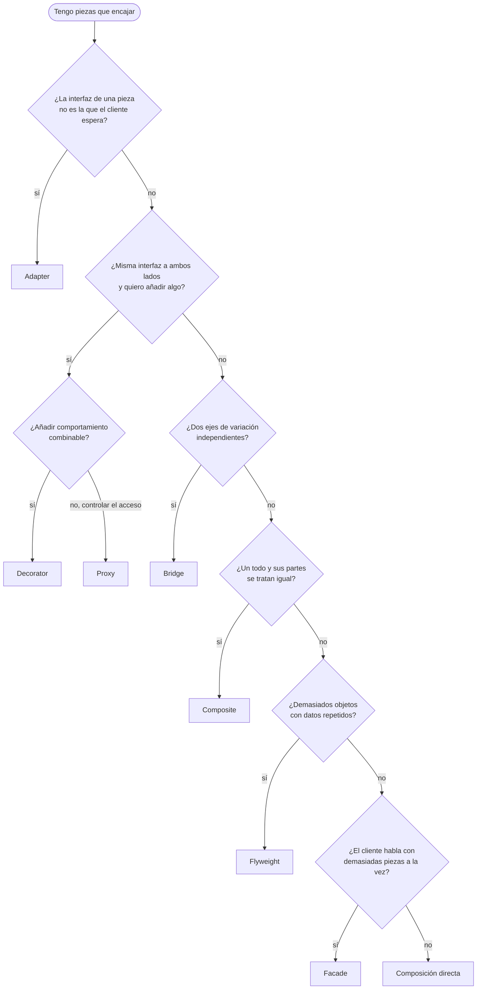
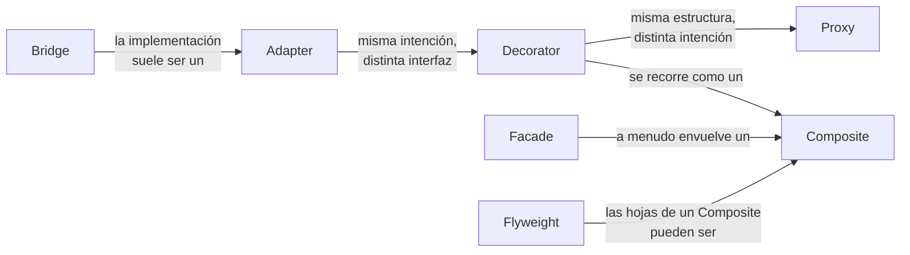

# Patrones estructurales

Seis de los siete ejemplos comparten un dominio, **documentos** (nóminas, informes, su generación y entrega), para que se vea cómo cada patrón coloca las piezas de forma distinta sobre los mismos tipos. Composite es anterior y vive en [`Military/`](../../../README.md#military-composite) con su propio dominio.

## Qué hace, en términos de negocio

Los patrones estructurales responden a otra pregunta de organización: **¿cómo encajan piezas que ya existen para formar algo mayor, sin reescribirlas?** En una empresa que genera nóminas e informes: un motor PDF externo habla a su manera y hay que entenderse con él; cada tipo de documento tiene que salir en varios formatos sin multiplicar el trabajo; una nómina a veces lleva marca de agua o firma y a veces no; exportar un documento son cinco pasos que nadie debería recordar; miles de documentos comparten los mismos estilos; y un documento archivado no debería descargarse hasta que alguien lo pida de verdad.

Cada patrón de esta carpeta es una respuesta distinta a esa pregunta, con el mismo dominio para que se vea cuándo encaja cada una:

Todos resuelven la misma pregunta: **cómo componer objetos y clases en estructuras mayores manteniéndolas flexibles**. Se diferencian en *qué* relación entre piezas atacan.

| Patrón | Problema que ataca | Señal de que lo necesitas | Estado |
|---|---|---|---|
| [Adapter](Adapter/README.md) | Una clase tiene la funcionalidad pero no la interfaz que el cliente espera | Integras una librería ajena y el código cliente ya existe | hecho |
| [Bridge](Bridge/README.md) | Una jerarquía crece en dos dimensiones a la vez (tipo × plataforma) | Clases como `PdfPayslip`, `HtmlPayslip`, `PdfReport`, `HtmlReport`... | hecho |
| [Composite](../../../README.md#military-composite) | Tratar un objeto y un grupo de objetos con la misma interfaz | Un árbol donde las operaciones se propagan a los hijos | hecho |
| [Decorator](Decorator/README.md) | Añadir responsabilidades a un objeto sin herencia | Combinaciones opcionales de extras (firma, marca de agua, compresión) | hecho |
| [Facade](Facade/README.md) | Un subsistema complejo necesita una entrada simple | El cliente orquesta cinco servicios para una sola operación de negocio | hecho |
| [Flyweight](Flyweight/README.md) | Muchos objetos comparten estado que se repite | Memoria disparada por miles de instancias con los mismos datos intrínsecos | hecho |
| [Proxy](Proxy/README.md) | Controlar el acceso a un objeto: carga perezosa, caché, permisos | El objeto real es caro o remoto y no siempre hace falta | hecho |

## Cómo elegir

## Relaciones entre ellos

- **Adapter vs Decorator vs Proxy**: los tres envuelven un objeto. Adapter cambia la interfaz; Decorator mantiene la interfaz y añade comportamiento; Proxy mantiene la interfaz y controla el acceso. La estructura de Decorator y Proxy es idéntica; la diferencia es la intención.
- **Bridge vs Adapter**: Bridge se diseña de antemano para que dos ejes evolucionen por separado; Adapter se aplica después, a algo que ya existe y no encaja.
- **Facade vs Adapter**: Facade simplifica una interfaz compleja (varios objetos); Adapter traduce una interfaz a otra (un objeto).
- **Composite + Decorator**: ambos se apoyan en recursión sobre la misma interfaz. Composite para estructurar, Decorator para extender.

## Qué cambia en .NET moderno

- **Decorator y Proxy** son el pan de cada día: `DelegatingHandler` en `HttpClient`, los `IPipelineBehavior` de MediatR, los middlewares. Con DI se registran con `Scrutor.Decorate` o a mano.
- **Adapter** aparece cada vez que se envuelve un SDK de terceros tras una interfaz propia para poder sustituirlo en tests.
- **Facade** es cualquier servicio de aplicación que orquesta repositorios y clientes para una operación de negocio.
- **Flyweight** lo hace el runtime por ti con `string.Intern`, los boxed `bool` cacheados y `ArrayPool<T>`; escribirlo a mano solo compensa con medición previa.
- **Bridge** es menos frecuente porque la DI ya inyecta la implementación; sigue siendo útil cuando la abstracción tiene jerarquía propia.
