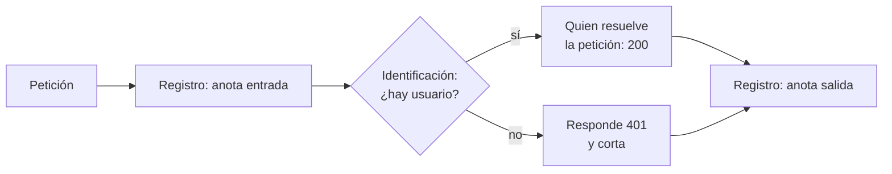
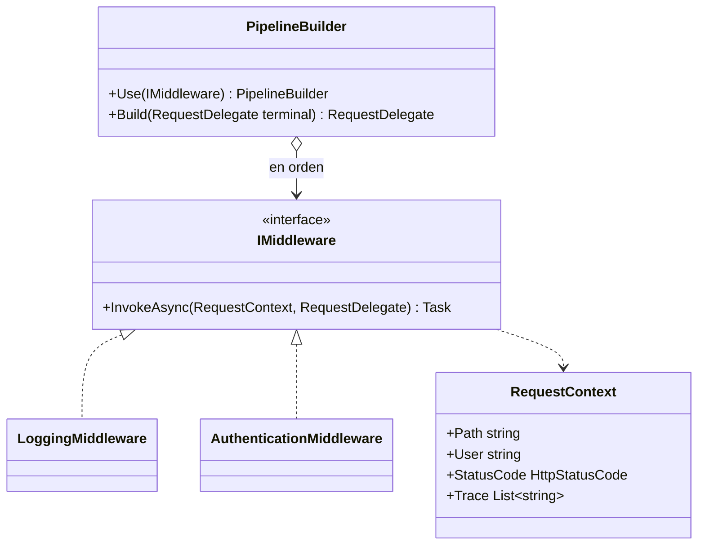
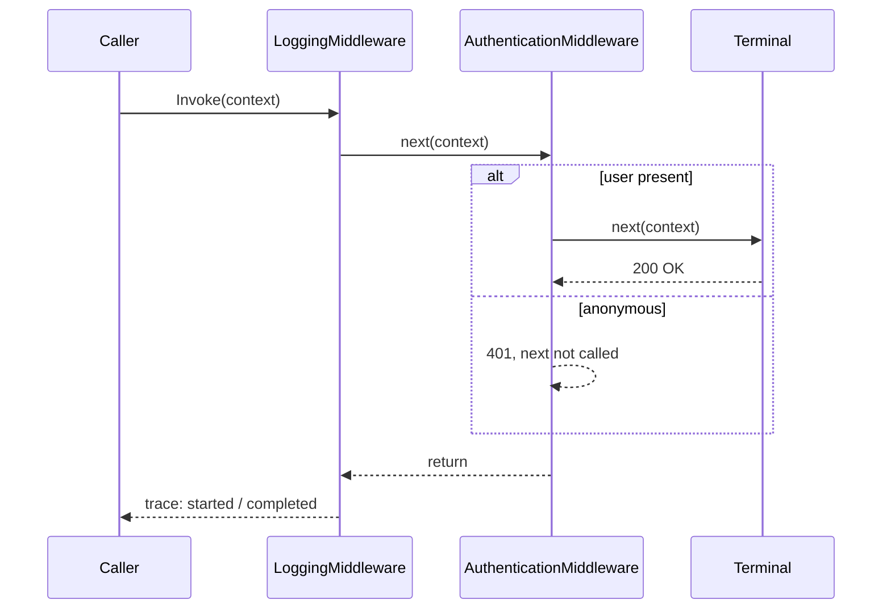

# Chain of Responsibility

**Comportamiento.** Pasar una petición por una cadena de manejadores, donde cada uno decide si la atiende, la transforma, la pasa al siguiente o la detiene.

Este ejemplo es anterior al catálogo y tiene dominio propio: el **pipeline de una petición web**, en la forma que usa ASP.NET Core para los middlewares. En [refactoring.guru](https://refactoring.guru/es/design-patterns/chain-of-responsibility) el mismo patrón se cuenta con un sistema de ayuda contextual.

## Qué hace, en términos de negocio

Cuando una petición llega a un servidor web, antes de llegar a quien la resuelve pasa por una fila de **controles**: uno anota que ha entrado y cuándo sale, otro comprueba que quien la hace está identificado, otro mide tiempos, otro traduce errores. Cada control hace lo suyo y decide si la petición sigue adelante. Si el control de identidad no encuentra usuario, responde "no autorizado" y la petición no llega más lejos; los controles anteriores aún ven la respuesta en el camino de vuelta.

Chain of Responsibility organiza esos controles en una **fila con orden**. Cada control recibe la petición y una forma de llamar al siguiente; puede hacer algo antes, llamar al siguiente, hacer algo después, o no llamarlo y cortar ahí. El orden de la fila es el orden en que actúan: el primero registrado es el más externo y es el último en terminar. Añadir un control es ponerlo en la fila; los demás no se enteran.

Quién gana: quien añade controles, porque los pone en la fila sin tocar los demás; y quien opera, porque el orden de la fila es visible en un solo sitio.

## Estructura

| Rol | Tipo |
|---|---|
| Handler | `Interfaces/IMiddleware` |
| Eslabón | `RequestDelegate` (un `Task` que procesa un `RequestContext`) |
| Concrete handlers | `Middlewares/LoggingMiddleware` (envuelve), `Middlewares/AuthenticationMiddleware` (corta) |
| Constructor de la cadena | `PipelineBuilder` |
| Petición | `RequestContext` |

`Use` acumula y devuelve el propio builder (Fluent Interface); `Build` compone en orden inverso para que el primero registrado sea el más externo. Es lo que hace `IApplicationBuilder`.

## Decisiones

**Cada middleware recibe `next` y decide si lo llama.**
Problema: el libro enlaza cada manejador con el siguiente mediante un campo `successor`; eso acopla a cada manejador con la construcción de la cadena.
Alternativa descartada: `SetNext(handler)` en cada middleware.
Qué se gana: los middlewares no saben quién va después; el builder compone la cadena y ellos solo reciben una función. Misma forma que ASP.NET Core, `DelegatingHandler` y los `IPipelineBehavior` de MediatR.

**Cortar la cadena es no llamar a `next`, nunca lanzar.**
Problema: hay que poder responder sin seguir adelante.
Alternativa descartada: lanzar una excepción que alguien captura arriba. Convierte el flujo normal (un 401) en un error y obliga a un manejador de excepciones en la cadena.
Qué se gana: fijar `StatusCode` y volver. Los middlewares anteriores ven la respuesta en su camino de vuelta, que es donde van métricas y registro.

**Chain of Responsibility, no Decorator.**
Problema: una cadena de objetos con la misma interfaz que se envuelven unos a otros parece [Decorator](../../Structural/Decorator/README.md).
Alternativa descartada: llamarlo Decorator.
Qué se gana: la distinción es que aquí un eslabón puede **no** delegar. El decorador siempre pasa la llamada al interior; el middleware decide.

**`RequestContext` lleva `Trace`.**
Problema: comprobar el orden de ejecución en tests sin mocks.
Alternativa descartada: mocks de `IMiddleware` que registren llamadas.
Qué se gana: los middlewares reales escriben en `Trace` y el test compara la lista. `StatusCode` arranca en 404 como en ASP.NET: si nadie responde, no encontrado.

## Cuándo usarlo

- Varios pasos independientes deben aplicarse a una petición en orden y alguno puede detenerla: autenticación, validación, límites, caché, registro.
- Quieres añadir o quitar pasos por configuración sin tocar los demás.
- Escalado de aprobaciones: la petición sube hasta quien tiene autoridad para resolverla.

## Cuándo no usarlo

- Un solo paso: una llamada.
- Todos los pasos deben ejecutarse siempre y ninguno corta: eso es [Decorator](../../Structural/Decorator/README.md) o una simple lista.
- El orden depende de datos de la petición y no es fijo: una cadena estática no lo expresa; hace falta un enrutador.

## Tests

`PipelineBuilderTests`: sin middlewares la petición va directa al terminal; con usuario los middlewares se ejecutan en orden de registro alrededor del terminal; sin usuario la autenticación responde 401 y el terminal no se ejecuta; y registrar un middleware nulo lanza.
