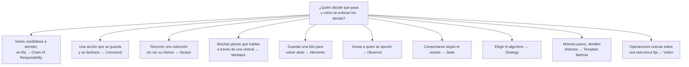
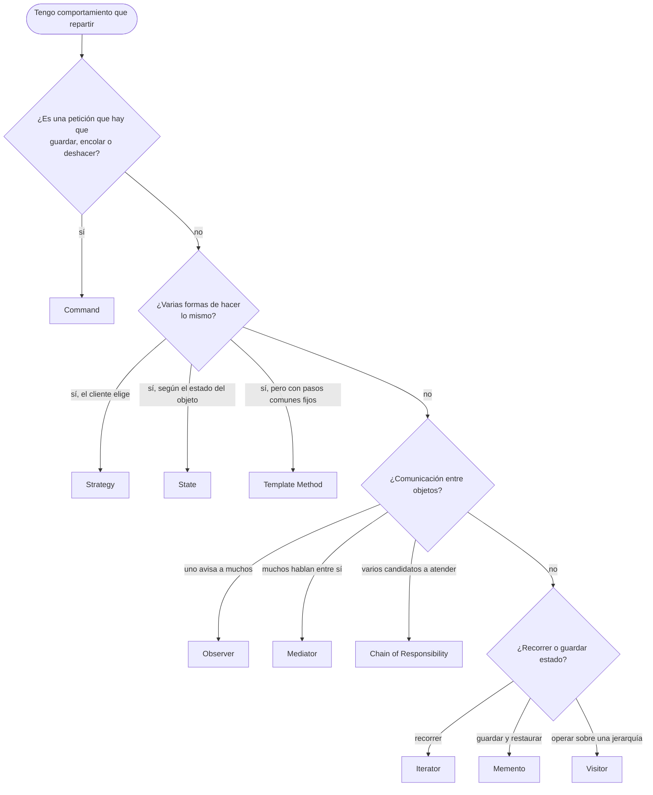
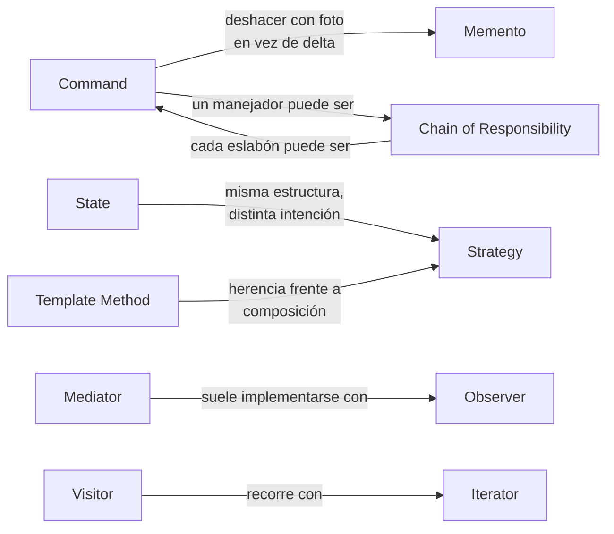

# Patrones de comportamiento

Ocho de los diez ejemplos comparten un dominio, **fichaje y ausencias** (jornadas, solicitudes de vacaciones, aprobaciones), para que se vea cómo cada patrón reparte una misma responsabilidad entre objetos de forma distinta. Chain of Responsibility y Strategy son anteriores y viven en [`ChainOfResponsibility/`](ChainOfResponsibility/README.md) y [`Strategy/`](Strategy/README.md) con dominio propio.

## Qué hace, en términos de negocio

Los patrones de comportamiento responden a una tercera pregunta de organización: **¿quién decide qué pasa, en qué orden, y cómo se enteran los demás?** En una empresa que gestiona jornadas y ausencias: un fichaje equivocado hay que poder deshacerlo; una solicitud de vacaciones pasa por estados y en cada uno se permiten cosas distintas; cuando se aprueba, varias personas y sistemas tienen que enterarse; el cálculo de horas de un mes sigue siempre los mismos pasos aunque cambie el convenio; y sobre el mismo calendario hay que sacar informes muy distintos sin tocar el calendario.

Cada patrón de esta carpeta es una respuesta distinta a esa pregunta, con el mismo dominio para que se vea cuándo encaja cada una:

Todos resuelven la misma pregunta: **cómo repartir responsabilidades y comunicación entre objetos sin acoplarlos**. Se diferencian en *qué* relación de comportamiento atacan.

| Patrón | Problema que ataca | Señal de que lo necesitas | Estado |
|---|---|---|---|
| [Chain of Responsibility](ChainOfResponsibility/README.md) | Varios manejadores posibles y no se sabe cuál atenderá | Middlewares, validaciones encadenadas, escalado de aprobaciones | hecho |
| [Command](Command/README.md) | Una petición debe guardarse, encolarse o deshacerse | Botón de deshacer, cola de operaciones, auditoría de acciones | hecho |
| [Iterator](Iterator/README.md) | Recorrer una colección sin exponer su estructura | Varias formas de recorrer lo mismo (por día, por semana, solo laborables) | hecho |
| [Mediator](Mediator/README.md) | Muchos objetos se hablan entre sí en una maraña | Cada componente conoce a todos los demás | hecho |
| [Memento](Memento/README.md) | Guardar y restaurar el estado de un objeto sin romper su encapsulación | Borradores, puntos de restauración, "volver a como estaba" | hecho |
| [Observer](Observer/README.md) | Varios interesados deben enterarse de un cambio | Notificaciones en cascada tras un evento de negocio | hecho |
| [State](State/README.md) | El comportamiento cambia según el estado interno | `switch` sobre un enum de estado repetido en varios métodos | hecho |
| [Strategy](Strategy/README.md) | Varias formas de hacer lo mismo, elegibles en tiempo de ejecución | `if/else` sobre "tipo de cálculo" | hecho |
| [Template Method](TemplateMethod/README.md) | Un algoritmo con pasos fijos y detalles variables | Clases casi iguales que difieren en dos o tres pasos | hecho |
| [Visitor](Visitor/README.md) | Añadir operaciones a una jerarquía sin modificarla | Cada informe nuevo obliga a tocar todas las clases del modelo | hecho |

## Cómo elegir

## Relaciones entre ellos

- **State vs Strategy**: misma forma (un contexto delega en un objeto intercambiable). En Strategy el cliente elige el algoritmo y los algoritmos no se conocen; en State el propio estado decide el siguiente y el cliente no interviene.
- **Template Method vs Strategy**: los dos varían partes de un algoritmo. Template Method con herencia (la subclase rellena huecos), Strategy con composición (se inyecta el algoritmo entero).
- **Command vs Memento** para deshacer: Command revierte aplicando el cambio inverso (delta); Memento restaura una foto completa. Delta cuando el cambio es pequeño y conocido; foto cuando el estado es complejo.
- **Observer vs Mediator**: Observer es uno-a-muchos y los observadores no se conocen; Mediator es muchos-a-muchos a través de un objeto central que sí conoce a todos.
- **Chain of Responsibility vs Decorator**: misma cadena de objetos con la misma interfaz. La cadena puede parar (un eslabón atiende y no pasa al siguiente); el decorador siempre delega.

## Qué cambia en .NET moderno

- **Observer** es `event` en el lenguaje y `IObservable<T>` en la BCL; escribirlo a mano es para entenderlo.
- **Iterator** es `IEnumerable<T>` con `yield return`; el patrón del libro ya está en el lenguaje.
- **Command** y **Mediator** juntos son MediatR: cada `IRequest` es un comando y `IMediator` la central. El proyecto `DotNet.Practices.Mediator` muestra ese uso; aquí se construye la versión del libro para ver qué hay debajo.
- **Strategy** con DI es registrar varias implementaciones de una interfaz y elegir por clave; **State** sigue escribiéndose a mano y es de los que más mejoran un `switch` repetido.
- **Template Method** aparece en toda clase base del framework con métodos `virtual` o `abstract` (`ControllerBase`, `BackgroundService.ExecuteAsync`).
- **Visitor** gana con pattern matching: un `switch` exhaustivo sobre una jerarquía `sealed` cubre la mayoría de casos donde el libro propone Visitor.
