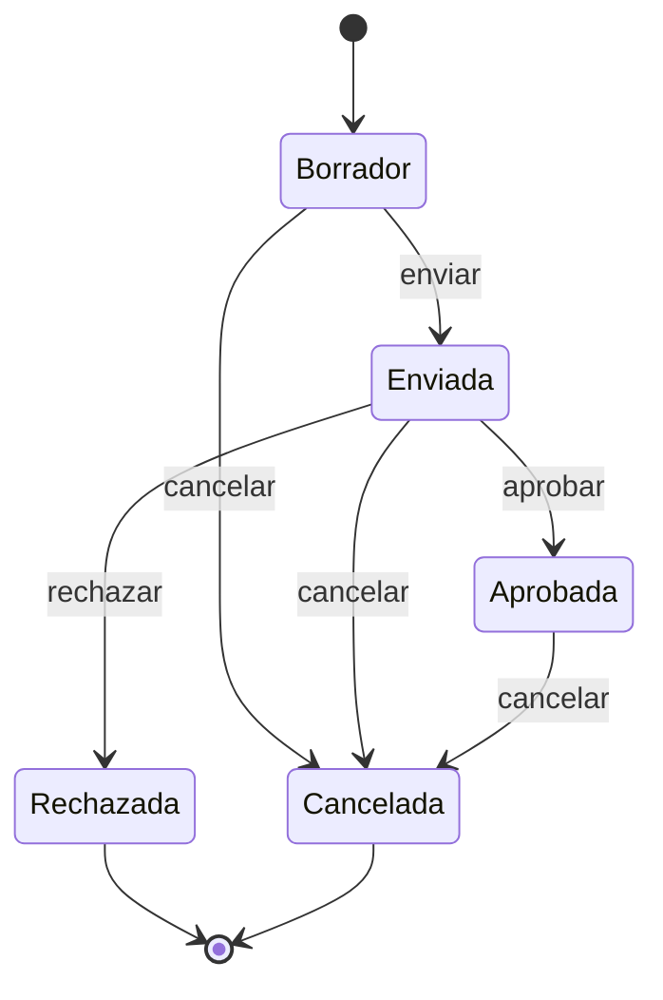
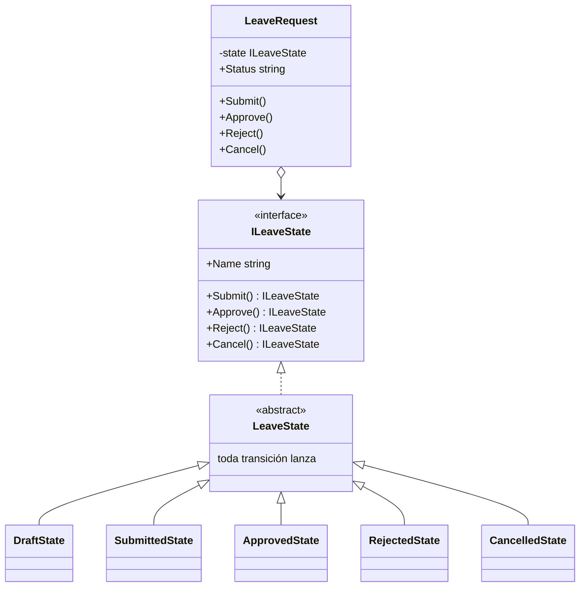

# State

**Comportamiento.** Hacer que un objeto cambie de comportamiento cuando cambia su estado interno, delegando en un objeto-estado en lugar de preguntar por el estado en cada método.

Dominio común de los de comportamiento: fichaje y ausencias. Una solicitud de vacaciones pasa por borrador, enviada, aprobada, rechazada o cancelada, y en cada estado se permiten cosas distintas. En [refactoring.guru](https://refactoring.guru/es/design-patterns/state) el mismo patrón se cuenta con un reproductor de música.

## Qué hace, en términos de negocio

La misma empresa que gestiona ausencias. Una solicitud de vacaciones tiene un ciclo de vida: se redacta, se envía, alguien la aprueba o la rechaza, y hasta cierto punto se puede cancelar. Lo que se puede hacer con ella depende de dónde esté: una solicitud rechazada no se puede aprobar, una ya cancelada no se puede volver a enviar. Si esas reglas viven como una lista de comprobaciones repartidas por el sistema ("si está en borrador y..."), cada estado nuevo o cada regla nueva obliga a revisarlas todas, y alguna se escapa.

State pone las reglas **en el propio estado**. Hay una ficha por estado (borrador, enviada, aprobada...) que sabe qué acciones admite y a qué estado llevan. La solicitud solo tiene que preguntar a su ficha actual: "me piden aprobar, ¿qué hago?". La ficha de "enviada" responde "pasas a aprobada"; la de "borrador" responde "eso no se puede". Añadir un estado ("pendiente de RRHH") es añadir una ficha y ajustar las vecinas, sin tocar la solicitud ni el resto.

Quién gana: quien gestiona solicitudes, porque el sistema no deja hacer lo que no toca; y quien cambia el proceso, porque cada estado y sus reglas están en un único sitio.

## Estructura

| Rol | Tipo |
|---|---|
| Context | `LeaveRequest` |
| State | `Interfaces/ILeaveState` |
| Base state | `Abstracts/LeaveState` (todas las transiciones prohibidas por defecto) |
| Concrete states | `States/DraftState`, `SubmittedState`, `ApprovedState`, `RejectedState`, `CancelledState` |

`LeaveRequest` no tiene ni un `if` ni un `switch` sobre el estado: cada método es `_state = _state.X()`. Cada estado concreto sobrescribe solo las transiciones que admite y devuelve el estado siguiente.

## Decisiones

**Las transiciones devuelven el siguiente estado.**
Problema: el libro hace que el estado reciba el contexto y le cambie el estado desde dentro (`request.State = new Approved()`); eso obliga a exponer un setter público y a que cada estado conozca al contexto.
Alternativa descartada: `void Approve(LeaveRequest request)` con `request.ChangeState(...)`.
Qué se gana: los estados no conocen al contexto, son objetos sin estado propio, y el contexto conserva su campo privado. La transición es una expresión.

**Base abstracta que prohíbe todo.**
Problema: con cinco estados y cuatro transiciones, cada estado concreto tendría que escribir las que no admite para lanzar.
Alternativa descartada: implementar `ILeaveState` directamente en cada estado.
Qué se gana: un estado concreto escribe solo lo que permite; lo demás lanza con un mensaje que nombra el estado y la acción. Añadir una transición a la interfaz es añadir un `virtual` en la base y el compilador no obliga a tocar los cinco estados.

**Estados como instancias nuevas, no singletons.**
Problema: los estados no tienen datos, así que podrían compartirse (`static readonly Instance`).
Alternativa descartada: una instancia por estado, compartida.
Qué se gana: nada que perder en claridad y nada que ganar en rendimiento con cinco objetos diminutos; y si mañana un estado necesita datos (quién rechazó, cuándo), ya es una instancia.

**`Status` como `string`, no enum.**
Problema: el patrón existe para sustituir el `switch` sobre un enum de estado; exponer el enum invita a volver a hacerlo fuera.
Alternativa descartada: `LeaveStatus Status` enum.
Qué se gana: lo que sale es un nombre para mostrar o persistir; las decisiones se toman dentro de los estados. Si hay que persistir y reconstruir, se mapea el nombre a la clase en un único sitio.

## Cuándo usarlo

- Un objeto con ciclo de vida y reglas distintas por fase: solicitudes, pedidos, documentos, conexiones.
- El mismo `switch (status)` aparece en varios métodos de la clase.
- Las transiciones son parte del dominio y cambian con el negocio.

## Cuándo no usarlo

- Dos estados y una comprobación: un `bool` es más claro.
- El comportamiento no cambia con el estado, solo un dato: un enum y ya.
- Se confunde con [Strategy](../Strategy/README.md): misma estructura, pero en Strategy el cliente elige el algoritmo y los algoritmos no se conocen; aquí el estado elige el siguiente y el cliente no interviene.

## Tests

`LeaveRequestTests`: una solicitud nueva está en borrador; enviar y aprobar la deja aprobada; enviar y rechazar, rechazada; cancelar una aprobada, cancelada; aprobar un borrador lanza; y enviar una rechazada lanza.
