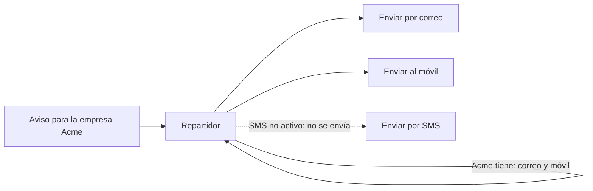
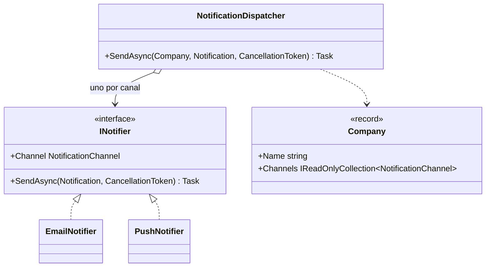

# Strategy

**Comportamiento.** Definir una familia de algoritmos intercambiables tras una misma interfaz, de forma que el cliente elija cuál usar en tiempo de ejecución sin conocer su interior.

Este ejemplo es anterior al catálogo y tiene dominio propio: **notificaciones** por varios canales a varias empresas. En [refactoring.guru](https://refactoring.guru/es/design-patterns/strategy) el mismo patrón se cuenta con rutas en coche, a pie o en transporte público.

## Qué hace, en términos de negocio

Una plataforma da servicio a muchas empresas y tiene que avisarlas de cosas. Cada empresa ha elegido por qué canales quiere recibir avisos: una solo por correo, otra por correo y notificación en el móvil, otra por lo que venga mañana. Enviar un aviso significa mandarlo por **cada canal que esa empresa tenga activo**, a la vez.

Strategy trata cada canal como una **forma intercambiable de enviar**: todas saben hacer lo mismo (enviar un aviso) y cada una lo hace a su manera. Un **repartidor** tiene a mano todas las formas, mira qué canales tiene activos la empresa y usa las que tocan, en paralelo. Añadir un canal nuevo es añadir una forma de enviar; el repartidor no cambia. Y si una empresa tiene activo un canal que no existe, el sistema avisa en lugar de callarse: eso es un error de configuración.

Quién gana: cada empresa, porque recibe los avisos solo por donde quiere; y quien añade canales, porque escribe uno y encaja sin tocar el reparto.

## Estructura

| Rol | Tipo |
|---|---|
| Strategy | `Interfaces/INotifier` |
| Concrete strategies | `Notifiers/EmailNotifier`, `Notifiers/PushNotifier` |
| Context | `NotificationDispatcher` |
| Configuración por tenant | `Company` |

El repartidor recibe todos los `INotifier` (en una aplicación con DI, `IEnumerable<INotifier>`), los indexa por canal y envía en paralelo por cada canal habilitado de la empresa.

## Decisiones

**Un notifier por canal, y duplicados lanzan en el constructor.**
Problema: dos implementaciones para el mismo canal es ambiguo; ¿cuál se usa?
Alternativa descartada: quedarse con la última o enviar por las dos.
Qué se gana: el error de registro aparece al arrancar, no al enviar.

**Canal habilitado sin notifier lanza `InvalidOperationException`.**
Problema: una empresa configurada con un canal que nadie implementa.
Alternativa descartada: ignorar el canal en silencio. La empresa cree que recibe avisos y no los recibe.
Qué se gana: la configuración inválida se detecta en el primer envío, con un mensaje que nombra el canal.

**Fan-out en paralelo con `Task.WhenAll`.**
Problema: los canales son independientes y uno lento no debería retrasar a los demás.
Alternativa descartada: enviar en secuencia. Más simple de razonar, pero la latencia se suma.
Qué se gana: la latencia del envío es la del canal más lento, no la suma. La deduplicación de canales en `Company` evita enviar dos veces por el mismo.

**Los notifiers concretos guardan lo enviado en memoria.**
Problema: comprobar en tests qué se envió por cada canal sin librerías de mocks.
Alternativa descartada: mocks.
Qué se gana: los tests leen `Sent` del notifier real. Es un atajo del ejemplo, marcado en el código; en producción un notifier envía y no guarda.

## Cuándo usarlo

- Varias formas de hacer lo mismo y la elección depende de datos (configuración, tenant, usuario) o cambia en tiempo de ejecución.
- Quieres añadir variantes sin tocar quien las usa.
- Con DI en .NET: registrar varias implementaciones de una interfaz y resolverlas como `IEnumerable<T>` es este patrón.

## Cuándo no usarlo

- Hay una sola forma de hacerlo: la interfaz sobra.
- Las variantes comparten la mayor parte del algoritmo y solo difieren en detalles con orden fijo: [Template Method](../TemplateMethod/README.md).
- La variante la decide el propio objeto según su estado interno, no el cliente: [State](../State/README.md). Misma estructura, distinta intención.

## Tests

`NotificationDispatcherTests`: cada empresa recibe el aviso solo por sus canales activos; un canal habilitado sin notifier lanza; y dos notifiers para el mismo canal se rechazan al construir el repartidor.
