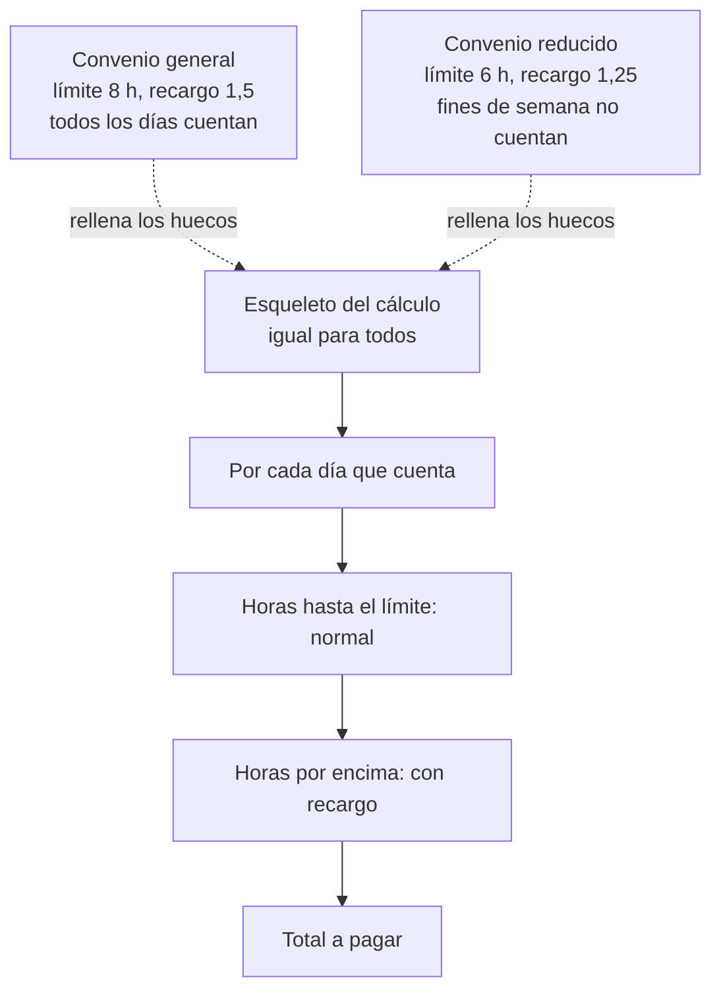
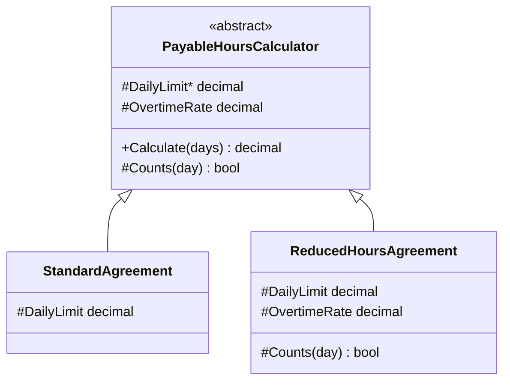

# Template Method

**Comportamiento.** Fijar el esqueleto de un algoritmo en una clase base y dejar que las subclases rellenen pasos concretos, sin poder cambiar el orden ni la estructura.

Dominio común de los de comportamiento: fichaje y ausencias. Calcular las horas a pagar de un mes sigue siempre los mismos pasos, pero el límite diario, el recargo de las extra y qué días cuentan dependen del convenio. En [refactoring.guru](https://refactoring.guru/es/design-patterns/template-method) el mismo patrón se cuenta con un minero de datos que lee distintos formatos de fichero.

## Qué hace, en términos de negocio

La misma empresa que gestiona jornadas. A final de mes hay que convertir las horas trabajadas en horas a pagar, y el cálculo tiene siempre la misma forma: por cada día, las horas hasta el límite de la jornada se pagan normal y las que sobran se pagan con recargo. Lo que cambia según el **convenio** son los números: en el general la jornada es de ocho horas y la extra se paga a uno y medio; en el de jornada reducida, seis horas, la extra a uno y cuarto, y los fines de semana no computan. Si cada convenio tuviera su propio cálculo completo, una corrección en la forma de calcular habría que repetirla en todos.

Template Method escribe el cálculo **una sola vez**, con huecos: "límite diario", "recargo", "¿este día cuenta?". Cada convenio es una ficha que rellena esos huecos y nada más; no puede cambiar el orden de los pasos ni saltarse ninguno. Un convenio nuevo es rellenar tres huecos. Una corrección en la forma de calcular se hace en un sitio y todos los convenios la heredan.

Quién gana: quien añade convenios, porque rellena tres datos y no reescribe un cálculo; y quien corrige el cálculo, porque lo hace una vez para todos.

## Estructura

| Rol | Tipo |
|---|---|
| Abstract class con el template method | `Abstracts/PayableHoursCalculator.Calculate` |
| Paso abstracto (obligatorio) | `DailyLimit` |
| Pasos con valor por defecto | `OvertimeRate`, `Counts` (hook) |
| Concrete classes | `Agreements/StandardAgreement`, `Agreements/ReducedHoursAgreement` |

`Calculate` es público y no es `virtual`: nadie puede cambiar el esqueleto. Los pasos son `protected`: solo las subclases los ven.

## Decisiones

**El template method no es `virtual`.**
Problema: si una subclase pudiera sobrescribir `Calculate`, el "esqueleto fijo" dejaría de serlo y el patrón se convertiría en herencia normal.
Alternativa descartada: `virtual` "por si acaso".
Qué se gana: la garantía del patrón la da el compilador. Si un convenio necesita otra estructura de cálculo, no es una subclase de esto; es otro calculador, y probablemente [Strategy](../Strategy/README.md).

**Tres tipos de paso: abstracto, con valor por defecto y hook.**
Problema: el libro distingue operaciones primitivas (obligatorias) de hooks (opcionales); con solo pasos abstractos cada subclase repite los valores comunes.
Alternativa descartada: todo abstracto.
Qué se gana: `StandardAgreement` tiene una línea, porque el recargo y el filtro por defecto ya le valen. `DailyLimit` sigue siendo abstracto porque no hay un límite "razonable" por defecto: obligar a decidirlo evita un convenio con un límite heredado sin querer.

**Los pasos son propiedades y un predicado, no métodos con lógica.**
Problema: en el ejemplo del libro los pasos son métodos que hacen cosas; aquí los huecos son datos y una regla.
Alternativa descartada: `protected abstract decimal RegularHours(WorkedDay)` y `OvertimeHours(WorkedDay)`, pasos con cálculo. Daría más libertad a las subclases y permitiría que una se saltara el límite.
Qué se gana: las subclases solo pueden parametrizar, no reescribir; es la versión más estricta del patrón y la que menos invita a duplicar lógica en cada convenio.

## Cuándo usarlo

- Varias clases hacen "casi lo mismo" y difieren en dos o tres pasos de un algoritmo con orden fijo.
- Quieres que las variantes no puedan romper la estructura: validación antes de guardar, apertura y cierre de recursos, cálculo con pasos regulados.
- Es la forma de las clases base del framework: `BackgroundService.ExecuteAsync`, `ControllerBase`, `Stream`.

## Cuándo no usarlo

- Las variantes necesitan cambiar el orden o saltarse pasos: ya no hay esqueleto común. [Strategy](../Strategy/README.md) con composición da esa libertad sin herencia.
- Solo hay una variante: el esqueleto con huecos es una clase normal con constantes.
- La jerarquía ya tiene otra razón de ser: Template Method consume la única herencia que C# permite. Si la clase ya hereda de algo, inyecta los pasos como dependencia en lugar de heredar.

## Tests

`PayableHoursCalculatorTests`: el convenio general paga a 1,5 lo que pasa de ocho horas y cuenta los fines de semana; el reducido paga a 1,25 lo que pasa de seis e ignora los fines de semana.
