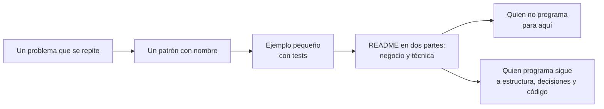

# DotNet.Practices.Patterns

Los 23 patrones de diseño del catálogo clásico, uno por carpeta, implementados en C# moderno con sus tests y explicados para dos lectores: primero para quien no programa, después para quien sí.

## Qué hace, en términos de negocio

Los patrones de diseño son **soluciones con nombre a problemas que se repiten** al organizar un sistema: quién construye las piezas, cómo encajan entre sí y quién decide qué pasa cuando algo cambia. Tener nombre importa: cuando alguien dice "esto es un Observer", el resto del equipo sabe qué esperar sin leer el código.

Este proyecto es el cuaderno de esos nombres. Cada patrón tiene su carpeta con un ejemplo pequeño sacado de un dominio reconocible, y cada categoría comparte un dominio para que se vea cuándo encaja cada patrón y cuándo no:

| Categoría | Pregunta que responde | Dominio del ejemplo |
|---|---|---|
| [Creacionales](Creational/README.md) | ¿Quién construye las piezas y cuánto hay que saber de ellas? | Logística: transportes, embalajes, envíos |
| [Estructurales](Structural/README.md) | ¿Cómo encajan piezas que ya existen para formar algo mayor? | Documentos: nóminas, informes, su generación y entrega |
| [De comportamiento](Behavioral/README.md) | ¿Quién decide qué pasa, en qué orden, y cómo se enteran los demás? | Fichaje y ausencias: jornadas, solicitudes, aprobaciones |

Tres ejemplos anteriores al catálogo conservan su propio dominio: una cadena de mando militar (Composite), avisos por varios canales a varias empresas (Strategy) y el pipeline de una petición web (Chain of Responsibility).



Quién gana: el equipo entero, porque comparte vocabulario; quien se incorpora, porque tiene un ejemplo probado de cada idea; y quien decide, porque cada README dice cuándo **no** usar el patrón.

## Estructura

```
Creational/     README.md comparativo + FactoryMethod/, AbstractFactory/, Builder/, Prototype/, Singleton/
Structural/     README.md comparativo + Adapter/, Bridge/, Composite/, Decorator/, Facade/, Flyweight/, Proxy/
Behavioral/     README.md comparativo + ChainOfResponsibility/, Command/, Iterator/, Mediator/, Memento/,
                Observer/, State/, Strategy/, TemplateMethod/, Visitor/
```

Dentro de cada patrón: `Interfaces/` para contratos, `Abstracts/` para clases base con código, una carpeta en plural para las implementaciones de una misma abstracción (`Transports/`, `Decorators/`, `States/`), y el resto en la raíz. Namespace igual a la ruta: `DotNet.Practices.Patterns.<Categoría>.<Patrón>`. Tests en `tests/DotNet.Practices.Patterns.Tests/` replicando la carpeta.

Cada patrón lleva:

- `README.md`: qué hace en términos de negocio, estructura con diagrama Mermaid, tabla de roles del libro, decisiones en formato Problema / Alternativa descartada / Qué se gana, cuándo usarlo, cuándo no, y qué prueban los tests.
- `CLAUDE.md`: solo las decisiones y trampas que no se deducen del código, para el agente.

## Decisiones

**Cada patrón es autocontenido, aunque repita tipos.**
Problema: los patrones de una categoría comparten dominio, así que `TransportMode`, `Document` o `LeaveRequest` aparecen en varias carpetas con el mismo nombre.
Alternativa descartada: un modelo de dominio común por categoría. Acopla los ejemplos entre sí: cambiar uno para ilustrar algo rompe a los demás.
Qué se gana: cada carpeta se lee, se copia y se borra sola. Los namespaces evitan el choque.

**El orden de refactoring.guru y la forma del libro, con la variante .NET al lado.**
Problema: varios patrones ya están en el lenguaje o en el runtime (Iterator es `IEnumerable<T>`, Observer es `event`, Singleton es `AddSingleton`).
Alternativa descartada: implementar solo la versión idiomática .NET. Se pierde la forma del libro, que es la que aparece en código antiguo y en entrevistas.
Qué se gana: se ve la forma clásica y, al lado, qué la sustituye hoy y por qué. Cuando las dos conviven en código (Singleton, Iterator), hay un test que las compara.

**Tests sin mocks.**
Problema: comprobar efectos (qué se envió, cuántas veces se cargó, qué orden siguieron los pasos).
Alternativa descartada: una librería de mocks.
Qué se gana: los objetos reales exponen lo mínimo para observarlos (`Sent`, `Loads`, `Trace`, `ReceivedOrders`), y los tests leen de ahí. Está marcado en cada CLAUDE.md como atajo del ejemplo.

## Tests

```
dotnet test tests/DotNet.Practices.Patterns.Tests
```

Un comportamiento y un solo `Assert.That` por test; nombres `Clase_Metodo_Resultado`. Ninguno necesita red, secretos ni configuración.
