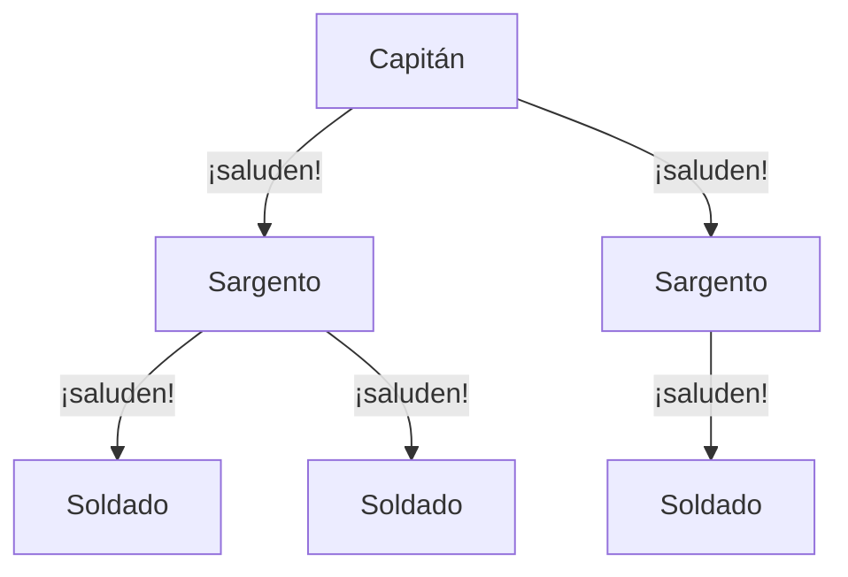
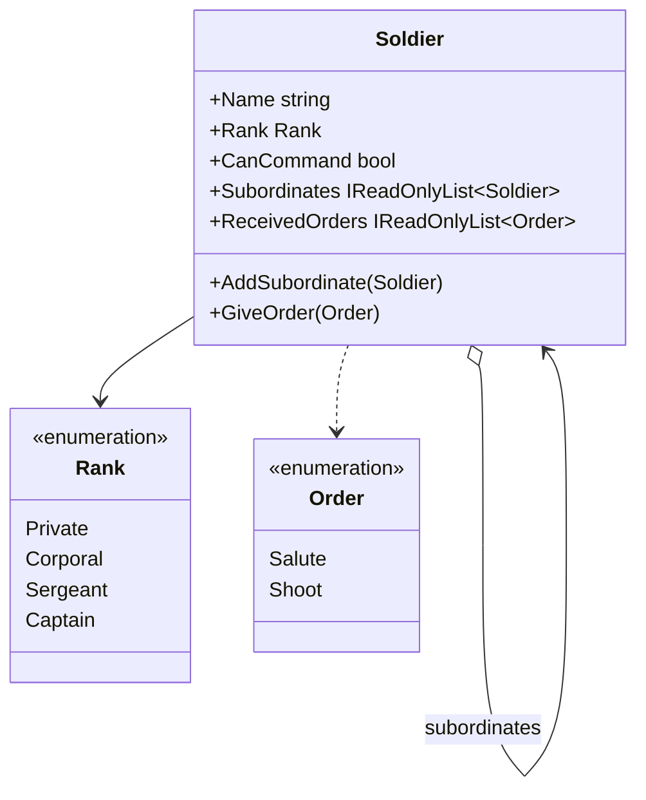

# Composite

**Estructural.** Tratar un objeto individual y un grupo de objetos con la misma interfaz, componiéndolos en un árbol donde una operación sobre un nodo se propaga a todo lo que cuelga de él.

Este ejemplo es anterior al catálogo y tiene dominio propio: una **cadena de mando** militar. En [refactoring.guru](https://refactoring.guru/es/design-patterns/composite) el mismo patrón se cuenta con cajas que contienen productos y otras cajas.

## Qué hace, en términos de negocio

Un ejército se organiza en árbol: un capitán manda sobre sargentos, cada sargento sobre cabos, cada cabo sobre soldados. Cuando el capitán da una orden, no la da a cada persona por su nombre: la da una vez y baja por toda la cadena hasta el último soldado. Y quien recibe la orden la ejecuta igual tenga o no gente a su cargo.

Composite modela exactamente eso: cada persona es un **nodo** que puede tener subordinados o no, y "dar una orden" significa recibirla y pasarla a todos los subordinados, que hacen lo mismo. Quien da la orden no necesita saber cuántos niveles hay debajo ni cuánta gente; el árbol se encarga. Las reglas de quién puede mandar sobre quién (solo alguien con rango superior, y un soldado raso no manda sobre nadie) se comprueban al construir el árbol, no al dar la orden.

Quién gana: quien manda, porque da la orden una vez; y quien organiza, porque añadir un nivel o una unidad no cambia cómo se dan las órdenes.

## Estructura

| Rol | Tipo |
|---|---|
| Component, Leaf y Composite a la vez | `Soldier` |
| Datos | `Rank` (enum ordenado), `Order` (enum) |

`GiveOrder` recorre el árbol de forma recursiva: cada subordinado recibe la orden y la pasa a los suyos. Quien da la orden no la recibe. `AddSubordinate` exige que quien manda no sea `Private` y que el subordinado tenga rango estrictamente inferior.

## Decisiones

**Una sola clase para hoja y compuesto.**
Problema: el libro separa `Leaf` y `Composite`; aquí un soldado sin subordinados hoy puede tenerlos mañana.
Alternativa descartada: `Soldier` (hoja) y `Unit` (compuesto) con una interfaz común. Obliga a convertir una hoja en compuesto cuando asciende, y el cliente tendría que saber cuál crear.
Qué se gana: una sola clase, sin conversiones; "ser hoja" es simplemente tener la lista de subordinados vacía.

**Órdenes como enum, no como objetos.**
Problema: una orden podría ser un objeto con `Execute`, es decir, [Command](../../Behavioral/Command/README.md).
Alternativa descartada: `ICommand` por orden. Aquí no hay que deshacer, encolar ni registrar; el enum basta y mantiene el foco en la estructura.
Qué se gana: el ejemplo enseña un patrón, no dos.

**Composite, no Chain of Responsibility.**
Problema: una cadena de mando se parece a una cadena de responsabilidad.
Alternativa descartada: [Chain of Responsibility](../../Behavioral/ChainOfResponsibility/README.md), donde la petición sube hasta que alguien la atiende y se para.
Qué se gana: la orden aquí baja a **todos** y nadie la detiene; eso es propagación en árbol, que es Composite.

**Violaciones de rango lanzan.**
Problema: añadir un subordinado de rango igual o superior es un error de quien construye el árbol.
Alternativa descartada: ignorar la operación o devolver `false`. Esconde el error hasta que una orden llega a quien no debía.
Qué se gana: el árbol inválido no llega a existir. `ReceivedOrders` existe para que los tests comprueben el alcance de una orden sin mocks.

## Cuándo usarlo

- Estructuras jerárquicas donde una operación debe aplicarse a un nodo y a todo lo que cuelga: organigramas, árboles de ficheros, menús, componentes de interfaz.
- El cliente quiere tratar igual a un elemento y a un grupo.

## Cuándo no usarlo

- La estructura es plana: una lista basta.
- Hojas y compuestos tienen interfaces muy distintas: forzar una común deja métodos sin sentido en las hojas.
- La operación debe detenerse en el primer nodo que la atienda: eso es [Chain of Responsibility](../../Behavioral/ChainOfResponsibility/README.md).

## Tests

`SoldierTests`: una orden llega a todos los niveles del árbol de forma recursiva; un soldado raso no puede dar órdenes ni tener subordinados; y un subordinado de rango igual o superior se rechaza.
