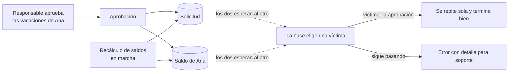

# Deadlock: dos operaciones que se bloquean mutuamente

**Error 1205.** Dos transacciones esperan cada una un bloqueo que tiene la otra. SQL Server lo detecta, elige una **víctima**, deshace su transacción y le devuelve una `SqlException` con `Number` 1205: "Transaction (Process ID N) was deadlocked on lock resources with another process and has been chosen as the deadlock victim. Rerun the transaction." La otra transacción sigue como si nada.

## Qué hace, en términos de negocio

Aprobar una solicitud de vacaciones toca dos cosas: la **solicitud** (pasa a aprobada) y el **saldo** del empleado (se le restan los días). Las dos tienen que cambiar juntas o no cambiar ninguna.

Mientras tanto, otro proceso (un recálculo de saldos, una corrección de RRHH) puede estar tocando las mismas dos cosas pero **en el orden contrario**: primero el saldo, luego la solicitud. Si coinciden en el tiempo, cada uno se queda esperando a que el otro suelte lo suyo. Ninguno puede avanzar. La base de datos lo detecta en segundos, elige a uno y le deshace todo lo que había hecho: la aprobación "falla" sin que nadie haya hecho nada mal.

Este ejemplo hace que la aprobación **lo vuelva a intentar sola** cuando le toca ser la víctima. Como la base ya ha deshecho todo, repetir desde el principio es seguro. Si el problema persiste tras unos intentos, entonces sí falla, con el error original para que soporte sepa lo que ha pasado.



Ejemplo concreto: el responsable de Ana aprueba sus 3 días justo cuando RRHH lanza un recálculo de saldos. La aprobación resulta elegida víctima, se repite al instante y termina bien: la solicitud queda aprobada y a Ana le quedan 19 días de 22. El responsable no se entera de nada.

Quién gana: quien aprueba, porque la operación termina bien aunque haya coincidido con otra; soporte, porque un deadlock que persiste llega con su número y no como "error inesperado"; y quien programa, porque el reintento está en un sitio y no repartido por cada pantalla.

## Estructura

```mermaid
sequenceDiagram
    participant C as Caller
    participant L as LeaveApprovalService
    participant S as SQL Server
    participant O as Otro proceso (prioridad HIGH)
    O->>S: XLOCK LeaveBalances (sin commit)
    C->>L: ApproveAsync(requestId)
    L->>S: BEGIN; UPDATE LeaveRequests (OUTPUT EmployeeId, Days)
    L->>S: UPDATE LeaveBalances
    Note over L,S: espera el lock de O
    O->>S: XLOCK LeaveRequests
    Note over S: deadlock detectado, víctima: L
    S-->>L: SqlException 1205 (transacción deshecha)
    O->>S: COMMIT
    L->>S: BEGIN; UPDATE LeaveRequests; UPDATE LeaveBalances; COMMIT
    L-->>C: Approval(requestId, Attempts: 2)
```

| Pieza | Tipo |
|---|---|
| Operación con reintento | `LeaveApprovalService(connectionString, maxAttempts = 3)` |
| Resultado observable | `Approval(RequestId, Attempts)` |
| Una ejecución, una transacción | `ApproveOnceAsync`: `UPDATE LeaveRequests ... OUTPUT`, `UPDATE LeaveBalances`, `COMMIT` |
| Deadlock reproducido | En el test: otro proceso con `DEADLOCK_PRIORITY HIGH` bloquea en orden inverso |

## Decisiones

**Reintentar solo 1205, solo un número acotado de veces, y toda la transacción.**
Problema: tras el 1205 la transacción ya no existe; repetir solo la sentencia que falló dejaría la aprobación a medias.
Alternativa descartada: reintentar cualquier `SqlException`. Una clave duplicada o un error de permisos volverían a fallar igual, y un timeout podría haber dejado trabajo hecho en el servidor.
Qué se gana: el filtro `when (Number == 1205 && attempt < maxAttempts)` reintenta solo lo que el servidor ha deshecho por completo. Agotados los intentos, el 1205 original sube tal cual.

**El número de intentos se ve en el resultado (`Approval.Attempts`).**
Problema: comprobar en un test que hubo reintento, sin mocks ni logs.
Alternativa descartada: un contador interno o un log.
Qué se gana: el test compara `Approval(1, Attempts: 2)` y listo. En producción ese dato sirve igual: una métrica de reintentos es la señal temprana de que hay un orden de bloqueo inconsistente que arreglar.

**El reintento es el parche; el arreglo es el orden de bloqueo.**
Problema: dos procesos que tocan las mismas tablas en orden distinto siempre acabarán en deadlock bajo carga.
Alternativa descartada: subir `maxAttempts` hasta que deje de verse.
Qué se gana: el ejemplo deja claro en el test cuál es la causa (el otro proceso bloquea saldo y luego solicitud; el servicio, al revés). Si ambos siguieran el mismo orden, uno esperaría al otro y no habría deadlock. El reintento cubre los casos que no controlas, como procesos de terceros.

**La víctima es determinista en el test gracias a `DEADLOCK_PRIORITY HIGH`.**
Problema: SQL Server elige como víctima la transacción más barata de deshacer; con dos transacciones parecidas la elección es azarosa y el test sería intermitente.
Alternativa descartada: repetir el test hasta que la víctima sea la correcta.
Qué se gana: el otro proceso se declara prioritario y el servicio es siempre la víctima. El test espera a que el servicio esté bloqueado consultando `sys.dm_exec_requests` antes de cerrar el ciclo, en lugar de dormir un tiempo fijo.

## Cuándo aplicarlo

- Transacciones cortas que tocan varias filas o tablas y que pueden coincidir con otros procesos sobre los mismos datos.
- Siempre que la operación sea idempotente desde cero: la víctima no deja rastro, así que repetirla es seguro.

## Cuándo no

- La operación tiene efectos fuera de la base (un correo, una llamada HTTP) dentro de la transacción: repetirla los duplicaría. Sácalos de la transacción primero.
- Como excusa para no ordenar los bloqueos: si el deadlock es entre dos piezas tuyas, arregla el orden.

## Tests

`LeaveApprovalServiceTests` (integración, crean su propia base): sin contención la aprobación termina al primer intento y resta los días del saldo; con otro proceso bloqueando en orden inverso, el servicio es la víctima, reintenta y termina al segundo intento; con `maxAttempts: 1` el 1205 sube al llamador.
