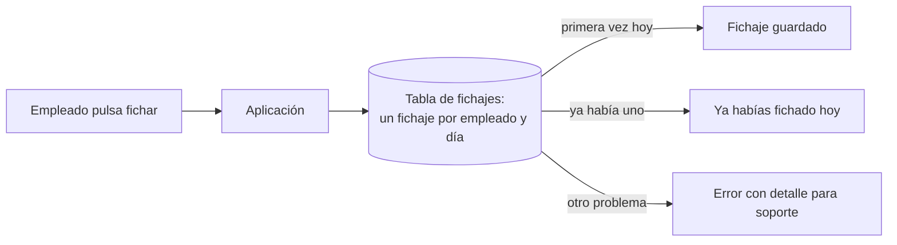
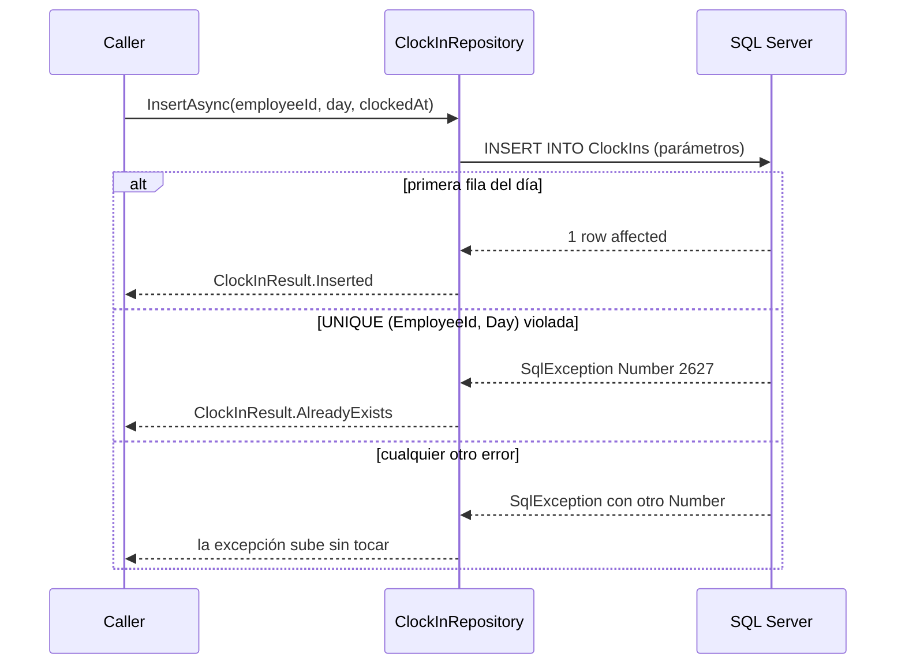

# DuplicateKey: clave única violada

**Error 2627 / 2601.** Insertar una fila que choca con una restricción `UNIQUE`, una clave primaria o un índice único. SQL Server rechaza la fila y la aplicación recibe una `SqlException`.

## Qué hace, en términos de negocio

Un empleado solo puede tener **un fichaje de entrada por día**. La base de datos lo garantiza con una regla que no admite dos filas con el mismo empleado y la misma fecha. Esa regla es la última línea de defensa: aunque dos pantallas, dos dispositivos o dos peticiones intenten fichar a la vez, solo una entra.

El problema es qué pasa con la segunda. Sin tratamiento, el empleado ve "error inesperado" y soporte recibe un ticket por algo que no es un fallo: **es la regla funcionando**. Este ejemplo convierte ese rechazo en una respuesta con sentido: "ya habías fichado hoy". Cualquier otro error de la base sigue subiendo con todo su detalle, porque ese sí es un fallo.

Ejemplo concreto: Ana ficha a las 9:00 desde el móvil y, sin darse cuenta, otra vez a las 9:05 desde el ordenador. El primer fichaje se guarda; el segundo recibe "ya habías fichado hoy". Luis ficha a las 9:00 el mismo día y su fichaje entra sin problema, porque la regla es por empleado.

Quién gana: el empleado, que entiende lo que ha pasado; soporte, que no recibe tickets por fichajes repetidos; y quien programa, que no tiene que comprobar antes de insertar si ya existe (una comprobación que, con dos peticiones a la vez, falla igualmente).

## Estructura

| Pieza | Tipo |
|---|---|
| Acceso a datos | `ClockInRepository` |
| Resultado de negocio | `ClockInResult` (`Inserted`, `AlreadyExists`) |
| Esquema | En el test: `ClockIns` con `UNIQUE (EmployeeId, Day)` |

## Decisiones

**Insertar y tratar el rechazo, no comprobar antes de insertar.**
Problema: dos peticiones simultáneas del mismo empleado. Con un `SELECT` previo, las dos ven que no hay fichaje y las dos insertan; la segunda falla igual, pero ahora con una excepción que nadie esperaba.
Alternativa descartada: `IF NOT EXISTS ... INSERT`. Sigue siendo una carrera salvo que se bloquee la tabla, y oculta que la base ya garantiza la regla.
Qué se gana: una ida a la base, sin carrera, y la restricción `UNIQUE` es la única fuente de verdad. El `catch` solo traduce.

**El filtro `when` compara `SqlException.Number`, no el mensaje.**
Problema: distinguir "clave duplicada" de cualquier otro error.
Alternativa descartada: buscar "duplicate key" en `Message`. Depende del idioma del servidor y de la versión.
Qué se gana: `2627` (restricción `UNIQUE` o `PRIMARY KEY`) y `2601` (índice único) son estables desde hace décadas. Los dos se tratan igual porque para el negocio significan lo mismo.

**Resultado de negocio (`ClockInResult`), no excepción propia.**
Problema: el llamador tiene que reaccionar a "ya existe" en el flujo normal.
Alternativa descartada: lanzar `DuplicateClockInException`. Usa excepciones para flujo de negocio y obliga a un `try/catch` en cada llamador.
Qué se gana: el llamador hace un `switch` sobre el enum y el compilador le recuerda el caso. Los errores de verdad siguen siendo excepciones.

**Parámetros tipados con `SqlDbType`, no `AddWithValue`.**
Problema: `AddWithValue` infiere el tipo del valor .NET; con `DateOnly` o `string` puede elegir un tipo que no casa con la columna y fuerza conversiones en el servidor.
Alternativa descartada: `AddWithValue` por brevedad.
Qué se gana: el tipo del parámetro coincide con la columna (`date`, `datetime2`) y el plan de ejecución se reutiliza.

## Cuándo aplicarlo

- Una restricción de unicidad codifica una regla de negocio y el caso "ya existe" es normal, no excepcional.
- Hay concurrencia real: varias peticiones pueden intentar lo mismo a la vez.

## Cuándo no

- "Ya existe" es de verdad un error de programación (una clave generada que nunca debería repetirse): que suba la excepción.
- Se necesita actualizar si existe: eso es un `MERGE` o un `UPDATE` seguido de `INSERT`, otro problema.

## Tests

`ClockInRepositoryTests` (integración, crean su propia base): el primer fichaje del día devuelve `Inserted`; el segundo del mismo empleado y día devuelve `AlreadyExists`; otro empleado el mismo día devuelve `Inserted`, lo que demuestra que la clave es compuesta.
