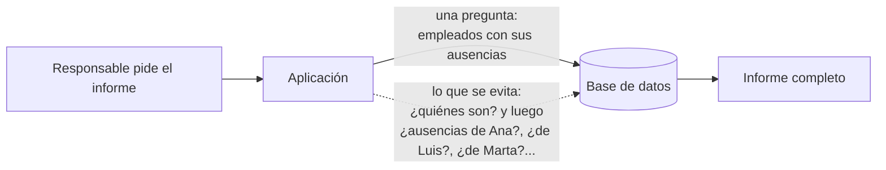

# NPlusOne: una consulta por cada fila

**Sin número de error.** La base no se queja: cada consulta es correcta y rápida. El problema es cuántas son. Para listar N empleados con sus ausencias, el código hace una consulta para los empleados y **una más por cada empleado**: N+1 en total. Con 3 empleados nadie lo nota; con 3.000, el informe tarda minutos y la base recibe miles de peticiones diminutas.

## Qué hace, en términos de negocio

Un responsable abre el informe de ausencias de su equipo: cada persona con los días que ha faltado este mes. Con un equipo pequeño el informe sale al instante. Cuando el equipo crece, o cuando RRHH lo pide para toda la empresa, el mismo informe **tarda cada vez más**, y no porque haya más datos que leer, sino porque la aplicación va a la base **una vez por persona** a preguntar por sus ausencias.

Este ejemplo muestra las dos formas de construir el mismo informe, con el mismo resultado exacto, y **mide** cuántas veces va cada una a la base: la forma correcta va una sola vez, pida el informe de 3 personas o de 3.000.



Ejemplo concreto: el equipo son Ana (faltó el 5 y el 6 de octubre), Luis (no faltó) y Marta (faltó el 20). Las dos formas devuelven exactamente esas tres filas. La correcta hace una consulta; la otra hace cuatro: una para saber quiénes son y tres para preguntar por cada uno.

Quién gana: el responsable, porque el informe tarda lo mismo con 3 que con 3.000 personas; la base, que recibe una petición en vez de miles; y quien programa, porque el test cuenta las consultas y avisa si alguien vuelve a introducir el bucle.

## Estructura

```mermaid
sequenceDiagram
    participant C as Caller
    participant T as TeamAbsencesReport
    participant S as SQL Server
    C->>T: BuildAsync()
    T->>S: SELECT e.Name, a.Day FROM Employees e LEFT JOIN Absences a ... ORDER BY e.Name, a.Day
    S-->>T: una fila por (empleado, ausencia); los sin ausencias, con Day NULL
    T-->>C: [Ana: 2026-10-05, 2026-10-06] [Luis: ] [Marta: 2026-10-20]
```

| Pieza | Tipo |
|---|---|
| Una consulta (lo correcto) | `TeamAbsencesReport.BuildAsync`: `LEFT JOIN` ordenado y agrupación en memoria |
| N+1 (lo que se mide para evitarlo) | `OneQueryPerEmployeeReport.BuildAsync`: empleados y, en un bucle, las ausencias de cada uno |
| Fila del informe | `EmployeeAbsences(Name, Days)` con los días como texto `yyyy-MM-dd` |
| Contador | En el test: `QueryCounter` cuenta los lotes y llamadas RPC completados con una sesión de Extended Events |

## Decisiones

**El N+1 se mide, no se explica.**
Problema: "esto hace demasiadas consultas" es una opinión hasta que se cuenta.
Alternativa descartada: instrumentar los informes con un contador propio o envolver `SqlConnection`. Contamina el código de producción con algo que solo sirve al test.
Qué se gana: el contador abre una sesión de Extended Events que cuenta, solo para esa base, cada lote y cada llamada RPC completados mientras se construye el informe: exactamente las idas a la base. El informe correcto da 1; el otro, 1+N. Si alguien reintroduce el bucle, el test lo dice con un número.

**La versión N+1 se conserva en la librería.**
Problema: sin ella no hay nada que medir ni con qué comparar.
Alternativa descartada: borrarla una vez vista la diferencia.
Qué se gana: las dos construyen el mismo resultado (el mismo test de forma pasa para ambas) y solo difieren en el número de idas a la base. Está marcada en el código como la forma a evitar.

**`LEFT JOIN` y agrupación en memoria, no una consulta por empleado ni `STRING_AGG`.**
Problema: los empleados sin ausencias tienen que aparecer, y las ausencias de uno tienen que quedar juntas.
Alternativa descartada: `STRING_AGG` en SQL para que el servidor devuelva ya el texto. Funciona, pero ata el formato del informe al SQL; y un `INNER JOIN` dejaría fuera a Luis.
Qué se gana: una sola ida, filas ordenadas por empleado y día, y el agrupado son diez líneas de C# que no dependen de la versión del servidor.

**`Days` es texto, no una lista.**
Problema: comparar el informe completo en el test con `Is.EqualTo`. Un `record` con una lista dentro compara la lista por referencia y nunca es igual.
Alternativa descartada: una lista de `DateOnly` y comparar campo a campo en el test.
Qué se gana: la fila es lo que se muestra (`"2026-10-05, 2026-10-06"`, formato invariante) y el test compara el informe entero de una vez.

## Cuándo aplicarlo

- Cualquier "lista de padres con sus hijos": equipos con empleados, pedidos con líneas, solicitudes con aprobaciones.
- Con ORMs, el mismo problema aparece con *lazy loading*: la propiedad de navegación dispara una consulta al tocarla dentro del bucle. `Include` o una proyección lo resuelven; el contador de consultas lo detecta igual.

## Cuándo no

- Si los hijos son muchos por padre y solo se necesitan de unos pocos padres: traer todo con un `JOIN` puede ser peor que dos consultas (padres y luego hijos de esos padres con `IN`). Dos consultas no es N+1.

## Tests

`TeamAbsencesReportTests` (integración, crean su propia base): los dos informes devuelven las mismas tres filas; `TeamAbsencesReport` ejecuta 1 consulta y `OneQueryPerEmployeeReport` ejecuta 1 + 3. El contador se maneja desde `master` para no contarse a sí mismo. Se descartó leer `sys.dm_exec_query_stats`: esas estadísticas se publican con retraso y, con la suite completa en paralelo, devolvían cero.
