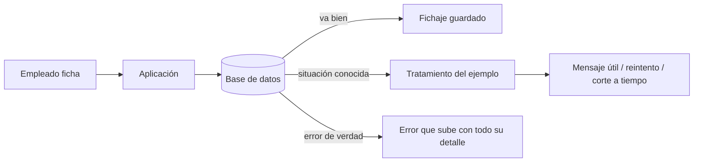

# DotNet.Practices.SqlErrors

Errores comunes de SQL Server, uno por carpeta: cada ejemplo **reproduce el error contra una base de datos real** en un test y muestra la forma correcta de tratarlo en C# con `Microsoft.Data.SqlClient`, sin ORM.

## Qué hace, en términos de negocio

Cuando una aplicación habla con su base de datos, hay fallos que **no son errores del programa sino situaciones normales**: dos personas guardan lo mismo a la vez, una consulta tarda más de la cuenta, dos operaciones se bloquean mutuamente, la base está un momento sin responder. Si el código no las distingue, todas acaban igual: un error genérico en pantalla y un ticket a soporte.

Este proyecto es el cuaderno de esas situaciones. Cada carpeta toma una de ellas, la provoca a propósito en una base de pruebas y enseña qué debe hacer la aplicación: avisar al usuario con un mensaje útil, reintentar sola, o cortar a tiempo. El dominio es el mismo que en los patrones de comportamiento: **fichaje y ausencias**, con empleados que fichan y una tabla que no admite dos fichajes del mismo empleado el mismo día.

| Situación | Qué ve el usuario sin tratarla | Qué ve con el ejemplo | Estado |
|---|---|---|---|
| [Dos registros iguales a la vez](DuplicateKey/README.md) | "Error inesperado" | "Ya habías fichado hoy" | hecho |
| [Consulta que tarda demasiado](Timeout/README.md) | La pantalla se queda colgada | Corte limpio y aviso | hecho |
| [Dos operaciones que se bloquean mutuamente](Deadlock/README.md) | Una de las dos falla al azar | Reintento automático, nadie se entera | hecho |
| [Base de datos sin responder un momento](TransientFaults/README.md) | Fallo en cadena | Reintento con espera, solo para fallos pasajeros | hecho |
| [Texto del usuario colado como orden a la base](SqlInjection/README.md) | Fuga o borrado de datos | El texto se trata siempre como dato | hecho |
| [Una consulta por cada fila](NPlusOne/README.md) | Lento al crecer los datos | Una consulta para todo, medido | hecho |



Quién gana: el empleado, que recibe un mensaje que entiende; soporte, que deja de recibir tickets por situaciones normales; y quien programa, que tiene cada caso reproducido y probado.

## Estructura

```
DuplicateKey/      clave única violada (2627 / 2601) tratada como resultado de negocio
Timeout/           consulta bloqueada que supera CommandTimeout (-2) y cancelación del llamador
Deadlock/          víctima de deadlock (1205) reintentada un número acotado de veces
TransientFaults/   errores transitorios de Azure SQL (40613, 40501...) con espera exponencial, a mano y con SqlClient
SqlInjection/      consulta parametrizada; la concatenación (fuga y error 102) solo se demuestra en el test
NPlusOne/          una consulta por fila frente a una sola, medido con las estadísticas del servidor
```

Cada carpeta es autocontenida: su esquema SQL vive en el test que lo usa, y los tipos no se comparten entre ejemplos. Namespace igual a la ruta: `DotNet.Practices.SqlErrors.<Ejemplo>`. Tests en `tests/DotNet.Practices.SqlErrors.Tests/` replicando la carpeta.

## Decisiones

**Solo `Microsoft.Data.SqlClient`, sin ORM.**
Problema: los errores de SQL Server llegan como `SqlException` con un `Number`; un ORM los envuelve en sus propias excepciones y el ejemplo acaba enseñando el ORM, no el error.
Alternativa descartada: Dapper o EF Core. Son lo habitual en producción, pero añaden una capa entre el error y quien lo lee.
Qué se gana: el código muestra el error tal como lo emite el servidor y cómo se distingue por su número. Es el único paquete de la librería.

**Los tests van contra SQL Server de verdad, no contra un doble.**
Problema: un deadlock, un timeout o una clave duplicada no se pueden simular con fidelidad; `SqlException` ni siquiera tiene constructor público.
Alternativa descartada: simular las excepciones. Probaría el `catch`, no el error.
Qué se gana: cada test crea una base con nombre único, la usa y la borra. Si no hay servidor, el test se marca como ignorado con el motivo, no como fallo.

**Instancia local por defecto, LocalDB o cualquier otra por variable de entorno.**
Problema: no todas las máquinas tienen la misma instancia, y la de desarrollo no debería ser una cadena de conexión en el código.
Alternativa descartada: Testcontainers. Exige Docker y en la máquina de desarrollo no está.
Qué se gana: por defecto `Server=localhost` con autenticación integrada; `DOTNET_PRACTICES_SQLSERVER` cambia el destino sin tocar código. La cadena no lleva secretos.

## Tests

```
dotnet test tests/DotNet.Practices.SqlErrors.Tests
```

Todos llevan `[Category("Integration")]` porque necesitan SQL Server. Cada test crea y borra su propia base (`DotNetPractices_SqlErrors_<guid>`), así que son independientes entre sí. Sin servidor accesible se ignoran con el motivo en el mensaje.

| Variable | Por defecto | Para qué |
|---|---|---|
| `DOTNET_PRACTICES_SQLSERVER` | `Server=localhost;Integrated Security=true;TrustServerCertificate=true` | Instancia donde crear las bases de prueba. Para LocalDB: `Server=(localdb)\MSSQLLocalDB;Integrated Security=true` |
