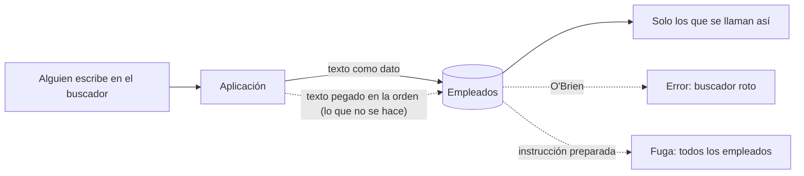
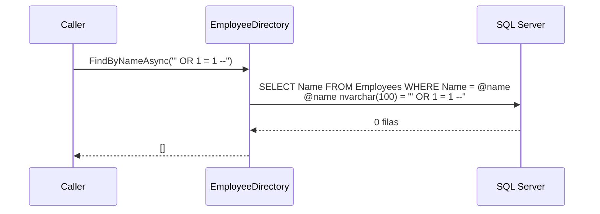

# SqlInjection: texto del usuario colado como orden a la base

**Error 102, y el peor: ninguno.** Cuando una consulta se construye pegando texto del usuario dentro del SQL, ese texto deja de ser un dato y pasa a ser **parte de la orden**. Un apellido con apóstrofo rompe la consulta ("Incorrect syntax near 'Brien'", 102). Y un texto preparado a propósito no rompe nada: la consulta funciona y devuelve, cambia o borra lo que el atacante quiera.

## Qué hace, en términos de negocio

El directorio de la empresa tiene un buscador por nombre. Alguien escribe un nombre y la aplicación pide a la base de datos los empleados que se llaman así.

Si la aplicación construye la pregunta pegando el texto tal cual, pasan dos cosas:

- **Un nombre normal falla.** Buscar a "Siobhan O'Brien" da error, porque el apóstrofo del apellido se confunde con el final del texto. Soporte recibe tickets de "el buscador no funciona con algunos nombres".
- **Un texto preparado no falla.** Alguien escribe en la casilla algo que no es un nombre sino una instrucción, y el buscador devuelve **todos los empleados** aunque esa persona no debería ver más que el suyo. Con otra instrucción podría cambiar o borrar datos. Nadie ve un error; el dato simplemente se va.

Este ejemplo hace que el texto del usuario **sea siempre un dato** y nunca una orden. "O'Brien" se encuentra. La instrucción preparada se busca como si fuera un nombre, no se llama así nadie, y devuelve vacío.

Ejemplo concreto: Ana busca "Siobhan O'Brien" y la encuentra. Otra persona escribe `' OR 1 = 1 --` en la casilla: con el texto como dato, el resultado es vacío; con el texto pegado en la orden, saldrían los tres empleados de la empresa.

Quién gana: los empleados, cuyos datos solo ve quien debe; soporte, que deja de recibir "no funciona con apóstrofos"; y la empresa, porque la fuga de datos por esta vía es la más antigua y la más fácil de evitar.

## Estructura

| Pieza | Tipo |
|---|---|
| Consulta parametrizada | `EmployeeDirectory.FindByNameAsync`: `WHERE Name = @name`, `SqlDbType.NVarChar, 100` |
| Lo que no se hace | Solo en el test: `"... WHERE Name = '" + name + "'"`, para demostrar la fuga y el error 102 |

## Decisiones

**La consulta vulnerable vive en el test, no en la librería.**
Problema: el ejemplo necesita demostrar el ataque contra una base real, pero una clase inyectable en una librería acaba copiada.
Alternativa descartada: una clase `ConcatenatingEmployeeDirectory` junto a la buena, "para comparar".
Qué se gana: el ataque está reproducido y probado (los tres empleados salen con `' OR 1 = 1 --`, y O'Brien da 102), pero no hay nada en `src/` que alguien pueda reutilizar por error.

**Parámetro con tipo y tamaño (`NVarChar, 100`), no `AddWithValue`.**
Problema: con `AddWithValue`, el tipo y la longitud salen del valor: cada búsqueda con una longitud distinta es un plan de ejecución distinto en la caché del servidor.
Alternativa descartada: `AddWithValue("@name", name)` por brevedad.
Qué se gana: un solo plan para todas las búsquedas y el tipo igual al de la columna, sin conversiones implícitas que invaliden el índice.

**Igualdad exacta, no `LIKE`.**
Problema: un buscador real suele ser "contiene".
Alternativa descartada: `LIKE '%' + @name + '%'`. Es igual de seguro frente a inyección, pero introduce otro problema: `%` y `_` escritos por el usuario son comodines y hay que escaparlos con `[%]` y `[_]`.
Qué se gana: el ejemplo enseña una sola cosa. El escapado de comodines se menciona aquí para que no se olvide al pasar a `LIKE`.

## Cuándo aplicarlo

- Siempre que un valor venga de fuera: formulario, API, fichero, otra base. Sin excepciones, también para números y fechas.
- También con ORMs: `FromSqlRaw` o `ExecuteSqlRaw` con interpolación son concatenación; `FromSqlInterpolated` y `FromSql` convierten la interpolación en parámetros.

## Cuándo no

- Nombres de tablas, columnas o `ORDER BY`: no se pueden parametrizar. Ahí la defensa es una lista blanca de valores permitidos, nunca el texto del usuario.

## Tests

`EmployeeDirectoryTests` (integración, crean su propia base): un nombre exacto se encuentra; "Siobhan O'Brien" se encuentra; la inyección devuelve vacío. Y los dos de la versión concatenada, escrita solo en el test: con la inyección salen los tres empleados; con O'Brien, `SqlException` 102 ("Incorrect syntax near 'Brien'").
