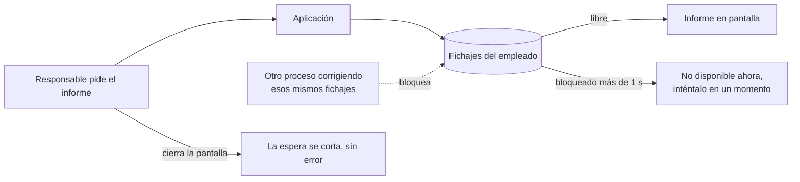
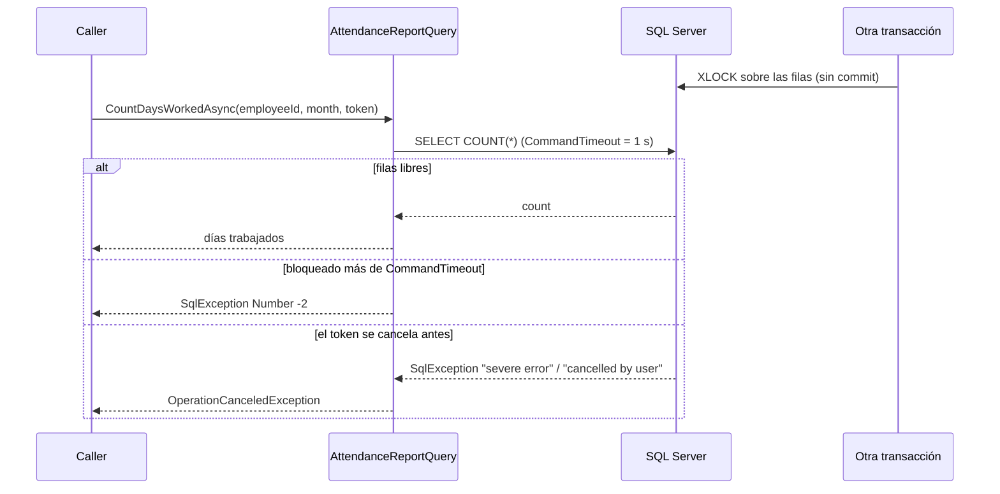

# Timeout: la consulta tarda demasiado

**Error -2.** La consulta no termina dentro del tiempo que la aplicación le concede (`CommandTimeout`). SQL Server no sabe nada de ese límite: es el cliente quien corta y recibe una `SqlException` con `Number` -2. La causa más habitual no es una consulta lenta, sino una consulta **bloqueada** por otra transacción que no ha terminado.

## Qué hace, en términos de negocio

Un responsable pide el informe de días trabajados de un empleado en el mes. Normalmente tarda nada. Pero si en ese momento otro proceso está modificando los fichajes de ese empleado (una corrección masiva, una importación) y aún no ha terminado, el informe se queda **esperando a que el otro acabe**. Sin un límite, la pantalla se queda colgada el tiempo que haga falta.

Este ejemplo pone dos límites y los distingue:

- **El límite de la aplicación**: cuánto está dispuesta a esperar por esa consulta antes de rendirse. Aquí, un segundo. Al superarlo, la consulta se corta y la aplicación puede avisar: "el informe no está disponible ahora mismo, inténtalo en un momento".
- **El límite de quien pidió**: si el usuario cierra la pantalla o la petición se cancela, no tiene sentido seguir esperando. La espera se corta en el acto y se informa como cancelación, no como error.

Ejemplo concreto: RRHH está corrigiendo los fichajes de octubre de Ana y la operación sigue abierta. Su responsable abre el informe de Ana: en vez de quedarse colgado, al segundo recibe "no disponible ahora mismo". El informe de Luis, que nadie está tocando, sale al instante.

Quién gana: quien espera, porque sabe qué pasa en un segundo y no en treinta; soporte, porque un timeout con su número se distingue de cualquier otro fallo; y el servidor, porque la aplicación suelta la conexión en lugar de acumular esperas.

## Estructura

| Pieza | Tipo |
|---|---|
| Consulta con límite explícito | `AttendanceReportQuery(connectionString, commandTimeout)` |
| Límite de la aplicación | `SqlCommand.CommandTimeout`, en segundos |
| Límite del llamador | `CancellationToken` propagado a `OpenAsync` y `ExecuteScalarAsync` |
| Bloqueo reproducido | En el test: `SELECT ... WITH (XLOCK, HOLDLOCK)` en una transacción abierta |

## Decisiones

**El timeout es un parámetro del constructor, no el valor por defecto.**
Problema: `SqlCommand.CommandTimeout` vale 30 segundos si nadie lo toca. Para un informe interactivo es una eternidad; para un cierre mensual puede ser poco.
Alternativa descartada: dejar el valor por defecto y "ya se verá". Nadie decide el límite y el usuario lo sufre.
Qué se gana: quien construye la consulta declara cuánto está dispuesto a esperar, y el test lo demuestra: con un segundo de límite, el fallo llega en poco más de un segundo, no en treinta.

**El timeout (-2) sube como `SqlException`; no se traduce ni se reintenta aquí.**
Problema: tras un timeout no se sabe si la consulta se quedó a medias o si el servidor está saturado.
Alternativa descartada: reintentar en el acto. Si la causa es un bloqueo, el reintento vuelve a bloquearse y multiplica la carga; si es saturación, la empeora. Subir el timeout a ciegas tampoco: solo traslada la espera al usuario.
Qué se gana: el llamador reconoce `Number == -2` y decide (avisar, degradar, encolar). Los errores de verdad y el timeout no se confunden.

**La cancelación del token se entrega como `OperationCanceledException`.**
Problema: al cancelar un comando bloqueado, SqlClient no lanza `OperationCanceledException` sino una `SqlException` con mensaje "A severe error occurred on the current command" o "Operation cancelled by user". El llamador que hace `catch (OperationCanceledException)` no la ve.
Alternativa descartada: dejar pasar la `SqlException`. Una cancelación voluntaria acabaría registrada como error grave.
Qué se gana: un filtro `catch (SqlException) when (cancellationToken.IsCancellationRequested)` la convierte en la excepción estándar. El filtro mira el token, no el número ni el mensaje, así que no depende de la versión del driver.

**El bloqueo se reproduce con un lock explícito, no con `WAITFOR DELAY`.**
Problema: hacer que la consulta tarde a propósito.
Alternativa descartada: una consulta de prueba con `WAITFOR`. Enseña una consulta lenta artificial, que casi nunca es la causa real.
Qué se gana: el test abre otra transacción con `XLOCK, HOLDLOCK` sobre las filas y no la cierra. Es exactamente lo que pasa en producción cuando una transacción se queda abierta, y la consulta de producción no cambia.

## Cuándo aplicarlo

- Consultas interactivas: el usuario está esperando y un segundo de más se nota.
- Siempre que haya un `CancellationToken` disponible (peticiones web, jobs con parada ordenada): propagarlo cuesta nada.

## Cuándo no

- Procesos batch largos donde el tiempo esperado es alto y conocido: ahí el límite se calcula, no se fija en un segundo.
- Como sustituto de arreglar la causa: un timeout recurrente es un síntoma de bloqueos o de falta de índices, no algo que se "gestiona".

## Tests

`AttendanceReportQueryTests` (integración, crean su propia base): sin bloqueo la consulta devuelve los días del mes; con las filas bloqueadas y un segundo de límite falla con `Number` -2 y en menos de diez segundos; con el límite en treinta segundos pero el token cancelado a los 200 ms, el llamador recibe `OperationCanceledException`.
