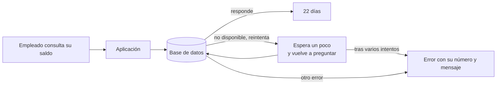
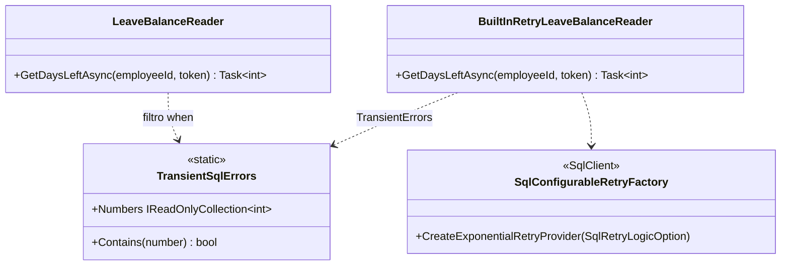

# TransientFaults: la base no responde un momento

**Errores 40613, 40501, 49918 y compañía.** En Azure SQL (y en cualquier servicio gestionado) la base de datos puede no estar disponible durante unos segundos: un failover, un movimiento de nodo, un pico de carga. El servidor lo dice con un número concreto y un mensaje que termina en "please retry". No es un fallo del programa ni de los datos: **pasa solo, si se espera un poco**.

## Qué hace, en términos de negocio

Un empleado abre la aplicación para ver cuántos días de vacaciones le quedan. Justo en ese instante la base de datos está cambiando de máquina y rechaza la consulta con "no disponible ahora mismo, reintenta más tarde". Sin tratamiento, el empleado ve un error y lo vuelve a intentar a mano; si son cientos de empleados a la vez, soporte recibe cientos de avisos por algo que ha durado tres segundos.

Este ejemplo enseña a la aplicación a **distinguir ese tipo de fallo de todos los demás** y a reintentar sola, esperando un poco más cada vez, un número limitado de veces. Si la base vuelve, el empleado ve su saldo sin enterarse de nada. Si no vuelve tras los intentos, el error sube con su número y su mensaje original. Y si el fallo es de otro tipo (un dato mal, un permiso que falta), **no se reintenta**: repetirlo no lo arreglaría y solo retrasaría el aviso.

Ejemplo concreto: Ana consulta su saldo mientras la base cambia de nodo. Las dos primeras consultas reciben "no disponible"; la aplicación espera 10 ms, luego 20 ms, y a la tercera obtiene sus 22 días. Ana solo ve el 22. Si la base siguiera caída tras tres intentos, el error llegaría tal cual a soporte. Si en cambio el fallo fuera "permiso denegado", soporte lo recibiría al primer intento.

Quién gana: el empleado, que no ve fallos de unos segundos; soporte, que solo recibe lo que de verdad necesita atención; y quien programa, que tiene la lista de números transitorios en un sitio y no repartida por el código.

## Estructura

| Pieza | Tipo |
|---|---|
| Lista de números transitorios | `TransientSqlErrors` (4060, 10928, 10929, 40197, 40501, 40613, 49918, 49919, 49920) |
| Reintento escrito a mano (forma del libro) | `LeaveBalanceReader(connectionString, maxAttempts, backoff)`: bucle, filtro `when`, espera exponencial |
| Reintento del driver (variante .NET) | `BuiltInRetryLeaveBalanceReader`: `SqlRetryLogicOption` + `SqlCommand.RetryLogicProvider` |
| Caída reproducida | En el test: el procedimiento `GetDaysLeft` hace `RAISERROR(40613, ...)` las primeras N llamadas |

## Decisiones

**Reintentar solo los números de la lista, nunca `catch (Exception)`.**
Problema: distinguir "vuelve a intentarlo" de "esto no se va a arreglar solo".
Alternativa descartada: reintentar cualquier excepción. Una clave duplicada, un permiso o un error de sintaxis se reintentarían tres veces para fallar igual, y un deadlock o un timeout tienen su propio tratamiento (ver `Deadlock/` y `Timeout/`).
Qué se gana: la lista de `TransientSqlErrors` es la misma que documenta Azure y la que trae SqlClient. Un número fuera de la lista sube al primer intento, y el test lo comprueba contando llamadas al servidor.

**Espera exponencial entre intentos.**
Problema: si cientos de clientes reintentan a la vez y sin pausa, la base que estaba recuperándose recibe una avalancha.
Alternativa descartada: reintentar en el acto o con pausa fija.
Qué se gana: `backoff * 2^(intento-1)` reparte los reintentos en el tiempo. En producción el `backoff` base son segundos; en los tests, 10 ms.

**Dos lectores: a mano y con el reintento del driver.**
Problema: SqlClient trae reintento configurable desde la versión 3, pero poca gente lo conoce y tiene dos sorpresas.
Alternativa descartada: enseñar solo una de las dos formas.
Qué se gana: la forma a mano muestra qué hace el reintento por dentro; la del driver muestra que ya existe y cómo se configura. Las sorpresas quedan en los tests: al agotar intentos el driver lanza `AggregateException` con una `SqlException` por intento, no la última; y el proveedor se asigna por comando (`RetryLogicProvider`), no es global.

**El fallo transitorio se simula con `RAISERROR` del número real.**
Problema: una instancia local no se cae a propósito como un gateway de Azure.
Alternativa descartada: lanzar una `SqlException` falsa desde C#. No tiene constructor público, y no probaría el camino del driver.
Qué se gana: el procedimiento del test emite el 40613 auténtico (con sus parámetros de formato) las primeras N veces; la excepción que llega es la misma que en Azure, y la lógica de reintento se prueba de verdad. Lo que no se prueba es la caída de la conexión en sí.

## Cuándo aplicarlo

- Lecturas y escrituras idempotentes contra una base gestionada (Azure SQL, Managed Instance), donde los fallos de segundos son normales.
- Si la aplicación usa `SqlClient` directo, el proveedor de reintento del driver evita escribir el bucle.

## Cuándo no

- Operaciones no idempotentes sin transacción: un reintento tras un 40501 podría repetir una escritura que sí llegó.
- Como respuesta a un timeout (-2): tras un timeout no se sabe si la consulta terminó. Ese caso es `Timeout/`.
- Si ya hay un reintento en otra capa (Polly en el cliente HTTP, EF Core con `EnableRetryOnFailure`): dos reintentos anidados multiplican los intentos.

## Tests

`TransientSqlErrorsTests` (sin base de datos): la clasificación por número, incluidos los que no son transitorios (2627, 1205, -2). `LeaveBalanceReaderTests` y `BuiltInRetryLeaveBalanceReaderTests` (integración, crean su propia base): con dos fallos y tres intentos se recupera; con tres fallos el error sube (como `SqlException` 40613 en el lector a mano, como `AggregateException` de tres 40613 en el del driver); un error no transitorio sube al primer intento, y el contador del servidor demuestra que solo hubo una llamada.
